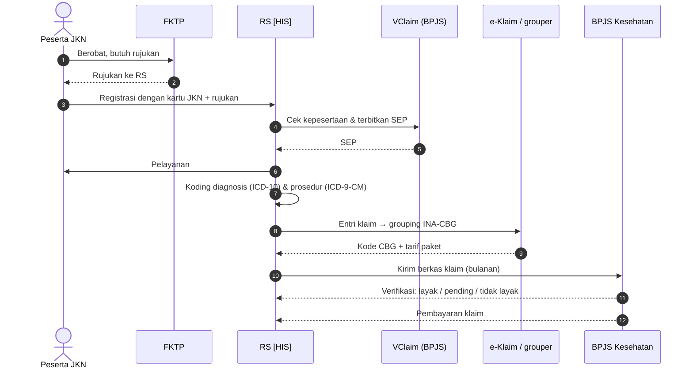

<Callout type="warn" title="Batas verifikasi">
Repo **tidak** berisi integrasi VClaim, penerbitan SEP, grouper INA-CBG, atau e-Klaim. Bagian "Konsep umum" di bawah adalah praktik umum di Indonesia, **bukan** bukti bahwa Mayapada (atau unit tertentu) melayani pasien BPJS dengan alur ini. <Confidence level="notfound">integrasi BPJS</Confidence> <Confidence level="confirm">unit mana yang bekerja sama dengan BPJS</Confidence>
</Callout>

## Konsep umum (FKRTL)

<Confidence level="general" />

| Istilah | Arti |
| --- | --- |
| **JKN** | Jaminan Kesehatan Nasional, diselenggarakan BPJS Kesehatan. |
| **FKTP / FKRTL** | Faskes tingkat pertama (puskesmas, klinik) / rujukan tingkat lanjut (RS). Rawat jalan di RS umumnya memerlukan rujukan FKTP. |
| **SEP** | Surat Eligibilitas Peserta — diterbitkan RS lewat aplikasi **VClaim** setelah cek kepesertaan aktif, hak kelas, dan rujukan. Tanpa SEP, layanan tidak dapat diklaim. |
| **INA-CBG** | Sistem pembayaran paket berdasarkan kelompok diagnosis/prosedur (casemix). Tarif paket ditetapkan Permenkes 3/2023 (mencabut Permenkes 52/2016 dan perubahannya). |
| **e-Klaim** | Aplikasi grouper INA-CBG di RS; menghasilkan berkas klaim bulanan (TXT) yang dikirim ke BPJS untuk diverifikasi (verifikasi digital/Vedika). |
| **Selisih biaya** | Naik kelas atas permintaan peserta (dalam batas regulasi) menimbulkan selisih yang dibayar peserta/asuransi tambahan. |

*Sumber:* rangkuman sumber sekunder (lihat Referensi); cek panduan resmi BPJS untuk detail menu & persyaratan.

## Apa yang ada di Odoo Mayapada

| Elemen | Lokasi | Arti |
| --- | --- | --- |
| `sale.order.bill.is_bpjs` | <Src file="mayapada/models/sale.py" /> | Penanda billing BPJS (dari HIS). |
| `inacbgs_code`, `inacbgs_amount` | `sale.order.bill` | Kode & nilai paket INA-CBG — memungkinkan perbandingan **tarif RS vs paket**. |
| `hospital.tariff` "BPJS" | data uji di memory | Tariff BPJS ada sebagai tarif per item (mis. untuk menghitung biaya riil). |
| `doctor.fee.bpjs` + import wizard | <Src file="mayapada/models/doctor_fee.py" line={26460} symbol="DoctorFeeBPJS" /> | Fee dokter untuk pasien BPJS dihitung terpisah (dari file import), dengan `total_accrual` "BPJS Accrual" di `doctor.fee`. |
| `doctor.rate.bpjs_doctor_ids` | `doctor.rate` | Grup dokter BPJS. |

<Confidence level="verified" />

## Implikasi bisnis

- **Pendapatan BPJS = paket**, bukan jumlah item. Selisih (tarif RS − INA-CBG) adalah untung/rugi kasus. Field `inacbgs_amount` membuka analisis ini.
- **Klaim pending/ditolak** membuat piutang BPJS menggantung; perlu kebijakan accrual & penyisihan. Model khusus klaim BPJS tidak ada di repo. <Confidence level="notfound" />
- **Fee dokter BPJS** biasanya tidak bisa dihitung dari tarif item (karena dibayar paket) → skema terpisah (import).

## Pertanyaan uji

<Accordions>
<Accordion title="Kenapa tarif per item tetap dibutuhkan untuk pasien BPJS walau dibayar paket?">
Untuk menghitung biaya riil per kasus, membandingkan dengan paket INA-CBG, menagih selisih naik kelas, dan untuk COB dengan asuransi tambahan.
</Accordion>
<Accordion title="Di mana SEP disimpan di Odoo?">
Tidak ada field SEP di repo. SEP dikelola di HIS/VClaim.
</Accordion>
</Accordions>

## Referensi

- Permenkes 3/2023 tentang Standar Tarif Pelayanan Kesehatan dalam Penyelenggaraan Program Jaminan Kesehatan (diundangkan 9 Jan 2023) — [peraturan.go.id (PDF)](https://www.peraturan.go.id/files/permenkes+-no-3-tahun-2023.pdf); rilis [Kemenkes](https://kemkes.go.id/id/ini-dia-standar-tarif-baru-pelayanan-jkn). Status: **Berlaku**, belum ada perubahan tercatat di [JDIH BPK](https://peraturan.bpk.go.id/Details/275518/permenkes-no-3-tahun-2023) dan tidak termasuk yang dicabut Permenkes 6/2026 (dicek 11 Okt 2026). Pemerintah merencanakan peralihan INA-CBG → INA-DRG ([Hukumonline, Feb 2025](https://www.hukumonline.com/berita/a/pemerintah-kaji-revisi-tarif-jkn-untuk-kontrol-inflasi-kesehatan-lt67ab246b281ee/)); belum ada regulasi penggantinya. <Confidence level="general" />
- Penjelasan SEP/VClaim/e-Klaim (sumber sekunder, bukan dokumen resmi BPJS): [MedMinutes – SEP](https://medminutes.io/blog/sep-bpjs-surat-eligibilitas-peserta-panduan-rumah-sakit/), [MedMinutes – e-Klaim](https://medminutes.io/eklaim/), [OCBC – VClaim](https://www.ocbc.id/id/article/2023/12/19/vclaim-bpjs). Diakses 10 Okt 2026. **Belum diverifikasi ke panduan resmi BPJS.**

**Kode:**

- <Src file="mayapada/models/doctor_fee.py" line={113} symbol="doctor.rate" /> — model `DoctorRate`
- <Src file="mayapada/models/doctor_fee.py" line={4498} symbol="doctor.fee" /> — model `DoctorFee`
- <Src file="mayapada/models/doctor_fee.py" line={26461} symbol="doctor.fee.bpjs" /> — model `DoctorFeeBPJS`
- <Src file="mayapada/models/hospital.py" line={178} symbol="hospital.tariff" /> — model `HospitalTariff`
- <Src file="mayapada/models/sale.py" line={9652} symbol="sale.order.bill" /> — model `SaleOrderBill`
