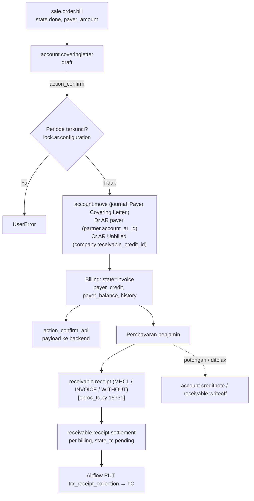

## 1. Apa itu?

**Covering letter** (`account.coveringletter`) adalah **surat tagihan kolektif** RS kepada satu penjamin (asuransi, perusahaan, TPA) yang berisi daftar billing pasien. Dokumen ini mengubah "tagihan yang belum dikirim" menjadi **piutang yang sudah ditagih** dengan tanggal jatuh tempo.

## 2. Kenapa RS membutuhkannya?

<Confidence level="general" /> Penjamin tidak membayar per pasien secara real-time; mereka menerima tagihan berkala, memverifikasi, lalu membayar sesuai termin. RS perlu: nomor tagihan resmi, tanggal kirim/terima (untuk menghitung jatuh tempo & aging), bukti terima, dan kemampuan mencocokkan pembayaran ke billing.

## 3. Siapa yang terlibat?

Staf AR (*Ka.Unit Finance Account Receivable*), penjamin/PIC penjamin (`cl_pic`, `cl_pic_email`), Finance Corporate, kasir/bank (penerimaan).

## 4. Proses di lapangan

<Steps>
<Step>AR memilih penjamin dan billing yang siap tagih (berdasarkan `bill`, `cob`, atau `admission`).</Step>
<Step>Opsional: diskon sebelum invoice (persentase + akun + analitik).</Step>
<Step>Konfirmasi → nomor letter, jurnal, billing menjadi `invoice`, payload dikirim ke API.</Step>
<Step>Cetak covering letter, kwitansi, tanda terima; kirim ke penjamin; catat `sent_date`, `received_date`, `received_by`.</Step>
<Step>Penjamin membayar → AR receipt dialokasikan ke billing; selisih menjadi credit note / write-off / tagih pasien.</Step>
<Step>Settlement per billing dikirim ke TrakCare agar status tagihan di HIS ikut lunas.</Step>
</Steps>

## 6. Diagram

*Sumber:* <Src file="mayapada/models/receivable.py" line={69} symbol="CoveringLetter" /> (model), <Src file="mayapada/models/receivable.py" line={621} symbol="action_confirm" />; <Src file="mayapada/eproc/eproc_tc.py" line={15731} symbol="ReceivableReceipt" />, <Src file="mayapada/eproc/eproc_tc.py" line={17731} symbol="ReceivableReceiptSettlement" /> (deskripsi "DIL TDM AR Billing Settlement"). <Confidence level="verified" />

## 7. Implementasi — jurnal

| Kejadian | Debit | Kredit | Sumber |
| --- | --- | --- | --- |
| Billing payer tercatat (EOD) | — (tidak ada jurnal per billing di model ini) | — | <Confidence level="inferred">pendapatan via jurnal revenue/accrual terpisah</Confidence> |
| Covering letter dikonfirmasi | AR penjamin (`payer.account_ar_id`) | AR Unbilled (`company.receivable_credit_id`; sebelum Feb 2022: akun kode `1104020101`) | <Confidence level="verified" /> |
| Diskon sebelum invoice | Akun diskon letter (+ analitik) | AR Unbilled | <Confidence level="verified" /> |
| Penerimaan penjamin | Bank | AR penjamin | <Confidence level="inferred">receivable.receipt.action_create_entries</Confidence> |

<Callout title="Jawaban: kapan tagihan menjadi piutang?">
Secara akuntansi Mayapada (per kode): bagian payer **sudah** piutang sejak billing diakui (di akun *AR Unbilled*), dan **berpindah ke piutang penjamin yang tertagih** saat covering letter dikonfirmasi. Jatuh tempo dihitung dari `due_day`/`due_date` letter. Kebijakan pengakuan pendapatan detail perlu dikonfirmasi ke Finance. <Confidence level="confirm" />
</Callout>

## 9. Business rules

- Tidak boleh mengonfirmasi letter bertanggal ≤ lock date AR.
- Diskon letter 0–100%.
- Billing yang sudah `invoice` tidak boleh masuk letter lain.
- Nomor letter memakai sequence `account.coveringletter.seq` (Bogor punya sequence sendiri — hard-coded `company_id.name == 'Mayapada Hospital Bogor'`). <Confidence level="verified" />
- Revisi letter tercatat (`revisi`, `revisi_name`, `revisi_sequence`).

## 10. Common problems

- **Rekonsiliasi pembayaran sebagian:** penjamin membayar total tanpa rincian per pasien → alokasi manual/impor (`receivable.receipt.import.wizard`).
- **Hard-coded nama company & kode akun** — rename company atau perubahan COA merusak alur tanpa error yang jelas.
- **API post gagal** (`api_post_status = failed`) → status di sistem lain tidak sinkron; perlu retry.

## 11. Yang perlu developer pahami

- `action_confirm` membuat **dan langsung mem-post** jurnal (`move.action_post()`).
- Kode menulis log ke file server (`/opt/odoo16/logs/...`) — jangan menambah data pasien ke log.

## 12. Pertanyaan uji

<Accordions>
<Accordion title="Akun apa yang berkurang saat covering letter dikonfirmasi?">
AR Unbilled (`company.receivable_credit_id`) dikredit; AR penjamin didebit.
</Accordion>
<Accordion title="Kenapa settlement dikirim balik ke TrakCare?">
Agar status tagihan per billing di HIS (lunas/outstanding) konsisten dengan pembukuan, sehingga kasir/billing tidak menagih ulang. Lihat README Airflow interface 29.
</Accordion>
</Accordions>

## Sumber

### Kode

- <Src file="mayapada/eproc/eproc_tc.py" line={15731} symbol="ReceivableReceipt" /> — class `ReceivableReceipt`
- <Src file="mayapada/eproc/eproc_tc.py" line={16844} symbol="receivable.receipt.import.wizard" /> — model `ReceivableReceiptImportWizard`
- <Src file="mayapada/eproc/eproc_tc.py" line={17731} symbol="ReceivableReceiptSettlement" /> — class `ReceivableReceiptSettlement`
- <Src file="mayapada/models/receivable.py" line={70} symbol="account.coveringletter" /> — model `CoveringLetter`
- <Src file="mayapada/models/receivable.py" line={621} symbol="action_confirm" /> — method `CoveringLetter`

### Eksternal

- Perpres 82/2018 tentang Jaminan Kesehatan (diubah Perpres 75/2019) — [peraturan.bpk.go.id (PDF)](https://peraturan.bpk.go.id/Download/254897/Perpres%20Nomor%2082%20Tahun%202018.pdf); ringkasan [Hukumonline](https://www.hukumonline.com/berita/a/inilah-12-ketentuan-dalam-perpres-jaminan-kesehatan-yang-perlu-dicermati-lt5bab443c5f973/). *Mendukung:* contoh termin penjamin yang diatur regulasi (BPJS). Termin asuransi swasta/korporat bersifat kontraktual — tidak ada regulasi umum. (diakses 11 Okt 2026).
