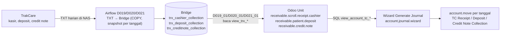

## 1. Apa itu?

| Transaksi | Arti bisnis | Model Odoo (alur TrakCare) |
| --- | --- | --- |
| **Cashier collection** | Uang yang diterima kasir (tunai, debit, kartu kredit, transfer, voucher) untuk tagihan pasien | `receivable.scroll.receipt.cashier` (<Src file="mayapada/models/receivable.py" line={9020} symbol="ReceivableScrollReceiptCashier" />) |
| **Deposit** | Uang muka pasien (umumnya rawat inap); kemudian dipakai (*availed*) atau dikembalikan (*refund*) | <Src file="mayapada/models/receivable.py" line={9287} symbol="receivable.patient.deposit" /> |
| **Credit note** | Pengurang tagihan setelah billing (diskon, koreksi, retur) | <Src file="mayapada/models/receivable.py" line={9762} symbol="receivable.credit.note" /> |
| **Advance / refund** | Uang muka/refund dengan tipe pembayaran | <Src file="mayapada/models/receivable.py" line={10262} symbol="receivable.advance" /> (`type` advance/refund) |
| **Write-off** | Penghapusan sisa piutang | <Src file="mayapada/models/receivable.py" line={10013} symbol="receivable.writeoff" /> |
| **Payment mode** | Master cara bayar → akun kas/bank | <Src file="mayapada/models/receivable.py" line={11138} symbol="receivable.payment.mode" /> |

Model legacy (generasi HIS lama) juga ada: `scroll.receipt.cashier`, `inpatient.deposit`, `account.creditnote`, `account.advance`, `patient.debt`. <Confidence level="verified" />

## 2. Kenapa penting?

<Confidence level="general" /> Kas adalah aset paling rawan. RS harus mencocokkan setiap hari: uang di laci/EDC/bank = penerimaan menurut sistem = pengurangan piutang/penambahan kewajiban deposit. Deposit adalah **kewajiban** RS kepada pasien sampai dipakai.

## 6. Alur data & jurnal

*Sumber:* `airflow:a2_scheduler_mix_interfacing/D019_txt_to_bridge_cashier_receipt.py`, `D020_txt_to_bridge_deposit.py`, `D021_txt_to_bridge_credit_note.py`, `D019_01_sync_unit_cashier_collection.py` (snapshot lokal); <Src file="mayapada/eproc/eproc_tc.py" line={22512} symbol="TC_JOURNALS" />, <Src file="mayapada/eproc/eproc_tc.py" line={22528} symbol="TC_JOURNAL_VIEWS" />. <Confidence level="verified" />

| Jurnal (total positif per tanggal) | Debit | Kredit |
| --- | --- | --- |
| TC Receipt Collection | Akun payment mode (kas/bank) | Akun kode `1104020101` (piutang) |
| TC Deposit Collection | Akun payment mode | Akun kode `2103000000` (titipan/deposit pasien) |
| TC Credit Note Collection | Akun payment mode, atau `7999000000` jika tanpa payment mode | Akun kode `2103030000` (memory: "Deposit Credit Note") |

Jika total per kelompok **negatif** (refund/reversal), debit dan kredit dibalik. Nama akun di COA perlu dicek per company. <Confidence level="verified">kode akun di SQL</Confidence> <Confidence level="confirm">nama & perlakuan akun</Confidence>

## 9. Business rules (wizard jurnal TC)

- Company wajib punya `sync_type`.
- Harus ada **tepat satu** jurnal "matic" aktif dengan sequence untuk nama jurnal tersebut.
- View sumber harus ada (dibuat di <Src file="mayapada/eproc/eproc_tc.py" line={22870} symbol="AccountJournalWizard.init" /> saat upgrade modul; jika gagal hanya warning).
- Satu jurnal per (jurnal, company, tanggal, ref) — pembuatan ulang ditolak; dikunci dengan `pg_advisory_xact_lock`.
- Tanggal awal & akhir harus < hari ini (tidak bisa menjurnal hari berjalan).
- Akun debit/kredit wajib ada, milik company yang sama, tidak deprecated; amount harus > 0 dan finite.

<Confidence level="verified">AccountJournalWizard._generate_tc_journal, <Src file="mayapada/eproc/eproc_tc.py" line={22880} symbol="_generate_tc_journal" /></Confidence>

## 10. Common problems

| Masalah | Penyebab | Catatan |
| --- | --- | --- |
| "Source view ... is not available" | View gagal dibuat saat upgrade (tabel/kolom sumber belum ada) | Lihat log upgrade untuk warning. |
| "needs one active matic journal" | Jurnal/sequence per company belum disiapkan | Memory: server sudah punya auto-setup `_get_tc_journal()` yang **belum ada di repo**. |
| Credit note gagal dijurnal | Akun `2103030000` tidak ada di COA unit (memory: Jakarta Timur) | Kode akun hard-coded. |
| Jurnal kas tidak sama dengan setoran bank | TXT tidak lengkap (D019 butuh snapshot harian lengkap, bukan delta) | File kosong = no-op, bukan "hapus". |

## 12. Pertanyaan uji

<Accordions>
<Accordion title="Kenapa deposit dikredit ke akun kewajiban, bukan pendapatan?">
Karena uang deposit masih milik pasien sampai layanan ditagihkan dan deposit dipakai; jika pasien batal, deposit dikembalikan.
</Accordion>
<Accordion title="Mengapa wizard jurnal tidak mengizinkan tanggal hari ini?">
Koleksi dari HIS bersifat EOD (end-of-day); data hari berjalan belum final.
</Accordion>
</Accordions>

## Sumber

### Kode

- <Src file="mayapada/models/receivable.py" line={1032} symbol="account.creditnote" /> — model `CreditNote`
- <Src file="mayapada/models/receivable.py" line={2316} symbol="account.advance" /> — model `AccountAdvance`
- <Src file="mayapada/models/receivable.py" line={3574} symbol="scroll.receipt.cashier" /> — model `ScrollReceiptCashier`
- <Src file="mayapada/models/receivable.py" line={7106} symbol="patient.debt" /> — model `PatientDebt`
- <Src file="mayapada/models/receivable.py" line={8224} symbol="inpatient.deposit" /> — model `InpatientDeposit`
- <Src file="mayapada/models/receivable.py" line={9021} symbol="receivable.scroll.receipt.cashier" /> — model `ReceivableScrollReceiptCashier`
- <Src file="mayapada/models/receivable.py" line={9287} symbol="receivable.patient.deposit" /> — model `ReceivablePatientDeposit`
- <Src file="mayapada/models/receivable.py" line={9762} symbol="receivable.credit.note" /> — model `ReceivableCreditNote`
- <Src file="mayapada/models/receivable.py" line={10013} symbol="receivable.writeoff" /> — model `ReceivableWriteoff`
- <Src file="mayapada/models/receivable.py" line={10262} symbol="receivable.advance" /> — model `ReceivableAdvance`
- <Src file="mayapada/models/receivable.py" line={11138} symbol="receivable.payment.mode" /> — model `ReceivablePaymentMode`
