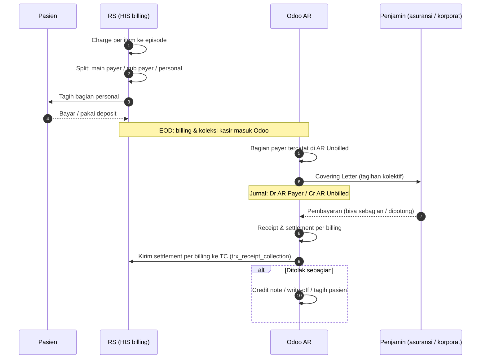

## Jenis penjamin (payer)

<Confidence level="general" />

| Penjamin | Mekanisme | Kapan dibayar |
| --- | --- | --- |
| **Pasien umum (self-pay)** | Bayar tunai/debit/kartu kredit/transfer di kasir; rawat inap dengan deposit | Saat pulang / di tempat |
| **Asuransi swasta – cashless** | RS menagih asuransi (sering via **TPA**) berdasarkan GL/kartu; pasien bayar *excess* | Termin setelah tagihan kolektif diterima |
| **Asuransi – reimbursement** | Pasien bayar penuh, lalu klaim sendiri ke asuransinya | RS dibayar pasien; bagi RS = self-pay |
| **Perusahaan (korporat)** | Kontrak kerja sama; surat jaminan; tagihan bulanan | Termin kontrak |
| **BPJS Kesehatan (JKN)** | SEP sebelum layanan; klaim paket INA-CBG lewat e-Klaim | Setelah verifikasi BPJS |
| **Coordination of Benefit (COB)** | Dua penjamin berbagi tagihan (mis. BPJS + asuransi swasta, atau dua asuransi) | Masing-masing penjamin |
| **Membership / kontrak khusus** | Diskon/tarif khusus | Tergantung kontrak |

Di Odoo, tipe customer HIS disimpan sebagai teks `customer_type_wipro` / `payer_type`. Fallback di <Src file="mayapada/models/sync.py" /> (`get_data`) memuat daftar tipe dari HIS lama: GOVERNMENT, INSURANCE, CORPORATE, EMPLOYEE, PT, ASURANSI, REFFERAL, BANK, PRIVATE CREDIT, E-COMMERCE, MAYAPADA. <Confidence level="verified" />

## Perpindahan tanggung jawab finansial

*Sumber:* `account.coveringletter.action_confirm` (<Src file="mayapada/models/receivable.py" line={621} symbol="action_confirm" />), `res.company.receivable_credit_id` = "AR Unbilled Account" (<Src file="mayapada/models/misc.py" line={2532} symbol="receivable_credit_id" />), README Airflow interface 29. <Confidence level="verified" />

## Halaman

<Cards>
  <Card title="Struktur Billing: Admission, Bill, COB" href="/docs/billing-insurance/struktur-billing" />
  <Card title="Covering Letter & Piutang Payer" href="/docs/billing-insurance/covering-letter-ar" />
  <Card title="BPJS / JKN: SEP, INA-CBG, e-Klaim" href="/docs/billing-insurance/bpjs-jkn" />
  <Card title="Deposit, Kasir, Credit Note, Refund" href="/docs/billing-insurance/deposit-kasir-refund" />
</Cards>
