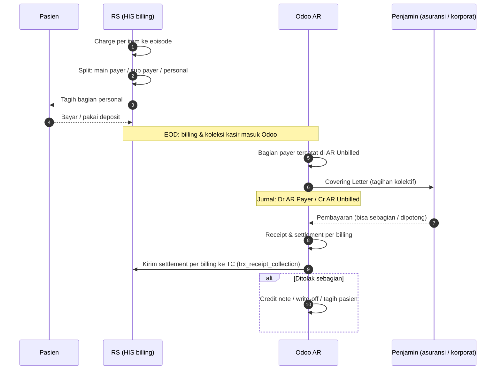

## Jenis penjamin (payer)

<Confidence level="general" />

| Penjamin | Mekanisme | Kapan dibayar |
| --- | --- | --- |
| **Pasien umum (self-pay)** | Bayar tunai/debit/kartu kredit/transfer di kasir; rawat inap dengan deposit | Saat pulang / di tempat |
| **Asuransi swasta – cashless** | RS menagih asuransi (sering via **TPA**) berdasarkan GL/kartu; pasien bayar *excess* | Termin setelah tagihan kolektif diterima |
| **Asuransi – reimbursement** | Pasien bayar penuh, lalu klaim sendiri ke asuransinya | RS dibayar pasien; bagi RS = self-pay |
| **Perusahaan (korporat)** | Kontrak kerja sama; surat jaminan; tagihan bulanan | Termin kontrak |
| **BPJS Kesehatan (JKN)** | SEP sebelum layanan; klaim paket INA-CBG lewat e-Klaim | Setelah verifikasi BPJS |
| **Coordination of Benefit (COB)** | Dua penjamin berbagi tagihan (mis. BPJS + asuransi swasta, atau dua asuransi) | Masing-masing penjamin |
| **Membership / kontrak khusus** | Diskon/tarif khusus | Tergantung kontrak |

Di Odoo, tipe customer HIS disimpan sebagai teks `customer_type_wipro` / `payer_type`. Fallback di <Src file="mayapada/models/sync.py" /> (`get_data`) memuat daftar tipe dari HIS lama: GOVERNMENT, INSURANCE, CORPORATE, EMPLOYEE, PT, ASURANSI, REFFERAL, BANK, PRIVATE CREDIT, E-COMMERCE, MAYAPADA. <Confidence level="verified" />

## Perpindahan tanggung jawab finansial

*Sumber:* `account.coveringletter.action_confirm` (<Src file="mayapada/models/receivable.py" line={621} symbol="action_confirm" />), `res.company.receivable_credit_id` = "AR Unbilled Account" (<Src file="mayapada/models/misc.py" line={2532} symbol="receivable_credit_id" />), README Airflow interface 29. <Confidence level="verified" />

## Halaman

<Cards>
  <Card title="Struktur Billing: Admission, Bill, COB" href="/docs/billing-insurance/struktur-billing" />
  <Card title="Covering Letter & Piutang Payer" href="/docs/billing-insurance/covering-letter-ar" />
  <Card title="BPJS / JKN: SEP, INA-CBG, e-Klaim" href="/docs/billing-insurance/bpjs-jkn" />
  <Card title="Deposit, Kasir, Credit Note, Refund" href="/docs/billing-insurance/deposit-kasir-refund" />
</Cards>

## Sumber

### Eksternal

- Perpres 82/2018 tentang Jaminan Kesehatan (diubah Perpres 75/2019, 64/2020, dan terakhir 59/2024 — [status BPK](https://peraturan.bpk.go.id/Details/94711/perpres-no-82-tahun-2018); tenggat klaim belum dicek terhadap perubahan terakhir) — [peraturan.bpk.go.id (PDF)](https://peraturan.bpk.go.id/Download/254897/Perpres%20Nomor%2082%20Tahun%202018.pdf); ringkasan [Hukumonline](https://www.hukumonline.com/berita/a/inilah-12-ketentuan-dalam-perpres-jaminan-kesehatan-yang-perlu-dicermati-lt5bab443c5f973/). *Mendukung:* jalur bayar BPJS: verifikasi kelengkapan klaim lalu pembayaran dengan tenggat & denda keterlambatan (diakses 11 Okt 2026).
- Koordinasi antar penyelenggara jaminan (COB) & selisih biaya, KMK HK.01.07/MENKES/1366/2024 — [BKPK Kemenkes](https://www.badankebijakan.kemkes.go.id/penataan-kebijakan-selisih-biaya-melalui-koordinasi-antar-penyelenggara-jaminan-dalam-program-jkn-resmi-diluncurkan/); penjelasan naik kelas via asuransi tambahan: [Kontan](https://keuangan.kontan.co.id/news/peserta-jkn-bisa-naik-kelas-rawat-pakai-skema-cob-begini-mekanismenya-1). *Mendukung:* satu pasien dapat ditanggung BPJS + asuransi tambahan (diakses 11 Okt 2026).
- Santunan perawatan Jasa Raharja maks. Rp20 juta (PMK 16/PMK.010/2017, lalu lintas jalan) — [Hukumonline](https://www.hukumonline.com/berita/a/alami-kecelakaan-lalu-lintas-begini-cara-klaim-santunannya-lt59e879ad02e31?page=all), [detikFinance](https://finance.detik.com/moneter/d-3421640/nilai-santunan-korban-kecelakaan-dari-jasa-raharja-naik-dua-kali-lipat); Jasa Raharja penjamin pertama, BPJS Kesehatan penjamin kedua — [Warta Ekonomi](https://wartaekonomi.co.id/read156389/bpjs-kesehatan-jasa-raharja-dan-korlantas-perkuat-sinergi-manfaat-kecelakaan-lalu-lintas). *Mendukung:* kecelakaan lalu lintas: Jasa Raharja lalu BPJS (diakses 11 Okt 2026).
