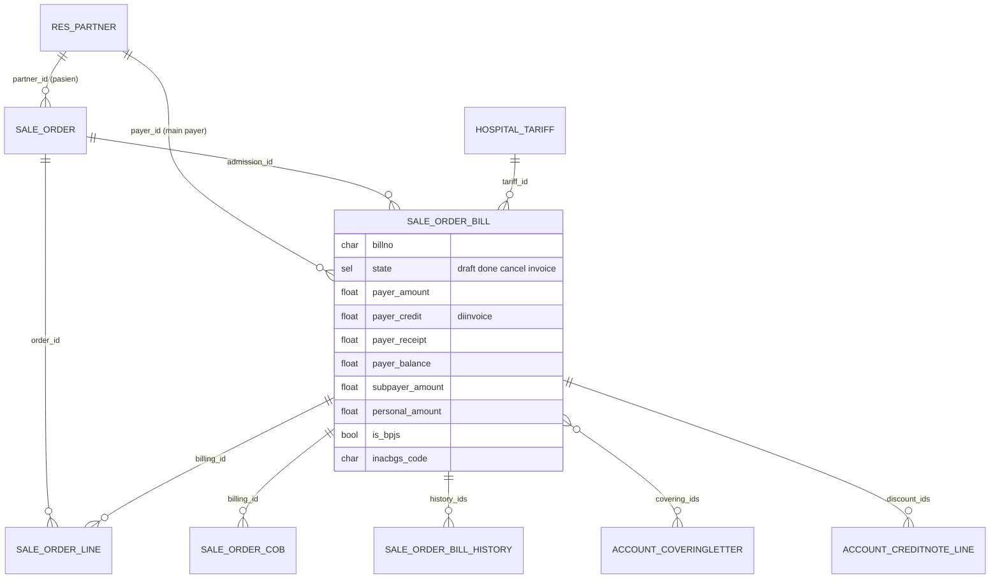
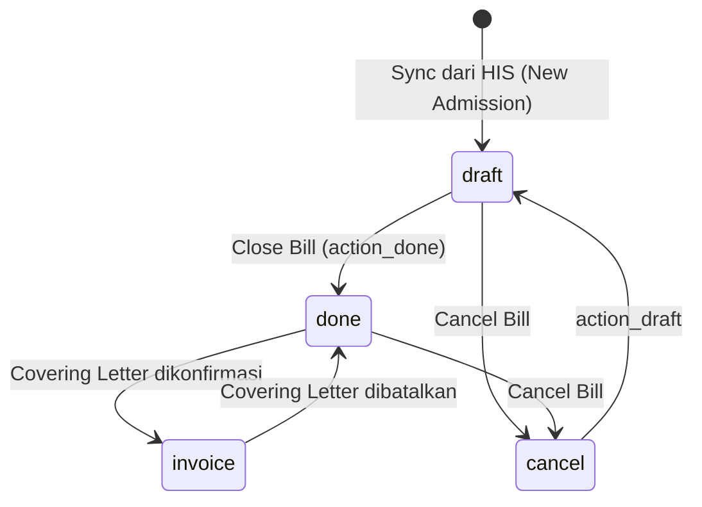

## 1. Apa itu?

Odoo menyimpan salinan billing HIS dalam tiga lapis:

| Lapis | Model | Kardinalitas |
| --- | --- | --- |
| Episode (admission) | `sale.order` | 1 per kunjungan |
| Tagihan | `sale.order.bill` | 1..n per admission; bisa di-*merge* (`merged_id`) |
| Bagian COB | `sale.order.cob` | 0..n per bill; satu per penjamin tambahan |
| Item | `sale.order.line` | n per admission; menunjuk `billing_id`, `cob_id`, `sub_cob_id` |

## 2. Kenapa dipisah?

<Confidence level="general" /> Satu episode bisa menghasilkan beberapa tagihan (interim bill rawat inap, tagihan farmasi terpisah) dan satu tagihan bisa ditanggung beberapa pihak. Piutang dikelola **per tagihan per penjamin**, bukan per episode.

## 6. ER diagram



*Sumber:* <Src file="mayapada/models/sale.py" /> (<Src file="mayapada/models/sale.py" line={42} symbol="SaleOrder" />, <Src file="mayapada/models/sale.py" line={9651} symbol="SaleOrderBill" />, <Src file="mayapada/models/sale.py" line={10446} symbol="SaleOrderCob" />). <Confidence level="verified" />

## 7. Implementasi — rumus saldo payer

Ketika covering letter dikonfirmasi (<Src file="mayapada/models/receivable.py" line={621} symbol="action_confirm" />):

```text
payer_adjustment = payer_amount × diskon_letter%      (jika diskon sebelum invoice aktif)
payer_credit     = payer_amount − payer_adjustment   (yang ditagihkan)
payer_balance    = payer_credit − payer_receipt − payer_discount (write-off)
state            = 'invoice'
```

Setiap kejadian (konfirmasi letter, credit note, receipt, advance) direkam di `sale.order.bill.history` lewat <Src file="mayapada/models/sale.py" line={9932} symbol="SaleOrderBill.action_history" /> — inilah **jejak audit saldo piutang per billing**. <Confidence level="verified" />

## 8. State billing



Saat covering letter dibatalkan, jurnalnya di-*cancel* lalu **dihapus** (`unlink`) dan billing kembali ke `done` (<Src file="mayapada/models/receivable.py" line={548} symbol="action_cancel" />). <Confidence level="verified" /> Penghapusan jurnal (bukan reversal) berarti jejak audit bergantung pada chatter & history, bukan ledger. <Confidence level="confirm">apakah diterima auditor</Confidence>

## 9. Business rules

- `lock_bill()` menutup (`done`) semua admission yang memiliki baris `type_line='BILL'`. <Confidence level="verified"><Src file="mayapada/models/sale.py" line={359} symbol="lock_bill" /></Confidence>
- Field `is_bpjs`, `inacbgs_code`, `inacbgs_amount` menyimpan informasi klaim BPJS dari HIS. Lihat [BPJS](/docs/billing-insurance/bpjs-jkn).
- `tpa_id/code/name` menyimpan Third Party Administrator jika asuransi memakai TPA.

## 10. Common problems

| Masalah | Penyebab |
| --- | --- |
| Billing ganda di Odoo | Sync ulang tanpa kunci unik (bill no + sync_type) |
| Saldo payer negatif | Receipt dialokasikan melebihi `payer_credit` |
| Bill tidak muncul di covering letter | Sudah `invoice`, atau payer berbeda |

## 12. Pertanyaan uji

<Accordions>
<Accordion title="Apa beda payer_amount dan payer_credit?">
`payer_amount` = bagian payer menurut billing HIS (nett). `payer_credit` = yang benar-benar ditagihkan setelah diskon sebelum invoice di covering letter.
</Accordion>
<Accordion title="Kenapa butuh tabel history?">
Untuk merekonstruksi saldo piutang per tanggal (aging, audit), karena field saldo di `sale.order.bill` hanya menyimpan nilai terakhir.
</Accordion>
</Accordions>

## Sumber

### Kode

- <Src file="mayapada/models/sale.py" line={42} symbol="SaleOrder" /> — class `SaleOrder`
- <Src file="mayapada/models/sale.py" line={43} symbol="sale.order" /> — extend `SaleOrder`
- <Src file="mayapada/models/sale.py" line={359} symbol="lock_bill" /> — method `SaleOrder`
- <Src file="mayapada/models/sale.py" line={1885} symbol="sale.order.line" /> — extend `SaleOrderLine`
- <Src file="mayapada/models/sale.py" line={9651} symbol="SaleOrderBill" /> — class `SaleOrderBill`
- <Src file="mayapada/models/sale.py" line={9652} symbol="sale.order.bill" /> — model `SaleOrderBill`
- <Src file="mayapada/models/sale.py" line={10404} symbol="sale.order.bill.history" /> — model `SaleOrderBillHistory`
- <Src file="mayapada/models/sale.py" line={10446} symbol="SaleOrderCob" /> — class `SaleOrderCob`
- <Src file="mayapada/models/sale.py" line={10447} symbol="sale.order.cob" /> — model `SaleOrderCob`

### Eksternal

- Koordinasi antar penyelenggara jaminan (COB) & selisih biaya, KMK HK.01.07/MENKES/1366/2024 — [BKPK Kemenkes](https://www.badankebijakan.kemkes.go.id/penataan-kebijakan-selisih-biaya-melalui-koordinasi-antar-penyelenggara-jaminan-dalam-program-jkn-resmi-diluncurkan/); penjelasan naik kelas via asuransi tambahan: [Kontan](https://keuangan.kontan.co.id/news/peserta-jkn-bisa-naik-kelas-rawat-pakai-skema-cob-begini-mekanismenya-1). *Mendukung:* satu tagihan ditanggung beberapa penjamin (koordinasi manfaat) (diakses 11 Okt 2026).
