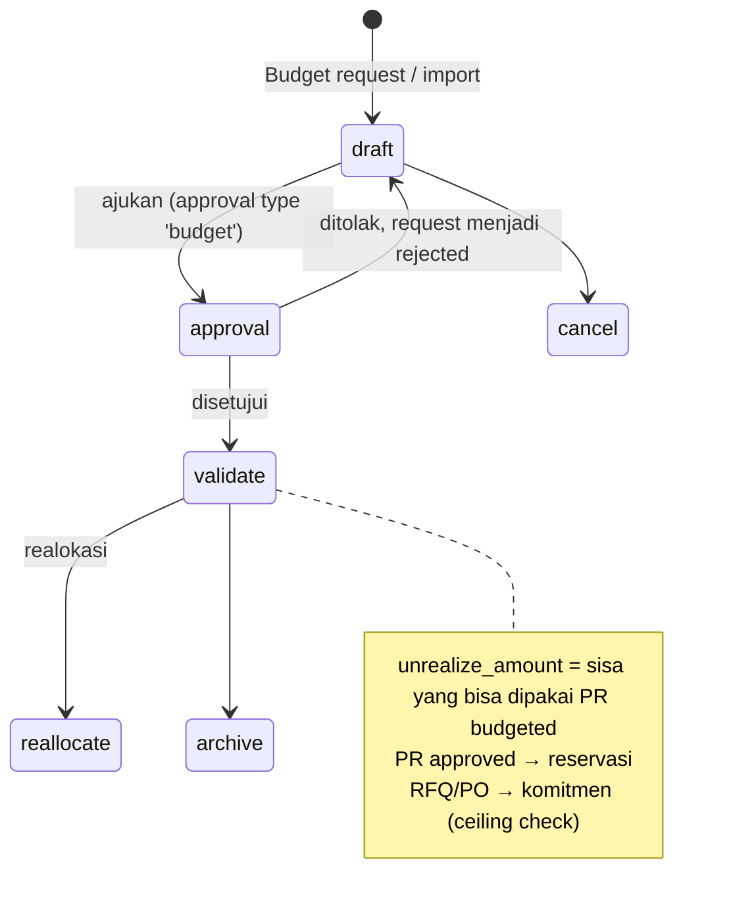

## 1. Apa itu?

Ada **dua generasi** budget di repo:

| Generasi | Model | Fokus |
| --- | --- | --- |
| Akuntansi (om_account_budget) | `crossovered.budget`, `crossovered.budget.lines`, `budget.approval(.rule)`, `budget.exceed(.line)`, `budget.history`, `budget.type` (`models/budget.py`) | Budget per akun/analitik, approval, pengajuan over-budget. State: `draft → confirm → validate → done / cancel`. |
| eProc | `eproc.budget.group` (group/category), `eproc.budget.request`, `eproc.budget.allocation`, `eproc.budget.item`, dashboard & tracking | Budget per **item pembelian** yang dikonsumsi PR/PO. |

<Confidence level="verified" />

## 2. Kenapa RS membutuhkannya?

<Confidence level="general" /> Capex alkes (USG, ventilator) bernilai sangat besar dan direncanakan tahunan; opex BHP mengikuti volume pasien. Budget memaksa pembelian sesuai rencana dan memberi peringatan dini saat biaya melampaui target.

## 6. Siklus budget item eProc

*Sumber:* `eproc.budget.request.state` (23342), `eproc.budget.item.state` (24365), `_check_budget_ceiling` (5378), `_validate_budget_line_amounts` (6832). <Confidence level="verified" />

## 7. Aturan penting

- PR `budgeted` wajib budget item yang cocok group/kategori/produk dengan sisa > 0.
- Total baris PR ≤ sisa budget item.
- RFQ untuk item kategori **"Medical Equipment"** (dicek dari nama item category, bukan ID) wajib berasal dari PR ber-budget.
- Cron `Budget: post SQL refresh tracking` setiap 1 menit (`data/budget.xml`, `_cron_post_budget_refresh_tracking`). <Confidence level="verified" />

## Cost center

`models/cost_center.py` (≈9.000 baris) berisi `cost.center.master`, `cost.center.report(.wizard)`, `cost.center.import`, `cost.center.reconcile`, `cost.center.dimension(.line/.account.line/.analytic.line/.journal.line)`, `cost.center.sum.account`. Company punya flag `cost_center_active` & `cost_center_date` yang juga dicek saat posting fee dokter. <Confidence level="verified" /> Detail aturan alokasi biaya belum dianalisis di dokumentasi ini. <Confidence level="confirm">perlu sesi lanjutan</Confidence>

## Pertanyaan uji

<Accordions>
<Accordion title="Kenapa pencocokan 'Medical Equipment' memakai nama kategori?">
Komentar kode menyebut master data yang memiliki kategori, tanpa ID database atau kode turunan — agar konsisten lintas database unit. Risikonya: rename kategori mematikan kontrol.
</Accordion>
</Accordions>
