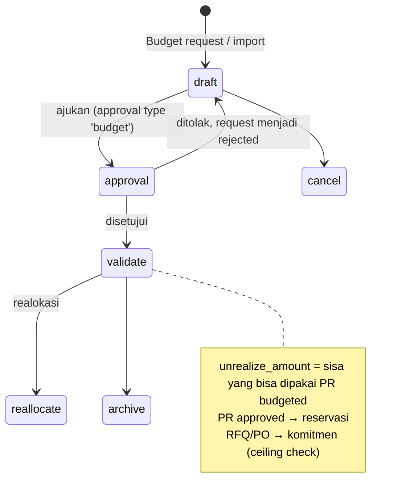

## 1. Apa itu?

Ada **dua generasi** budget di repo:

| Generasi | Model | Fokus |
| --- | --- | --- |
| Akuntansi (om_account_budget) | `crossovered.budget`, `crossovered.budget.lines`, `budget.approval(.rule)`, `budget.exceed(.line)`, `budget.history`, `budget.type` (<Src file="mayapada/models/budget.py" />) | Budget per akun/analitik, approval, pengajuan over-budget. State: `draft → confirm → validate → done / cancel`. |
| eProc | `eproc.budget.group` (group/category), `eproc.budget.request`, `eproc.budget.allocation`, `eproc.budget.item`, dashboard & tracking | Budget per **item pembelian** yang dikonsumsi PR/PO. |

<Confidence level="verified" />

## 2. Kenapa RS membutuhkannya?

<Confidence level="general" /> Capex alkes (USG, ventilator) bernilai sangat besar dan direncanakan tahunan; opex BHP mengikuti volume pasien. Budget memaksa pembelian sesuai rencana dan memberi peringatan dini saat biaya melampaui target.

## 6. Siklus budget item eProc

*Sumber:* <Src file="mayapada/eproc/eproc_tc.py" line={23342} symbol="eproc.budget.request.state" />, <Src file="mayapada/eproc/eproc_tc.py" line={24365} symbol="eproc.budget.item.state" />, <Src file="mayapada/eproc/eproc_tc.py" line={5378} symbol="_check_budget_ceiling" />, <Src file="mayapada/eproc/eproc_tc.py" line={6832} symbol="_validate_budget_line_amounts" />. <Confidence level="verified" />

## 7. Aturan penting

- PR `budgeted` wajib budget item yang cocok group/kategori/produk dengan sisa > 0.
- Total baris PR ≤ sisa budget item.
- RFQ untuk item kategori **"Medical Equipment"** (dicek dari nama item category, bukan ID) wajib berasal dari PR ber-budget.
- Cron `Budget: post SQL refresh tracking` setiap 1 menit (`data/budget.xml`, `_cron_post_budget_refresh_tracking`). <Confidence level="verified" />

## Cost center

<Src file="mayapada/models/cost_center.py" /> (≈9.000 baris) berisi `cost.center.master`, `cost.center.report(.wizard)`, `cost.center.import`, `cost.center.reconcile`, `cost.center.dimension(.line/.account.line/.analytic.line/.journal.line)`, `cost.center.sum.account`. Company punya flag `cost_center_active` & `cost_center_date` yang juga dicek saat posting fee dokter. <Confidence level="verified" /> Detail aturan alokasi biaya belum dianalisis di dokumentasi ini. <Confidence level="confirm">perlu sesi lanjutan</Confidence>

## Pertanyaan uji

<Accordions>
<Accordion title="Kenapa pencocokan 'Medical Equipment' memakai nama kategori?">
Komentar kode menyebut master data yang memiliki kategori, tanpa ID database atau kode turunan — agar konsisten lintas database unit. Risikonya: rename kategori mematikan kontrol.
</Accordion>
</Accordions>

## Sumber

### Kode

- <Src file="mayapada/eproc/eproc_tc.py" line={5378} symbol="_check_budget_ceiling" /> — method `EprocOrder`
- <Src file="mayapada/eproc/eproc_tc.py" line={6832} symbol="_validate_budget_line_amounts" /> — method `EprocRequest`
- <Src file="mayapada/eproc/eproc_tc.py" line={23299} symbol="eproc.budget.group" /> — model `EprocBudgetGroup`
- <Src file="mayapada/eproc/eproc_tc.py" line={23318} symbol="eproc.budget.request" /> — model `EprocBudgetRequest`
- <Src file="mayapada/eproc/eproc_tc.py" line={23744} symbol="eproc.budget.allocation" /> — model `EprocBudgetAllocation`
- <Src file="mayapada/eproc/eproc_tc.py" line={24320} symbol="eproc.budget.item" /> — model `EprocBudgetItem`
- <Src file="mayapada/eproc/eproc_tc.py" line={24506} symbol="_cron_post_budget_refresh_tracking" /> — method `EprocBudgetItem`
- <Src file="mayapada/models/budget.py" line={2033} symbol="budget.history" /> — model `BudgetHistory`
- <Src file="mayapada/models/budget.py" line={2054} symbol="budget.type" /> — model `BudgetType`
- <Src file="mayapada/models/cost_center.py" line={8700} symbol="cost.center.master" /> — model `CostCenterMaster`
- <Src file="mayapada/models/cost_center.py" line={8833} symbol="cost.center.import" /> — model `CostCenterImport`
- <Src file="mayapada/models/cost_center.py" line={8861} symbol="cost.center.reconcile" /> — model `CostCenterReconcile`
- <Src file="mayapada/models/cost_center.py" line={8965} symbol="cost.center.sum.account" /> — model `CostCenterSumAccount`
- <Src file="om_account_budget/models/account_budget.py" line={42} symbol="crossovered.budget" /> — model `CrossoveredBudget`
- <Src file="om_account_budget/models/account_budget.py" line={79} symbol="crossovered.budget.lines" /> — model `CrossoveredBudgetLines`

### Eksternal

- Permenkes 72/2016 tentang Standar Pelayanan Kefarmasian di Rumah Sakit, Lampiran Bab II — [JDIH Kemenkes (PDF)](https://jdih.kemkes.go.id/storage/documents/pdfs/2016permenkes072.pdf). *Mendukung:* perencanaan kebutuhan farmasi wajib mempertimbangkan anggaran yang tersedia (Bab II A.2) (diakses 11 Okt 2026).
