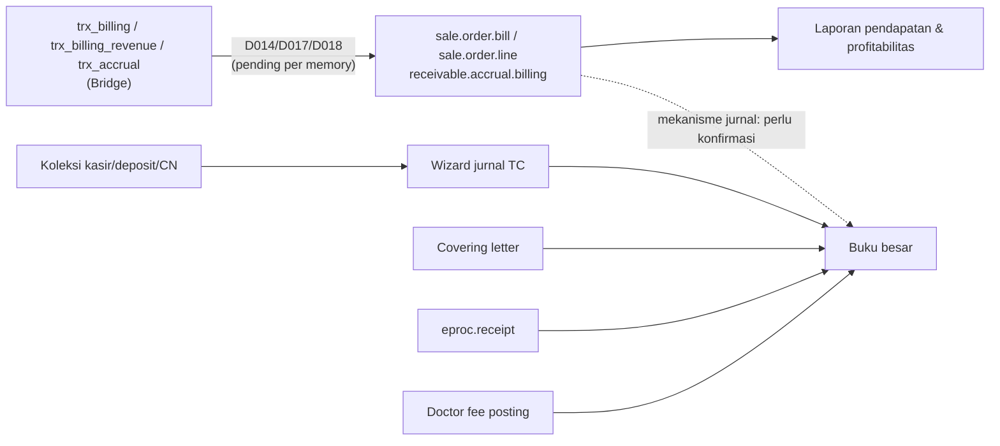

## 1. Konsep inti

<Confidence level="general" />

| Konsep | Di rumah sakit |
| --- | --- |
| **Pendapatan** | Diakui saat layanan diberikan (bukan saat dibayar). Rawat inap yang belum pulang di akhir bulan → **accrual**. |
| **Piutang (AR)** | Pasien (personal), penjamin (asuransi/korporat), BPJS. Piutang penjamin bisa "belum ditagih" (unbilled) atau "sudah ditagih". |
| **Deposit pasien** | **Kewajiban** sampai dipakai untuk tagihan atau dikembalikan. |
| **Hutang (AP)** | Supplier obat/alkes, jasa, dan **jasa medis dokter**. |
| **Persediaan & HPP** | Obat/BHP dinilai (WAC); keluar saat dispensing/consumption menjadi HPP/beban. |
| **Cost center & budget** | Kontrol biaya per departemen dan anggaran capex/opex. |
| **Closing** | Kunci periode setelah semua sinkronisasi & jurnal lengkap. |

## 2. Peta jurnal yang dihasilkan kode

| Kejadian bisnis | Dokumen Odoo | Debit | Kredit | Sumber |
| --- | --- | --- | --- | --- |
| Barang diterima (PO/WO) | `eproc.receipt` done | Persediaan (valuasi kategori) | Stock input / GRNI | <Src file="mayapada/eproc/eproc_tc.py" line={13355} symbol="_create_accounting_impacts" /> |
| Retur ke vendor | `eproc.receipt` RT | Stock input | Persediaan | idem |
| Invoice supplier | `payable.invoice` | Interim/GRNI (+ pajak) | AP supplier | <Src file="mayapada/models/payable.py" /> ~543–600 |
| Pembayaran supplier | `payable.payment(.group)` | AP | Bank | <Src file="mayapada/models/payable.py" /> <Confidence level="inferred" /> |
| Kasir terima uang pasien (harian) | Jurnal TC Receipt Collection | Kas/bank per payment mode | Akun `1104020101` | `view_account_tc_cashier_collection` |
| Deposit pasien | Jurnal TC Deposit Collection | Kas/bank | Akun `2103000000` | `view_account_tc_deposit_collection` |
| Credit note | Jurnal TC Credit Note Collection | Kas/bank atau `7999000000` | Akun `2103030000` | `view_account_tc_creditnote_collection` |
| Tagih penjamin | `account.coveringletter` | AR payer | AR Unbilled | <Src file="mayapada/models/receivable.py" line={621} symbol="action_confirm" /> |
| Dispense/consumption/transfer/opname (harian) | Jurnal TC Stock * | lihat [Stock Movement](/docs/procurement-inventory/stock-movement) | | `view_account_tc_stock_movement` |
| Fee dokter (bulanan) | `doctor.fee.posting.wizard` | Beban fee (expense account) | Hutang fee / pajak | <Src file="mayapada/models/doctor_fee.py" line={753} symbol="posting" /> |

<Confidence level="verified" /> Nama akun per kode perlu dicek di COA tiap company. <Confidence level="confirm" />

## 3. Pendapatan dari billing HIS

Pendapatan per item ada di `sale.order.line` (dengan dimensi dokter, service group, payer). Jurnal pendapatan **tidak** dibuat oleh model di atas; README Airflow mendefinisikan *Billing Analysis including accrual* (`trx_billing_revenue`) dan *IP Payable Accrual Cutoff* (`trx_accrual`) ke model `sale.order.bill`, `sale.order.line`, dan model accrual. Memory mencatat D014 Billing, D017 Accrual, D018 Revenue masih **stub/pending source** per 29 Sep 2026. <Confidence level="inferred" /> <Confidence level="confirm">mekanisme jurnal pendapatan produksi</Confidence>

## 4. Kontrol periode & approval jurnal

- `account.move.status`: `draft → waiting (Waiting for Approval) → approved → posted` — lapisan approval jurnal di atas state Odoo standar. <Confidence level="verified"><Src file="mayapada/models/account.py" line={18953} symbol="status" /></Confidence>
- `account.move.post.wizard` / `account.move.cancel.wizard` — posting/batal massal.
- `lock.ar.configuration` — kunci tanggal AR; `closing.wizard`, `stock.ledger.closing.wizard`, `sale.bulk.closing.wizard` — closing per area. <Confidence level="verified" />
- `om_fiscal_year` (add-on) untuk tahun fiskal.

## 5. Multi-company & konsolidasi

- Setiap RS = company; record rule mengisolasi data per company.
- Laporan konsolidasi: `account.console.company.mapping`, `account.console.financial.report.wizard`, `console.trial.balance(.line)`, `account.console.cashflow.wizard`. <Confidence level="verified">models/account.py</Confidence>
- Sinkronisasi antar Odoo (unit → main) lewat API `api_consol_*` — lihat [Konsolidasi Odoo-ke-Odoo](/docs/integrations/odoo-consolidation).
- Transaksi intercompany khusus: <Confidence level="notfound">model intercompany eksplisit</Confidence>

## Halaman

<Cards>
  <Card title="Jurnal Harian dari TrakCare" href="/docs/finance-accounting/jurnal-trakcare" />
  <Card title="Budget & Cost Center" href="/docs/finance-accounting/budget-cost-center" />
</Cards>

## Sumber

### Kode

- <Src file="mayapada/eproc/eproc_tc.py" line={11417} symbol="eproc.receipt" /> — model `EprocReceipt`
- <Src file="mayapada/eproc/eproc_tc.py" line={13355} symbol="_create_accounting_impacts" /> — method `EprocReceipt`
- <Src file="mayapada/models/account.py" line={30273} symbol="account.console.company.mapping" /> — model `AccountConsoleCompanyMapping`
- <Src file="mayapada/models/account.py" line={30335} symbol="account.console.financial.report.wizard" /> — model `AccountConsoleFinancialReportWizard`
- <Src file="mayapada/models/account.py" line={30418} symbol="account.console.cashflow.wizard" /> — model `AccountConsoleCashflowWizard`
- <Src file="mayapada/models/account.py" line={32405} symbol="closing.wizard" /> — model `Closing`
- <Src file="mayapada/models/account.py" line={34187} symbol="account.move.post.wizard" /> — model `AccountMovePostWizard`
- <Src file="mayapada/models/account.py" line={34205} symbol="account.move.cancel.wizard" /> — model `AccountMoveCancelWizard`
- <Src file="mayapada/models/doctor_fee.py" line={540} symbol="doctor.fee.posting.wizard" /> — model `DoctorFeePostingWizard`
- <Src file="mayapada/models/payable.py" line={188} symbol="payable.invoice" /> — model `PayableInvoice`
- <Src file="mayapada/models/receivable.py" line={70} symbol="account.coveringletter" /> — model `CoveringLetter`
- <Src file="mayapada/models/receivable.py" line={3494} symbol="lock.ar.configuration" /> — model `LockArConfiguration`
- <Src file="mayapada/models/sale.py" line={1885} symbol="sale.order.line" /> — extend `SaleOrderLine`
- <Src file="mayapada/models/sale.py" line={9652} symbol="sale.order.bill" /> — model `SaleOrderBill`
- <Src file="mayapada/models/sale.py" line={11569} symbol="sale.bulk.closing.wizard" /> — model `SaleBulkClosingWizard`
- <Src file="mayapada/models/stock.py" line={4553} symbol="stock.ledger.closing.wizard" /> — model `StockLedgerClosing`

### Eksternal

- PSAK 72 Pendapatan dari Kontrak dengan Pelanggan (kini PSAK 115) — [IAI, ED PSAK 72 (PDF)](https://web.iaiglobal.or.id/assets/files/file_berita/ED%20PSAK%2072_Pendapatan%20dari%20Kontrak%20dengan%20Pelanggan.pdf); ringkasan sekunder [Mekari Jurnal](https://www.jurnal.id/id/blog/psak-72/). *Mendukung:* pendapatan diakui saat/selama layanan diberikan; deposit = liabilitas kontrak (diakses 11 Okt 2026).
