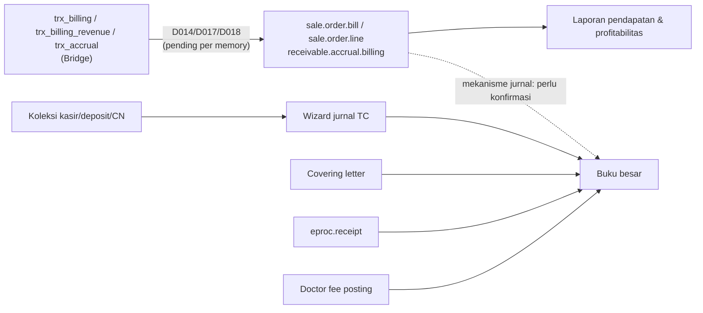

## 1. Konsep inti

<Confidence level="general" />

| Konsep | Di rumah sakit |
| --- | --- |
| **Pendapatan** | Diakui saat layanan diberikan (bukan saat dibayar). Rawat inap yang belum pulang di akhir bulan → **accrual**. |
| **Piutang (AR)** | Pasien (personal), penjamin (asuransi/korporat), BPJS. Piutang penjamin bisa "belum ditagih" (unbilled) atau "sudah ditagih". |
| **Deposit pasien** | **Kewajiban** sampai dipakai untuk tagihan atau dikembalikan. |
| **Hutang (AP)** | Supplier obat/alkes, jasa, dan **jasa medis dokter**. |
| **Persediaan & HPP** | Obat/BHP dinilai (WAC); keluar saat dispensing/consumption menjadi HPP/beban. |
| **Cost center & budget** | Kontrol biaya per departemen dan anggaran capex/opex. |
| **Closing** | Kunci periode setelah semua sinkronisasi & jurnal lengkap. |

## 2. Peta jurnal yang dihasilkan kode

| Kejadian bisnis | Dokumen Odoo | Debit | Kredit | Sumber |
| --- | --- | --- | --- | --- |
| Barang diterima (PO/WO) | `eproc.receipt` done | Persediaan (valuasi kategori) | Stock input / GRNI | `_create_accounting_impacts` eproc_tc.py:13355 |
| Retur ke vendor | `eproc.receipt` RT | Stock input | Persediaan | idem |
| Invoice supplier | `payable.invoice` | Interim/GRNI (+ pajak) | AP supplier | `models/payable.py` ~543–600 |
| Pembayaran supplier | `payable.payment(.group)` | AP | Bank | `models/payable.py` <Confidence level="inferred" /> |
| Kasir terima uang pasien (harian) | Jurnal TC Receipt Collection | Kas/bank per payment mode | Akun `1104020101` | `view_account_tc_cashier_collection` |
| Deposit pasien | Jurnal TC Deposit Collection | Kas/bank | Akun `2103000000` | `view_account_tc_deposit_collection` |
| Credit note | Jurnal TC Credit Note Collection | Kas/bank atau `7999000000` | Akun `2103030000` | `view_account_tc_creditnote_collection` |
| Tagih penjamin | `account.coveringletter` | AR payer | AR Unbilled | `models/receivable.py:621` |
| Dispense/consumption/transfer/opname (harian) | Jurnal TC Stock * | lihat [Stock Movement](/docs/procurement-inventory/stock-movement) | | `view_account_tc_stock_movement` |
| Fee dokter (bulanan) | `doctor.fee.posting.wizard` | Beban fee (expense account) | Hutang fee / pajak | `models/doctor_fee.py:753` |

<Confidence level="verified" /> Nama akun per kode perlu dicek di COA tiap company. <Confidence level="confirm" />

## 3. Pendapatan dari billing HIS

Pendapatan per item ada di `sale.order.line` (dengan dimensi dokter, service group, payer). Jurnal pendapatan **tidak** dibuat oleh model di atas; README Airflow mendefinisikan *Billing Analysis including accrual* (`trx_billing_revenue`) dan *IP Payable Accrual Cutoff* (`trx_accrual`) ke model `sale.order.bill`, `sale.order.line`, dan model accrual. Memory mencatat D014 Billing, D017 Accrual, D018 Revenue masih **stub/pending source** per 29 Sep 2026. <Confidence level="inferred" /> <Confidence level="confirm">mekanisme jurnal pendapatan produksi</Confidence>

## 4. Kontrol periode & approval jurnal

- `account.move.status`: `draft → waiting (Waiting for Approval) → approved → posted` — lapisan approval jurnal di atas state Odoo standar. <Confidence level="verified">models/account.py:18953</Confidence>
- `account.move.post.wizard` / `account.move.cancel.wizard` — posting/batal massal.
- `lock.ar.configuration` — kunci tanggal AR; `closing.wizard`, `stock.ledger.closing.wizard`, `sale.bulk.closing.wizard` — closing per area. <Confidence level="verified" />
- `om_fiscal_year` (add-on) untuk tahun fiskal.

## 5. Multi-company & konsolidasi

- Setiap RS = company; record rule mengisolasi data per company.
- Laporan konsolidasi: `account.console.company.mapping`, `account.console.financial.report.wizard`, `console.trial.balance(.line)`, `account.console.cashflow.wizard`. <Confidence level="verified">models/account.py</Confidence>
- Sinkronisasi antar Odoo (unit → main) lewat API `api_consol_*` — lihat [Konsolidasi Odoo-ke-Odoo](/docs/integrations/odoo-consolidation).
- Transaksi intercompany khusus: <Confidence level="notfound">model intercompany eksplisit</Confidence>

## Halaman

<Cards>
  <Card title="Jurnal Harian dari TrakCare" href="/docs/finance-accounting/jurnal-trakcare" />
  <Card title="Budget & Cost Center" href="/docs/finance-accounting/budget-cost-center" />
</Cards>
