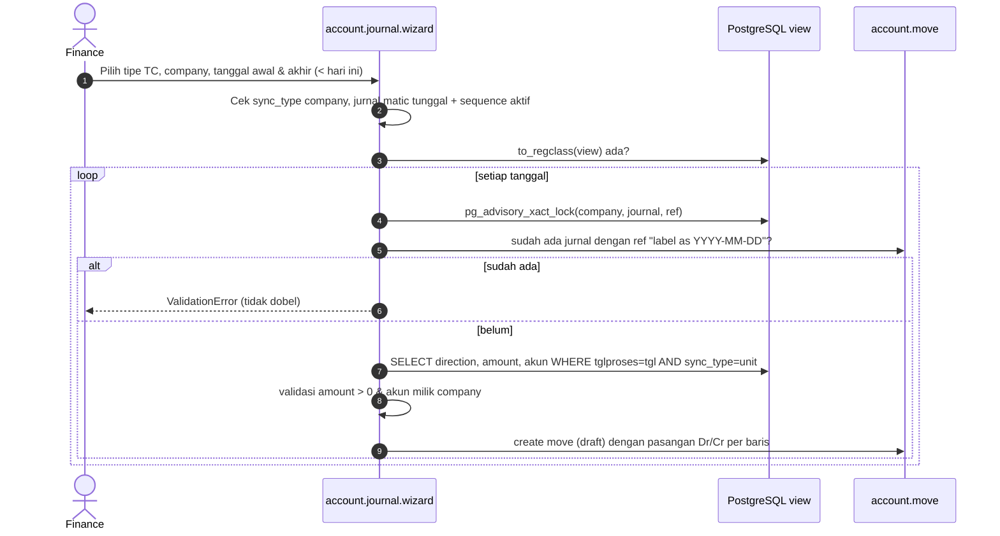

## 1. Apa itu?

`account.journal.wizard` (diperluas di <Src file="mayapada/eproc/eproc_tc.py" line={22862} symbol="AccountJournalWizard" />) punya 13 tipe jurnal TC (<Src file="mayapada/eproc/eproc_tc.py" line={22512} symbol="TC_JOURNALS" />). Untuk setiap tanggal dalam rentang, wizard membaca view SQL `view_account_tc_*`, mengelompokkan per akun, dan membuat satu `account.move` per tanggal.

| Tipe | Nama jurnal | View | move_type filter |
| --- | --- | --- | --- |
| tc_receipt_collection | TC Receipt Collection | view_account_tc_cashier_collection | — |
| tc_creditnote_collection | TC Credit Note Collection | view_account_tc_creditnote_collection | — |
| tc_deposit_collection | TC Deposit Collection | view_account_tc_deposit_collection | — |
| tc_stock_receipt | TC Stock Receipt & Return | view_account_tc_stock_receiving | — |
| tc_stock_difference | TC Stock Price Difference | view_account_tc_stock_price_difference | — |
| tc_stock_dispense | TC Stock Dispense & Return | view_account_tc_stock_movement | DIS_PACKING, DIS_ISSUE, DIS_RETURN |
| tc_stock_issue | **TC Stock Consumption** (nama jurnal) | view_account_tc_stock_movement | ISSUE_REQ, ISSUE_RET |
| tc_stock_consumption | TC Stock Consumption | view_account_tc_stock_movement | CONSUMPTION |
| tc_stock_internal | TC Stock Internal Transfer | view_account_tc_stock_movement | TRANSFER_IN, TRANSFER_OUT |
| tc_stock_opname | TC Stock Opname | view_account_tc_stock_movement | ADJ_SO |
| tc_stock_adjustment | TC Stock Adjustment | view_account_tc_stock_movement | ADJ_RECEIPT, ADJ_ISSUE |
| tc_stock_disposal | TC Stock Disposal | view_account_tc_stock_movement | DISPOSAL |
| tc_stock_others | TC Stock Others | view_account_tc_stock_movement | BOM_OUTPUT, BOM_INPUT |

## 2. Kenapa RS membutuhkannya?

<Confidence level="general" /> Volume transaksi harian HIS sangat besar (ribuan baris kasir & dispensing). Menjurnal per baris membuat buku besar tidak terbaca; jurnal ringkasan harian per akun tetap bisa diaudit lewat view sumber.

## 6. Sequence generate

*Sumber:* <Src file="mayapada/eproc/eproc_tc.py" line={22880} symbol="AccountJournalWizard._generate_tc_journal" />, <Src file="mayapada/eproc/eproc_tc.py" line={22961} symbol="generate" />, <Src file="mayapada/eproc/eproc_tc.py" line={22870} symbol="init" />. <Confidence level="verified" />

## 7. Catatan implementasi

- View dibuat saat **upgrade modul** (`init`) dengan `CREATE OR REPLACE VIEW` dalam savepoint; gagal = warning saja, sehingga error baru muncul saat generate.
- Jurnal dibuat **draft**, tidak auto-post (memory: muncul di *Accounting > Adviser > Journals > Journal Entries*).
- Repo **belum** berisi `_get_tc_journal()`/`TC_JOURNAL_SETUP` (auto-create jurnal & sequence per company) yang menurut memory sudah di-deploy ke server 9 Okt 2026. Di repo, jurnal matic harus dibuat manual. <Confidence level="verified">repo</Confidence> <Confidence level="inferred">server</Confidence>

## 9. Aturan view (ringkas)

- **Cashier:** dikelompokkan per tanggal, state, tipe pembayaran; payment mode → akun debit.
- **Receiving:** receipt `done`, kecuali item konsinyasi `CG%`; RT membalik arah.
- **Stock movement:** move `done`; akun dari **item category** (`stock_output_id`, `stock_valuation_id`); arah dari tanda qty.
- **Price difference:** selisih harga penerimaan (memory: join diperbaiki ke `receipt_line_id`; contoh rollback Db 5301000000 / Cr 1106010000).

## 10. Common problems

| Error | Solusi |
| --- | --- |
| "The selected company has no sync_type." | Isi `res.company.sync_type`. |
| "...needs one active matic journal with an entry sequence..." | Buat tepat satu jurnal `is_matic` dengan sequence aktif. |
| "Source view ... is not available" | Upgrade modul; periksa tabel sumber (mis. `eproc_stock_move.cost_total`). |
| "Invalid account_debit_id ..." | Item category tanpa akun valuasi/output, atau kode akun hard-coded tidak ada di COA company. |
| "... already has a journal for ..." | Sudah digenerate; batalkan jurnal lama dulu jika perlu ulang. |

## 12. Pertanyaan uji

<Accordions>
<Accordion title="Kenapa wizard memakai advisory lock?">
Agar dua user yang men-generate tanggal yang sama bersamaan tidak membuat jurnal ganda (cek-lalu-buat dibuat atomik per kunci company+jurnal+ref).
</Accordion>
<Accordion title="Kenapa jurnal dibuat per tanggal, bukan per rentang?">
Supaya setiap hari bisa dicocokkan dengan laporan kas/stok harian dan diulang per hari jika ada koreksi.
</Accordion>
</Accordions>

## Sumber

### Kode

- <Src file="mayapada/eproc/eproc_tc.py" line={22880} symbol="AccountJournalWizard._generate_tc_journal" /> — method `AccountJournalWizard`
- <Src file="mayapada/models/account.py" line={18869} symbol="account.move" /> — model `AccountMove`
- <Src file="mayapada/models/account.py" line={32540} symbol="account.journal.wizard" /> — model `AccountJournalWizard`
