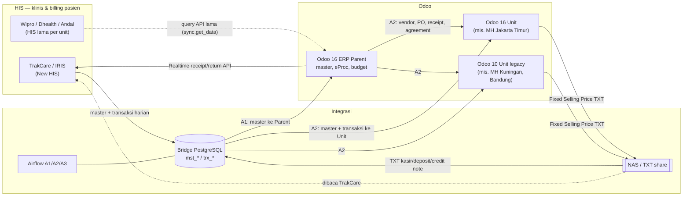

## Arsitektur sistem (verified + inferred)

**Penjelasan bisnis:** Rumah sakit menjalankan layanan klinis di HIS. Back office (keuangan, pengadaan, tarif) membutuhkan data dari HIS untuk mengakui pendapatan dan piutang, dan HIS membutuhkan harga jual dari back office. Bridge + Airflow menjadi "jalan tol" antar keduanya.

**Aktor:** Tim IT/integrasi (Airflow), Finance & Accounting, Procurement, Billing/Kasir (di HIS).

*Legenda:* garis padat = alur yang ada di kode/README; garis putus = alur legacy atau yang belum terverifikasi end-to-end.
*Sumber:* `airflow:README.md` (bagian Overview & Business Interface Landscape), <Src file="mayapada/models/sync.py" /> (`servers`, `get_data`), <Src file="mayapada/eproc/eproc_tc.py" line={13713} symbol="_send_tc_by_api" />. <Confidence level="verified">kode & README</Confidence> <Confidence level="confirm">topologi produksi per unit</Confidence>

<Callout type="warn" title="Odoo 10 juga ada">
Project memory mencatat dua generasi Odoo Unit: Odoo 16 (database `MAYAPADA-LIVE16`) dan Odoo 10 (database `MAYAPADA-LIVE2`, untuk unit Kuningan dan lainnya). Fitur tarif di-*backport* ke Odoo 10. **Source Odoo 10 tidak ada di repo ini**, sehingga dokumentasi ini hanya mendeskripsikannya dari memory. <Confidence level="inferred">dari memory</Confidence>
</Callout>

## Kode unit (sync_type)

Diambil dari <Src file="mayapada/models/sync.py" /> (`type` selection) dan pemetaan bisnis di README Airflow:

| sync_type | Label di kode | Rumah sakit (README Airflow) |
| --- | --- | --- |
| 1 | Wipro MHJS | Mayapada Hospital Jakarta Selatan |
| 2 | Wipro MHTG | Mayapada Hospital Tangerang |
| 3 | Dhealth MHSB | Mayapada Hospital Surabaya |
| 6 | Dhealth MHKN | Mayapada Hospital Kuningan |
| 7 | Dhealth MHBG | Mayapada Hospital Bogor |
| 8 | Dhealth MHBD | Mayapada Hospital Bandung |
| 9 | HIS MHNS | Mayapada Hospital Nusantara |
| 10 | MEC JS | Mayapada Eye Centre |
| 11 | New HIS MHJT | Mayapada Hospital Jakarta Timur |
| 12 | New HIS MABIH | Mayapada Apollo Batam International Hospital |
| 13 | MMCK | Mayapada Medical Center Kuningan |
| 999 | Parent MHG | Mayapada Healthcare Group |

Label `4`, `5`, `31`–`35` juga ada di kode (New HIS MHJS/MHTG, entitas BSL/PT/Corporate) tanpa pemetaan di README. <Confidence level="confirm" />

## Inventaris modul di repo

Repo `odoo-revamp` berisi satu modul bisnis besar **`mayapada`** (Odoo 16, depends: `account`, `om_account_accountant`, `om_account_budget`, `om_account_asset`, `sale_management`, `purchase`, `stock`, `mrp`, `hr`, `purchase_requisition`, `account_standard_report`, `auth_oauth`) dan add-on pendukung (laporan, tema, utilitas).

<Callout type="info" title="Nama modul ≠ daftar di brief">
Brief menyebut kandidat seperti `mayapada_hospital`, `mayapada_doctor_fee`, dll. **Modul-modul itu tidak ada.** Semua domain berada sebagai **file** di dalam satu modul `mayapada`. Lihat [Mayapada Codebase](/docs/mayapada-codebase).
</Callout>

| File (di `mayapada/`) | Baris | Domain bisnis | Model kunci |
| --- | ---: | --- | --- |
| <Src file="mayapada/eproc/eproc_tc.py" /> | 25.452 | eProcurement, tarif, AR TrakCare, budget, stok eProc, jurnal TC | `eproc.request/order/receipt`, `tariff.*`, `receivable.receipt` |
| <Src file="mayapada/models/sale.py" /> | 15.750 | Admission & billing pasien hasil sync HIS | `sale.order`, `sale.order.bill`, `sale.order.cob` |
| <Src file="mayapada/models/receivable.py" /> | 11.561 | Piutang, covering letter, deposit, credit note | `account.coveringletter`, `inpatient.deposit` |
| <Src file="mayapada/models/doctor_fee.py" /> | 27.503 | Fee dokter & payout | `doctor.rate`, `doctor.fee`, `doctor.fee.line` |
| <Src file="mayapada/models/referral_fee.py" /> | 3.561 | Fee perujuk eksternal | `referral.agen`, `referral.fee` |
| <Src file="mayapada/models/marketing_fee.py" /> | 5.476 | Insentif marketing | `marketing.fee`, `marketing.pic` |
| <Src file="mayapada/models/purchase.py" /> | 12.989 | Procurement Odoo standar (generasi lama) | `purchase.order`, `purchase.requisition` |
| <Src file="mayapada/models/stock.py" /> | 6.423 | Stok Odoo standar, ledger | `stock.picking`, `stock.ledger` |
| <Src file="mayapada/models/payable.py" /> | 3.410 | Hutang supplier (AP) | `payable.invoice`, `payable.payment` |
| <Src file="mayapada/models/account.py" /> | 34.218 | Akuntansi, profitabilitas, laporan | `account.move`, `profitability.*` |
| <Src file="mayapada/models/budget.py" />, <Src file="mayapada/models/cost_center.py" /> | 3.995 / 8.982 | Budget & cost center | `crossovered.budget`, `cost.center.*` |
| <Src file="mayapada/models/hospital.py" /> | 2.580 | Master RS | `hospital.tariff`, `hospital.bed.type` |
| <Src file="mayapada/models/resapi.py" /> | 4.338 | REST API generik & konsolidasi Odoo-ke-Odoo | `ApiController` |

## Sumber

### Kode

- <Src file="mayapada/eproc/eproc_tc.py" line={13713} symbol="_send_tc_by_api" /> — method `EprocReceipt`
- <Src file="mayapada/eproc/eproc_tc.py" line={15732} symbol="receivable.receipt" /> — model `ReceivableReceipt`
- <Src file="mayapada/models/account.py" line={18869} symbol="account.move" /> — model `AccountMove`
- <Src file="mayapada/models/doctor_fee.py" line={113} symbol="doctor.rate" /> — model `DoctorRate`
- <Src file="mayapada/models/doctor_fee.py" line={4498} symbol="doctor.fee" /> — model `DoctorFee`
- <Src file="mayapada/models/doctor_fee.py" line={10385} symbol="doctor.fee.line" /> — model `DoctorFeeLine`
- <Src file="mayapada/models/hospital.py" line={30} symbol="hospital.bed.type" /> — model `HospitalBedType`
- <Src file="mayapada/models/hospital.py" line={178} symbol="hospital.tariff" /> — model `HospitalTariff`
- <Src file="mayapada/models/marketing_fee.py" line={2681} symbol="marketing.fee" /> — model `MarketingFee`
- <Src file="mayapada/models/marketing_fee.py" line={3790} symbol="marketing.pic" /> — model `MarketingPIC`
- <Src file="mayapada/models/payable.py" line={188} symbol="payable.invoice" /> — model `PayableInvoice`
- <Src file="mayapada/models/payable.py" line={1141} symbol="payable.payment" /> — model `PayablePayment`
- <Src file="mayapada/models/purchase.py" line={31} symbol="purchase.order" /> — extend `PurchaseOrder`
- <Src file="mayapada/models/purchase.py" line={6795} symbol="purchase.requisition" /> — extend `PurchaseRequest`
- <Src file="mayapada/models/receivable.py" line={70} symbol="account.coveringletter" /> — model `CoveringLetter`
- <Src file="mayapada/models/receivable.py" line={8224} symbol="inpatient.deposit" /> — model `InpatientDeposit`
- <Src file="mayapada/models/referral_fee.py" line={25} symbol="referral.agen" /> — model `ReferralAgen`
- <Src file="mayapada/models/referral_fee.py" line={1145} symbol="referral.fee" /> — model `ReferralFee`
- <Src file="mayapada/models/resapi.py" line={97} symbol="ApiController" /> — class `ApiController`
- <Src file="mayapada/models/sale.py" line={43} symbol="sale.order" /> — extend `SaleOrder`
- <Src file="mayapada/models/sale.py" line={9652} symbol="sale.order.bill" /> — model `SaleOrderBill`
- <Src file="mayapada/models/sale.py" line={10447} symbol="sale.order.cob" /> — model `SaleOrderCob`
- <Src file="mayapada/models/stock.py" line={30} symbol="stock.picking" /> — extend `StockPicking`
- <Src file="mayapada/models/stock.py" line={6263} symbol="stock.ledger" /> — model `StockLedger`
- <Src file="om_account_budget/models/account_budget.py" line={42} symbol="crossovered.budget" /> — model `CrossoveredBudget`
