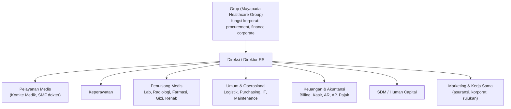
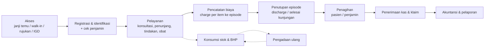

## Rumah sakit sebagai organisasi

<Confidence level="general" />

Rumah sakit swasta adalah **bisnis jasa yang sangat teregulasi**: ia menjual layanan klinis (yang tidak bisa distandarkan sepenuhnya), menyimpan stok bernilai tinggi yang bisa kedaluwarsa, bekerja sama dengan dokter yang sering **bukan karyawan**, dan ditagihkan ke banyak pihak (pasien, asuransi, perusahaan, BPJS).

Struktur yang lazim (nama bisa berbeda per RS):

*Diagram konseptual.* Untuk Mayapada, keberadaan fungsi korporat terlihat dari grup akses Odoo seperti *Finance & Accounting – Corporate*, *Procurement – Corporate*, *Ka.Dept Purchasing*, *Ka.Unit Accounting* (`mayapada/security/security.xml`). <Confidence level="verified">nama grup</Confidence> <Confidence level="confirm">struktur organisasi aktual</Confidence>

## Tiga jenis proses

| Jenis | Contoh | Sistem utama | Di Odoo? |
| --- | --- | --- | --- |
| **Medis/klinis** | Anamnesis, diagnosis, order lab, resep, tindakan, asuhan keperawatan | HIS/EMR (RME), LIS, RIS/PACS | Tidak. Odoo hanya menerima hasil yang berdampak finansial (diagnosis kode, item tagihan). |
| **Operasional** | Pengadaan, gudang, distribusi obat ke unit, jadwal, maintenance, aset | ERP + modul HIS (farmasi/inventori) | Ya: eProcurement, stok eProc, aset, budget. |
| **Finansial** | Tarif, billing, klaim, kasir, piutang, hutang, fee dokter, akuntansi | HIS (billing pasien) + ERP | Ya untuk tarif, AR/AP, fee, jurnal; billing pasien di HIS. |

## Siklus layanan (healthcare service lifecycle)

Langkah A–E dan sebagian F terjadi di HIS. G–H dan P (pengadaan) adalah wilayah Odoo. Lihat [Patient Journey](/docs/patient-journey).

## Multi-cabang & multi-company

Mayapada adalah grup dengan banyak rumah sakit. Di Odoo setiap RS adalah **company** (`res.company`) dengan `sync_type` unik; data master bisa milik grup (*Parent*) atau unit. Record rule di repo umumnya berpola `['|', ('company_id','=',False), ('company_id','in', company_ids)]` — data tanpa company dibagi, data ber-company diisolasi. <Confidence level="verified">security/record_rules.xml, 55 aturan dengan pola ini</Confidence>

Konsekuensi bisnis: harga, stok, piutang, dan jurnal **per unit**, sementara vendor, agreement, dan item master bisa dikelola terpusat lalu didistribusikan ke unit (A2 "ERP Parent → Unit").

## Halaman terkait

- [Sistem Informasi RS: HIS, SIMRS, RME, ERP, LIS, PACS](/docs/hospital-fundamentals/sistem-informasi)
- [Revenue Center vs Cost Center](/docs/hospital-fundamentals/revenue-cost-center)
- [Master Data](/docs/master-data)

## Sumber

### Kode

- <Src file="mayapada/models/misc.py" line={2404} symbol="res.company" /> — extend `ResCompany`

### Eksternal

- DJP, "Dok, Sudah Benarkah Cara Menghitung Pajak Penghasilan Anda?" (dokter sebagai mitra, bagi hasil, bruto sebelum dipotong RS) — [pajak.go.id](https://www.pajak.go.id/id/artikel/dok-sudah-benarkah-cara-menghitung-pajak-penghasilan-anda). *Mendukung:* dokter praktik di RS umumnya sebagai mitra, bukan pegawai (diakses 11 Okt 2026).
- [Permenkes 6/2026 tentang Rumah Sakit](https://peraturan.bpk.go.id/Details/350851/permenkes-no-6-tahun-2026) (berlaku 12 Jun 2026; mencabut Permenkes 85/2015 dan 4/2018), Pasal 71–72: tarif RS ditetapkan berdasarkan **pola tarif nasional** (dari komponen biaya satuan/unit cost) dan **pagu tarif maksimal** dari gubernur; prinsip keadilan mencakup tarif yang **transparan** dan memperhatikan **kelas pelayanan**; tarif JKN mengacu standar tarif Menteri. *Mendukung:* tarif RS diatur pola tarif nasional (diakses 11 Okt 2026; teks pasal sudah dicek).
- [Permenkes 6/2026 tentang Rumah Sakit](https://peraturan.bpk.go.id/Details/350851/permenkes-no-6-tahun-2026) (berlaku 12 Jun 2026; mencabut Permenkes 85/2015 dan 4/2018), Pasal 36 ayat (1): kewajiban RS antara lain memberi informasi yang benar tentang pelayanan (huruf a), melaksanakan fungsi sosial termasuk **pelayanan gawat darurat tanpa uang muka** (huruf f), dan memberi informasi yang benar, jelas, jujur mengenai hak & kewajiban pasien (huruf l). *Mendukung:* kewajiban RS kepada pasien & masyarakat (diakses 11 Okt 2026; teks pasal sudah dicek).
