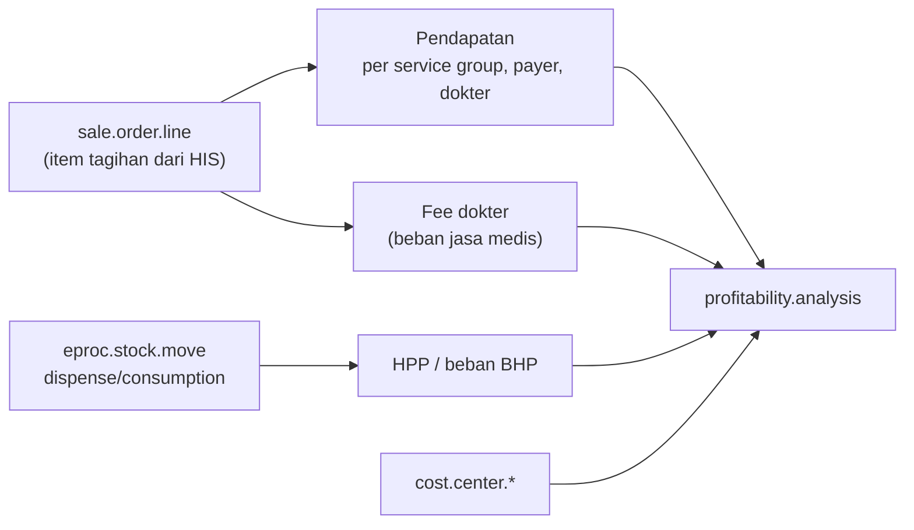

## Konsep

<Confidence level="general" />

- **Revenue center** — unit yang menghasilkan tagihan: rawat jalan (poliklinik), rawat inap, IGD, kamar operasi, ICU, laboratorium, radiologi, farmasi, MCU, hemodialisis.
- **Cost center** — unit pendukung tanpa tagihan langsung: SDM, IT, keuangan, laundry, gizi (sebagian), maintenance, rekam medis.
- **Medis vs non-medis** — departemen medis/penunjang medis bersentuhan dengan pasien; non-medis mendukung operasi.

Manajemen RS ingin tahu **profitabilitas per layanan, per dokter, per penjamin, per unit** — sehingga setiap pendapatan dan biaya harus dibawa dengan dimensi (analytic) yang tepat.

## Dimensi di Odoo Mayapada

| Dimensi | Field / model | Catatan |
| --- | --- | --- |
| Dokter | `account.analytic.account` dengan `sync_wipro_type='doctor_internal'` | Dokter direpresentasikan sebagai **akun analitik**, bukan partner. Spesialisasi = parent analytic. |
| Layanan / service group | `sale.order.line.service_categ_id`, `service_group_id`, `revenue_type` | Pengelompokan pendapatan. |
| Patient group / payer type | `sale.order.line.patient_group`, `payer_type` | Laporan `patientgroup.report`, `payertype.report`. |
| Departemen | `hr.department` (+ cost center), `department.report`, `department.cost.report` | |
| Cost center | `cost.center.master`, `cost.center.report`, `cost.center.dimension*` | 9 ribu baris logika laporan & rekonsiliasi (<Src file="mayapada/models/cost_center.py" />). |
| Mapping analitik | `account.analytic.revenue.mapping(.new)`, `account.analytic.cost.mapping(.new)`, `...doctor.cost.mapping`, `...scrap.mapping` | Menentukan akun/analitik untuk pendapatan & biaya. |
| Profitabilitas | `profitability.analysis`, `profitability.ledger`, `profitability.dimension` | Analisis laba per dimensi. |

<Confidence level="verified">mayapada/models/account.py, cost_center.py, sale.py</Confidence>

*Diagram konseptual dari relasi model.* <Confidence level="inferred" />

## Pertanyaan uji

<Accordions>
<Accordion title="Kenapa dokter di Odoo Mayapada adalah analytic account?">
Agar setiap pendapatan dan beban fee bisa diberi dimensi dokter (dan spesialisasi via parent) untuk laporan profitabilitas. Data identitas pembayaran dokter ada di `doctor.rate` (bank, NPWP). <Confidence level="inferred" />
</Accordion>
<Accordion title="Laboratorium termasuk revenue center atau cost center?">
Revenue center (menagih pemeriksaan), tetapi sekaligus penunjang medis. Di Odoo ada grup akses khusus *Billing Analysis Laboratorium*.
</Accordion>
</Accordions>

## Sumber

### Kode

- <Src file="mayapada/eproc/eproc_tc.py" line={5789} symbol="hr.department" /> — model `HrDepartment`
- <Src file="mayapada/eproc/eproc_tc.py" line={5839} symbol="account.analytic.account" /> — model `AccountAnalyticAccount`
- <Src file="mayapada/models/account.py" line={2268} symbol="department.cost.report" /> — model `DepartmentCostReport`
- <Src file="mayapada/models/account.py" line={2348} symbol="department.report" /> — model `DepartmentReport`
- <Src file="mayapada/models/account.py" line={2430} symbol="payertype.report" /> — model `PayertypeReport`
- <Src file="mayapada/models/account.py" line={2571} symbol="patientgroup.report" /> — model `PatientGroupReport`
- <Src file="mayapada/models/account.py" line={3969} symbol="profitability.dimension" /> — model `ProfitabilityDimension`
- <Src file="mayapada/models/account.py" line={3998} symbol="profitability.ledger" /> — model `ProfitabilityLedger`
- <Src file="mayapada/models/account.py" line={18508} symbol="profitability.analysis" /> — model `ProfitabilityAnalysis`
- <Src file="mayapada/models/cost_center.py" line={8700} symbol="cost.center.master" /> — model `CostCenterMaster`
- <Src file="mayapada/models/cost_center.py" line={8724} symbol="cost.center.report" /> — model `CostCenterReport`
- <Src file="mayapada/models/doctor_fee.py" line={113} symbol="doctor.rate" /> — model `DoctorRate`

### Eksternal

- Unit cost & pusat biaya produksi/penunjang di RS — [Permenkes 6/2026 tentang Rumah Sakit](https://peraturan.bpk.go.id/Details/350851/permenkes-no-6-tahun-2026) (berlaku 12 Jun 2026; mencabut Permenkes 85/2015 dan 4/2018) Pasal 71–72 (pola tarif nasional berbasis biaya satuan/unit cost) dan studi kasus [JMPK UGM](https://journal.ugm.ac.id/v3/JMPK/article/view/4930). *Mendukung:* pembagian pusat biaya untuk perhitungan unit cost/tarif (diakses 11 Okt 2026).
