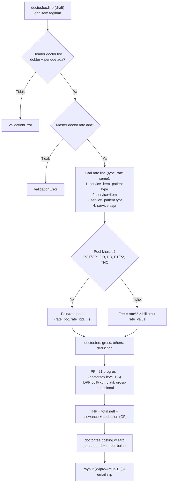

## 1. Apa itu?

**Doctor fee** adalah perhitungan jasa medis bulanan per dokter dari semua layanan yang ia berikan (sebagai *primary*, *perform*, *prescribe*, *referral*, operator bedah, anestesi, dll.).

## 2. Kenapa RS membutuhkannya?

<Confidence level="general" /> Dokter spesialis adalah "mesin pendapatan" RS; ketepatan dan ketepatan waktu fee memengaruhi loyalitas dokter. Fee juga harus dipotong pajak dengan benar dan diakui sebagai beban pada periode yang tepat.

## 3. Siapa yang terlibat?

*Finance & Accounting – Staff Fee Doctor* (hitung & posting), *Staff MCU* (fee MCU), dokter (menerima slip/email), Finance (pembayaran), manajemen (master rate; status `doctor.rate`: draft → waiting release → release, dengan opsi `no_approval`).

## 4. Proses di lapangan (berdasarkan model)

<Steps>
<Step>Master **doctor.rate** per dokter: validitas, guarantee fee (GF) & prorata, allowance, NPWP, gross-up, bank, flag pool (POT/GP, P1/P2, IGD, TNC, HD, Referral), dokter eksternal/dental.</Step>
<Step>**Rate line** (`doctor.rate.line`): per service category, (opsional) service item, (opsional) patient type, payer, bed type, **type_rate** (peran: doctor/primary/perform/prescribe/referal/...), `rate` % atau `rate_value`.</Step>
<Step>Item tagihan HIS masuk sebagai **doctor.fee.line** (bill amount, dokter per peran, payer, service, bed type). Header **doctor.fee** per dokter per bulan harus sudah ada.</Step>
<Step>Compute: cari rate line paling spesifik, hitung fee per baris; pool POT/IGD/HD dibagi berdasarkan poin.</Step>
<Step>Header: gross fee + others − deductions, **PPh 21/23** progresif (dengan DPP 50%), gross-up opsional, GF minimum → **Take Home Pay (THP)**.</Step>
<Step>Confirm → **Posting** bulanan per dokter (jurnal beban vs hutang + pajak) → payout & email slip.</Step>
</Steps>

## 6. Diagram

*Sumber:* `DoctorFeeLine._compute_fee_line` (<Src file="mayapada/models/doctor_fee.py" line={10776} symbol="_compute_fee_line" />), <Src file="mayapada/models/doctor_fee.py" line={4687} symbol="DoctorFee.compute_grossup" />, <Src file="mayapada/models/doctor_fee.py" line={753} symbol="DoctorFeePostingWizard.posting" />, <Src file="mayapada/models/doctor_fee.py" line={113} symbol="doctor.rate" />, <Src file="mayapada/models/doctor_fee.py" line={409} symbol="doctor.rate.line" />, <Src file="mayapada/models/doctor_fee.py" line={28} symbol="doctor.tax" />. <Confidence level="verified" />

## 7. Implementasi — detail penting

- **Prioritas rate line** ditentukan urutan pencarian `drl_1`…`drl_4` (lihat diagram). <Confidence level="verified" />
- **POT/GP** berlaku untuk dokter `is_pot_gp`, pasien IP/Emergency (`'2','3'`), service "Consultation" atau "OP/IP Procedure", **kecuali** daftar item yang di-*hard-code* (ECG, Treadmill, setting ventilator, dll.). <Confidence level="verified" /> Arti singkatan POT/GP, P1/P2, TNC: <Confidence level="confirm" />
- **Pajak**: `doctor.tax` menyimpan tarif per level (`tax_dpp_min/max`, `tax_rate`, `tax_rate2` tanpa NPWP). `compute_grossup` menghitung PPh 21 dengan **bruto kumulatif** (`bruto_prev`, `pph21_prev`) dan **DPP 50%**, termasuk gross-up iteratif (komentar contoh: bruto 110 jt → gross-up ≈ 3.513.514). <Confidence level="verified" />
- **Posting**: membaca view `view_account_service_cost` untuk `trans_type IN ('DF-LINE','DF-THP','DF-OTHER','DF-DEDUCTION')`, membuat jurnal ke akun beban, akun kredit (hutang), dan akun pajak yang dipilih di wizard; label `DF YYYY-MM / Nama Dokter`. Untuk company "Mayapada Hospital Tangerang" tipe posting default = *Doctor Fee Others*. <Confidence level="verified" />
- **Sumber transaksi**: Bridge `trx_payout_collection` (README: *Payout Doctor Master*, TC → Odoo) ke `doctor.payout.line`; memory: D022_01 payout masih `NotImplementedError` (29 Sep 2026). <Confidence level="inferred" />
- **BPJS**: `doctor.fee.bpjs` + import wizard; `total_accrual` "BPJS Accrual" di header.

<Callout type="warn" title="Regulasi pajak berubah">
Aturan PPh 21 berubah sejak 2024 (skema Tarif Efektif Rata-rata untuk pegawai; ketentuan bukan pegawai juga diatur ulang). Kode memakai skema progresif berbasis DPP 50% yang tersimpan di `doctor.tax`. Kesesuaian dengan regulasi pajak terbaru **tidak** diverifikasi di dokumentasi ini — konsultasikan dengan tim pajak. <Confidence level="confirm" />
</Callout>

## 8. Alur data (sintetis)

| Data | Nilai |
| --- | --- |
| dr. Andi (fiktif), Sp.PD, Maret | 120 visite rawat inap @ Rp300.000 (bill) |
| Rate line: service "Visit", type_rate perform, patient type IP, rate 75% | fee per baris Rp225.000 |
| Gross fee | 120 × 225.000 = **Rp27.000.000** |
| DPP 50% | Rp13.500.000 (+ kumulatif bulan sebelumnya untuk lapisan tarif) |
| PPh 21 (contoh 5% lapisan pertama, ber-NPWP) | Rp675.000 |
| THP (tanpa allowance/deduction) | **Rp26.325.000** |

Angka tarif pajak contoh saja; tarif aktual dari `doctor.tax`. <Confidence level="inferred" />

## 10. Common problems

| Masalah | Penyebab |
| --- | --- |
| "Fee Header untuk dokter ini untuk periode yang anda pilih belum ada." | Header bulan belum dibuat (`doctor.fee.wizard.create_doctor_fee`). |
| "Master Rate untuk dokter ini belum ada." | Dokter baru tanpa `doctor.rate`. |
| Fee 0 untuk layanan tertentu | Tidak ada rate line yang cocok (service/item/patient type/type_rate). |
| Pajak salah setelah koreksi bulan lalu | Bruto kumulatif sebelumnya berubah. |
| Dokter dengan dua analytic account | Duplikasi master dokter dari sync (analytic) → fee terpecah. |

## 11. Yang perlu developer pahami

- `patient_type` di fee memakai kode **numerik**.
- Banyak logika memakai **nama** service/item/company yang di-*hard-code* — rename master data dapat mengubah fee diam-diam.
- Posting memakai SQL view; pastikan view konsisten dengan baris fee yang sudah `confirmed`.

## 12. Pertanyaan uji

<Accordions>
<Accordion title="Kenapa pajak dokter dihitung kumulatif?">
Tarif PPh 21 progresif berdasarkan akumulasi penghasilan; bulan berikutnya bisa masuk lapisan tarif lebih tinggi.
</Accordion>
<Accordion title="Apa itu guarantee fee?">
Jaminan minimum pendapatan dokter (sering untuk dokter baru); jika fee aktual di bawah GF, RS menambah selisihnya. Field `guarantee_fee`, `join_prorate`, `gf`, `gf_other`. <Confidence level="inferred" />
</Accordion>
<Accordion title="Bagaimana jika dokter berperan sebagai primary sekaligus perform di satu baris?">
Rate dicari per `type_rate` (= `rate_remark` baris); setiap peran menghasilkan baris fee sendiri dari HIS. <Confidence level="inferred" />
</Accordion>
</Accordions>

## Sumber

### Kode

- <Src file="mayapada/models/doctor_fee.py" line={28} symbol="doctor.tax" /> — model `DoctorTax`
- <Src file="mayapada/models/doctor_fee.py" line={113} symbol="doctor.rate" /> — model `DoctorRate`
- <Src file="mayapada/models/doctor_fee.py" line={409} symbol="doctor.rate.line" /> — model `DoctorRateLine`
- <Src file="mayapada/models/doctor_fee.py" line={753} symbol="DoctorFeePostingWizard.posting" /> — method `DoctorFeePostingWizard`
- <Src file="mayapada/models/doctor_fee.py" line={4687} symbol="DoctorFee.compute_grossup" /> — method `DoctorFee`
- <Src file="mayapada/models/doctor_fee.py" line={8436} symbol="doctor.payout.line" /> — model `DoctorPayoutLine`
- <Src file="mayapada/models/doctor_fee.py" line={10776} symbol="DoctorFeeLine._compute_fee_line" /> — method `DoctorFeeLine`
- <Src file="mayapada/models/doctor_fee.py" line={26461} symbol="doctor.fee.bpjs" /> — model `DoctorFeeBPJS`
