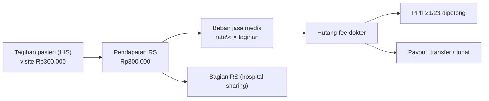

## Karyawan vs dokter mitra

<Confidence level="general" />

| Aspek | Karyawan RS (perawat, admin, dokter umum tertentu) | Dokter spesialis mitra (umumnya) |
| --- | --- | --- |
| Hubungan | Hubungan kerja (gaji tetap, BPJS Ketenagakerjaan) | Kemitraan / kontrak praktik |
| Pembayaran | Gaji bulanan + tunjangan + lembur | **Jasa medis (professional fee)** per layanan, kadang + *guarantee fee* minimum |
| Pajak | PPh 21 pegawai | PPh 21 **bukan pegawai** (tenaga ahli), DPP 50% dari bruto; PPh 23 untuk badan |
| Sistem | HR/payroll | Modul fee dokter |

## Pendapatan RS ≠ fee dokter

Tagihan pasien untuk "visite dokter Rp300.000" adalah **pendapatan RS**. Sebagian (misalnya 70–80%) menjadi **beban jasa medis** dan **hutang kepada dokter**. Selisihnya adalah bagian RS (*hospital sharing*). Persentase aktual ada di master rate per dokter. <Confidence level="confirm">persentase kebijakan Mayapada</Confidence>

## Modul di repo

| Domain | File | Model kunci |
| --- | --- | --- |
| Fee dokter | <Src file="mayapada/models/doctor_fee.py" /> (27.503 baris) | `doctor.rate`, `doctor.rate.line`, `doctor.fee`, `doctor.fee.line`, `doctor.payout.line`, `doctor.fee.bpjs`, `doctor.mcu`, `doctor.tax` |
| Fee perujuk | <Src file="mayapada/models/referral_fee.py" /> | `referral.agen`, `referral.rate(*)`, `referral.transaction`, `referral.fee(.line)` |
| Insentif marketing | <Src file="mayapada/models/marketing_fee.py" /> | `marketing.employee`, `marketing.rate(*)`, `marketing.fee`, `marketing.pic`, `marketing.personal` |
| HR | <Src file="mayapada/models/hr.py" /> | `hr.department` (19 field tambahan), `res.position` |
| Gaji (akuntansi) | <Src file="mayapada/models/account.py" /> | `account.salary`, `account.salary.deduction`, `salary.expense.import.wizard` |

**Lembur & approval HR**: tidak ditemukan model lembur/overtime di repo. <Confidence level="notfound" /> Payroll kemungkinan di sistem lain; Odoo hanya menerima beban gaji via import (`salary.expense.import.wizard`, template `Format_Import_Salary_Expense.xlsx`). <Confidence level="inferred" />

<Cards>
  <Card title="Doctor Fee: rate, hitung, pajak, posting" href="/docs/hr-doctor-fees/doctor-fee" />
  <Card title="Referral & Marketing Fee" href="/docs/hr-doctor-fees/referral-marketing-fee" />
</Cards>

## Sumber

### Kode

- <Src file="mayapada/eproc/eproc_tc.py" line={5789} symbol="hr.department" /> — model `HrDepartment`
- <Src file="mayapada/models/account.py" line={25149} symbol="account.salary" /> — model `AccountSalary`
- <Src file="mayapada/models/account.py" line={25317} symbol="account.salary.deduction" /> — model `AccountSalaryDeduction`
- <Src file="mayapada/models/account.py" line={25471} symbol="salary.expense.import.wizard" /> — model `SalaryExpenseImportWizard`
- <Src file="mayapada/models/doctor_fee.py" line={28} symbol="doctor.tax" /> — model `DoctorTax`
- <Src file="mayapada/models/doctor_fee.py" line={113} symbol="doctor.rate" /> — model `DoctorRate`
- <Src file="mayapada/models/doctor_fee.py" line={409} symbol="doctor.rate.line" /> — model `DoctorRateLine`
- <Src file="mayapada/models/doctor_fee.py" line={3056} symbol="doctor.mcu" /> — model `DoctorMCU`
- <Src file="mayapada/models/doctor_fee.py" line={4498} symbol="doctor.fee" /> — model `DoctorFee`
- <Src file="mayapada/models/doctor_fee.py" line={8436} symbol="doctor.payout.line" /> — model `DoctorPayoutLine`
- <Src file="mayapada/models/doctor_fee.py" line={10385} symbol="doctor.fee.line" /> — model `DoctorFeeLine`
- <Src file="mayapada/models/doctor_fee.py" line={26461} symbol="doctor.fee.bpjs" /> — model `DoctorFeeBPJS`
- <Src file="mayapada/models/hr.py" line={525} symbol="res.position" /> — model `ResPosition`
- <Src file="mayapada/models/marketing_fee.py" line={195} symbol="marketing.employee" /> — model `MarketingEmployee`
- <Src file="mayapada/models/marketing_fee.py" line={2681} symbol="marketing.fee" /> — model `MarketingFee`
- <Src file="mayapada/models/marketing_fee.py" line={3520} symbol="marketing.personal" /> — model `MarketingPersonal`
- <Src file="mayapada/models/marketing_fee.py" line={3790} symbol="marketing.pic" /> — model `MarketingPIC`
- <Src file="mayapada/models/referral_fee.py" line={25} symbol="referral.agen" /> — model `ReferralAgen`
- <Src file="mayapada/models/referral_fee.py" line={949} symbol="referral.transaction" /> — model `ReferralTransaction`

### Eksternal

- DJP, "Dok, Sudah Benarkah Cara Menghitung Pajak Penghasilan Anda?" (dokter sebagai mitra, bagi hasil, bruto sebelum dipotong RS) — [pajak.go.id](https://www.pajak.go.id/id/artikel/dok-sudah-benarkah-cara-menghitung-pajak-penghasilan-anda). *Mendukung:* hubungan kemitraan & bagi hasil (diakses 11 Okt 2026).
- PPh 21 dokter bukan pegawai = tarif Pasal 17 × 50% bruto (PMK 168/2023) — [DDTCNews](https://news.ddtc.co.id/berita/nasional/1809604/rumus-baru-pph-21-bikin-kurang-bayar-wp-dokter-naik-begini-contohnya). *Mendukung:* PPh 21 bukan pegawai, DPP 50% bruto (diakses 11 Okt 2026).
- Status dokter mitra & perlindungan BPJS Ketenagakerjaan — [Katadata](https://katadata.co.id/berita/nasional/6a8833e910354/dokter-bisa-kerja-di-3-tempat-bpjs-ketenagakerjaan-soroti-jaminan-kecelakaan). *Mendukung:* dokter mitra tidak otomatis terdaftar BPJS Ketenagakerjaan sebagai pekerja (diakses 11 Okt 2026).
