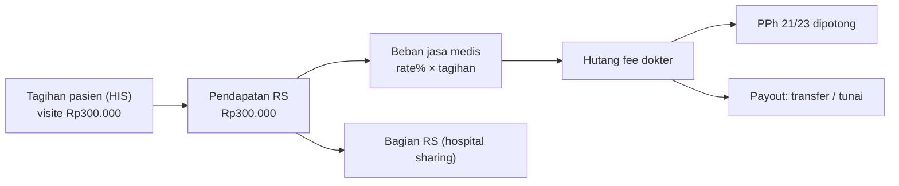

## Karyawan vs dokter mitra

<Confidence level="general" />

| Aspek | Karyawan RS (perawat, admin, dokter umum tertentu) | Dokter spesialis mitra (umumnya) |
| --- | --- | --- |
| Hubungan | Hubungan kerja (gaji tetap, BPJS Ketenagakerjaan) | Kemitraan / kontrak praktik |
| Pembayaran | Gaji bulanan + tunjangan + lembur | **Jasa medis (professional fee)** per layanan, kadang + *guarantee fee* minimum |
| Pajak | PPh 21 pegawai | PPh 21 **bukan pegawai** (tenaga ahli), DPP 50% dari bruto; PPh 23 untuk badan |
| Sistem | HR/payroll | Modul fee dokter |

## Pendapatan RS ≠ fee dokter

Tagihan pasien untuk "visite dokter Rp300.000" adalah **pendapatan RS**. Sebagian (misalnya 70–80%) menjadi **beban jasa medis** dan **hutang kepada dokter**. Selisihnya adalah bagian RS (*hospital sharing*). Persentase aktual ada di master rate per dokter. <Confidence level="confirm">persentase kebijakan Mayapada</Confidence>

## Modul di repo

| Domain | File | Model kunci |
| --- | --- | --- |
| Fee dokter | `models/doctor_fee.py` (27.503 baris) | `doctor.rate`, `doctor.rate.line`, `doctor.fee`, `doctor.fee.line`, `doctor.payout.line`, `doctor.fee.bpjs`, `doctor.mcu`, `doctor.tax` |
| Fee perujuk | `models/referral_fee.py` | `referral.agen`, `referral.rate(*)`, `referral.transaction`, `referral.fee(.line)` |
| Insentif marketing | `models/marketing_fee.py` | `marketing.employee`, `marketing.rate(*)`, `marketing.fee`, `marketing.pic`, `marketing.personal` |
| HR | `models/hr.py` | `hr.department` (19 field tambahan), `res.position` |
| Gaji (akuntansi) | `models/account.py` | `account.salary`, `account.salary.deduction`, `salary.expense.import.wizard` |

**Lembur & approval HR**: tidak ditemukan model lembur/overtime di repo. <Confidence level="notfound" /> Payroll kemungkinan di sistem lain; Odoo hanya menerima beban gaji via import (`salary.expense.import.wizard`, template `Format_Import_Salary_Expense.xlsx`). <Confidence level="inferred" />

<Cards>
  <Card title="Doctor Fee: rate, hitung, pajak, posting" href="/docs/hr-doctor-fees/doctor-fee" />
  <Card title="Referral & Marketing Fee" href="/docs/hr-doctor-fees/referral-marketing-fee" />
</Cards>
