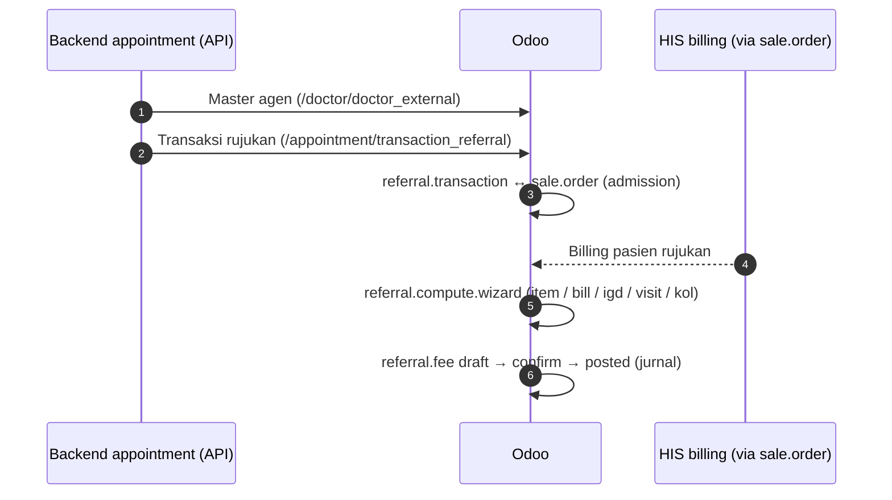

## Referral fee

### Apa & kenapa

Imbalan kepada **pihak perujuk** yang membawa pasien: dokter eksternal, RS lain, klinik, puskesmas, agen asuransi, dll. (`referral.agen.category_id`). <Confidence level="verified" />

<Callout type="warn" title="Kepatuhan">
Pemberian imbalan atas rujukan pasien adalah area sensitif secara etika kedokteran dan regulasi. Dokumentasi ini hanya menjelaskan **kode**; dasar kebijakan & legalitas skema perlu dikonfirmasi ke Legal/Compliance Mayapada. <Confidence level="confirm" />
</Callout>

### Model

| Model | Fungsi |
| --- | --- |
| `referral.agen` | Master perujuk: kode, kategori, KTP, rekening, institusi, blokir |
| `referral.rate` | Rate per agen (`referral_type` AGEN) atau per kategori; validitas |
| `referral.rate.item/service/payer/tariff/bill/visit/payer.discount` | Dimensi rate: per item, service, penjamin, tarif, billing, kunjungan, diskon payer |
| `referral.transaction` | Transaksi rujukan dari backend appointment (`get_data_master_transaksi_agen` → `/appointment/transaction_referral`) dengan link ke `sale.order` |
| `referral.fee` / `referral.fee.line` | Fee per agen; `fee_type` BILL / VISIT / ITEM |
| `referral.compute.wizard` | Tipe: item, bill, **igd** (per billing IGD), visit, **kol** (Key Opinion Leader) |
| `referral.fee.confirm/posting.wizard` | Konfirmasi & posting; state `draft → confirm → posted` |

<Confidence level="verified">`models/referral_fee.py`, `models/sync.py`</Confidence>

Endpoint backend dikonfigurasi di `company.api_backend_endpoint` & `api_backend_key`. <Confidence level="verified" />

## Marketing fee

### Apa & kenapa

Insentif untuk **tim marketing** (karyawan, level posisi) dan **PIC penjamin** berdasarkan pendapatan dari penjamin/korporat yang mereka kelola, termasuk aturan pelanggan baru vs lama, dividen, dan pengecualian payer. <Confidence level="inferred" />

| Model | Fungsi |
| --- | --- |
| `marketing.position`, `marketing.sales`, `marketing.employee(.company)` | Struktur tim & penugasan per company |
| `marketing.rate` (+ `.line`, `.dividen`, `.exception`, `.exception.type`) | Rate insentif, rate pelanggan baru, dividen, payer yang dikecualikan |
| `marketing.rate.personal`, `marketing.rate.pic` | Rate personal & per PIC (fee %, nominal, NPWP, PPh 21/23, payor terkait, patient type, metode bayar) |
| `marketing.billing` | Basis billing yang dihitung (`status` draft/calculated) |
| `marketing.fee`, `marketing.personal`, `marketing.pic` (+ lines, addition, deduction) | Perhitungan bulanan; state `draft → confirm → posted` |
| `marketing.posting.wizard`, `marketing.report.wizard` | Posting & laporan |

`marketing.pic.line.payment_type`: **AR** (Advance Realization) atau **RC** (Receipt) — insentif PIC dihitung dari **penerimaan kas** atas piutang penjamin, bukan dari billing. <Confidence level="inferred">dari pilihan field</Confidence>

## Pertanyaan uji

<Accordions>
<Accordion title="Kenapa referral fee butuh link ke sale.order?">
Fee bergantung pada nilai/jenis kunjungan pasien yang dirujuk (billing, visit, item, IGD), sehingga transaksi rujukan harus dicocokkan ke admission & billing.
</Accordion>
<Accordion title="Apa risiko jika referral.agen tidak diblokir saat kerja sama berakhir?">
Fee tetap terhitung untuk rujukan baru. Field `blocked` dan validitas rate (`start/end_date_validity`) adalah kontrolnya.
</Accordion>
</Accordions>
