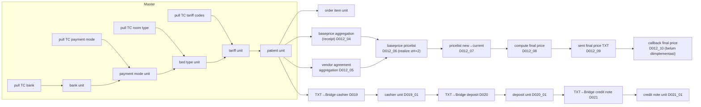

<Callout type="info" title="Sumber">
Halaman ini disusun dari snapshot lokal `/Users/macbook/Documents/mayapada/_airflow_current/` (README, 3 DAG, 13 worker, 3 test) dan project memory. Memory menegaskan source kanonik ada di server Airflow (`/opt/airflow_git/tc_files_new`); snapshot lokal **bukan** salinan deploy. <Confidence level="inferred" />
</Callout>

## Kelompok jadwal

| Grup | Jam (desain) | Tanggung jawab |
| --- | --- | --- |
| **A1** | ±00:02–03:00 | Master TC → Bridge; Bridge → ERP Parent; maintenance DB Parent |
| **A2** | ±03:00–06:00 | Master Unit, Parent → Unit procurement, **pricing**, settlement, revenue, payout, stok, callback |
| **A3** | ±06:00 | Orderpoint: statistik → saran → realisasi PR/RFQ |

## Rantai DAG per unit (testing_mqdd_mhkn / _mhbd)

*Sumber:* `airflow:dags/testing_mqdd_mhkn.py` baris 231–267 (dependensi task). <Confidence level="verified">snapshot</Confidence> Status implementasi D012_10: <Confidence level="inferred">memory</Confidence>

## Interface bisnis (ringkas dari README)

| # | Interface | Arah | Tabel Bridge |
| --- | --- | --- | --- |
| 1–19 | Master (UoM, kategori, item, departemen, lokasi, kamar, payor, TPA, tarif, room type, dokter, pasien, payment mode, bank) | TC → Odoo | `mst_*` |
| 20–21 | Purchase receipt / return | **Odoo → TC realtime** | — (API) |
| 22–23 | Lot, stock movement (12 subtipe) | TC → Odoo | `mst_lot`, `trx_stock_move` |
| 24–27 | Kasir, deposit, debt, credit note | TC → Odoo | `trx_*_collection` |
| 29 | Settlement per billing AR | Odoo → TC | `trx_receipt_collection` |
| 30 | Payout dokter | TC → Odoo | `trx_payout_collection` |
| 31 | Selling price | Odoo → TC (H-1) | `trx_selling_price` |
| 32–35 | Visit, billing, revenue detail, IP accrual | TC → Odoo | `trx_visit`, `trx_billing`, `trx_billing_revenue`, `trx_accrual` |

## Kontrak eksekusi job (penting untuk developer)

- **`sync_type`** memilih unit; **`dummy=True`** memilih koneksi dummy — **bukan dry-run**, tetap menulis ke database dummy.
- **Return value** tidak seragam; TC pull umumnya `read/inserted/updated`. **Sumber kosong = sukses 0 baris** — tidak membuktikan data benar.
- Worker Bridge → Unit menulis via SQL langsung → **constraint & default ORM Odoo tidak berjalan**; validasi harus di worker.
- Identitas relasi: `sync_id_api` (kunci TrakCare) → FK lokal.
- Koleksi D019–D021: TXT `^` dengan header kontrak tetap; COPY ke TEMP table; mengganti **snapshot lengkap** per `sync_type + company + cutoff_date` dalam satu transaksi; advisory lock; file gagal ke folder `failed` + `error.log`; arsip setelah commit. File kosong = no-op. <Confidence level="verified">snapshot D019</Confidence>

## Pertanyaan uji

<Accordions>
<Accordion title="Kenapa task Airflow hijau belum tentu berarti data masuk?">
Karena sumber kosong menghasilkan 0 baris tanpa error, mode dummy bisa menulis ke DB lain, dan beberapa task NAS di-*bypass* di testing (`NAS_TASKS_ENABLED=False`).
</Accordion>
<Accordion title="Mengapa pricing chain harus berurutan?">
Aggregation menghasilkan draft base price; rollover mengaktifkan harga; compute membutuhkan harga aktif/pending terbaru; publikasi membutuhkan versi fixed terbaru. Urutan terbalik mengirim harga basi.
</Accordion>
</Accordions>
