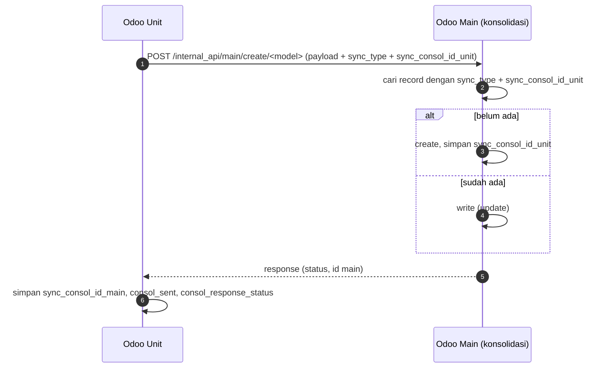

## 1. Konsolidasi unit ↔ main

**Apa:** Odoo Mayapada mendukung dua peran (`consol_type` di `models/sync.py`): `main` (Odoo konsolidasi grup) dan `unit` (Odoo rumah sakit). Record yang disinkron membawa `sync_consol_id_unit`, `sync_consol_id_main`, `sync_consol_date`, `consol_sent`, `consol_response_status`.

**Endpoint** (`models/resapi.py`, semua `auth='user'`):

| Route | Fungsi |
| --- | --- |
| `/internal_api/unit/<operation>/<model>` | Operasi CRUD di sisi unit (`api_consol_unit_method`) |
| `/internal_api/main/<operation>/<model>` | Operasi CRUD di sisi main |
| `/internal_api_group/main/...`, `/internal_api_many2many/main/...` | Varian untuk grup & relasi M2M |
| `/internal_api_purchase/{unit,main}/...`, `/delete_purchase_tax_internal_api/...` | Varian khusus pajak PO |
| `/internal_api/call_function/{main,unit}/<model>` | Memanggil fungsi model |
| `/internal_api_unlink/{unit,main}/<model>` | Hapus record |
| `/api/<operation>/<model>`, `/qa_api/...` | API generik |

Pencocokan record memakai `sync_consol_id_unit` + `sync_type`, misalnya `SELECT sync_consol_id_unit FROM <model> WHERE sync_type=... AND sync_consol_id_unit=...`. Log ditulis ke file per tanggal/operasi/model. <Confidence level="verified" />

*Sequence direkonstruksi dari nama field & handler; pemicu sisi unit tidak dianalisis.* <Confidence level="inferred" />

<Callout type="warn">
Beberapa handler membangun SQL dengan `str.format` dari input request (contoh di `api_consol_unit_method`). Ini risiko SQL injection untuk pengguna terautentikasi — kandidat perbaikan keamanan. <Confidence level="verified" />
</Callout>

## 2. Sinkronisasi HIS lama

Untuk unit dengan HIS lama, method `_sync_*` (mis. `HospitalTariff._sync_hospital_tariff`, `HospitalBedType._sync_hospital_bed_type`) memanggil `sync.get_data(server, query)` — HTTP POST ke API query (view `dbo.VRP_Odoo*`), lalu **upsert SQL** `INSERT ... ON CONFLICT (id) DO UPDATE`. <Confidence level="verified">models/hospital.py, models/sync.py</Confidence>

Catatan: kode memakai `unicode` dan `xrange` (Python 2) — beberapa jalur `_sync_*` kemungkinan **tidak berjalan** di Odoo 16/Python 3 dan merupakan sisa migrasi. <Confidence level="verified">nama builtin</Confidence> <Confidence level="confirm">apakah masih dipakai</Confidence>

## 3. Odoo 16 vs Odoo 10

Tidak ada kode yang menghubungkan Odoo 16 dan Odoo 10 secara langsung. Keduanya adalah **target** job Airflow A2 (dipilih via `sync_type`) dan berbagi desain modul tarif (backport). Perbedaan framework (Python 2, API lama) membuat patch harus diadaptasi, bukan disalin. <Confidence level="inferred">memory</Confidence>
