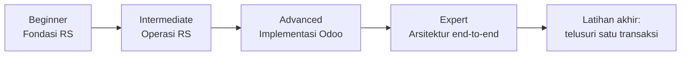

## 1. Beginner — Hospital Fundamentals

**Kesulitan:** ★☆☆☆ · **Prasyarat:** tidak ada · **Estimasi relatif:** 1×

**Tujuan:** memahami kosakata, struktur organisasi, alur pasien, dan perbedaan sistem.

**Urutan baca**
1. [Start Here: 20 Konsep Inti](/docs/getting-started)
2. [Bagaimana RS Beroperasi](/docs/hospital-fundamentals)
3. [Sistem Informasi RS](/docs/hospital-fundamentals/sistem-informasi)
4. [Revenue vs Cost Center](/docs/hospital-fundamentals/revenue-cost-center)
5. [Patient Journey](/docs/patient-journey) → [Rawat Jalan](/docs/patient-journey/rawat-jalan) → [Rawat Inap](/docs/patient-journey/rawat-inap) → [IGD](/docs/patient-journey/igd) → [MCU & Daycare](/docs/patient-journey/mcu-daycare)
6. [Glosarium](/docs/glossary)

**Poin kunci:** Odoo = back office; episode & patient type; payer split; HIS adalah source of truth klinis.

<Accordions>
<Accordion title="Uji: Sebutkan 3 langkah patient journey yang terjadi di Odoo.">
Penerimaan & jurnal koleksi (kasir/deposit/credit note), penagihan penjamin (covering letter) & settlement, serta laporan/fee. Registrasi s.d. billing terjadi di HIS.
</Accordion>
<Accordion title="Uji: Apa beda eligible dan alloted bed type?">
Eligible = hak kelas menurut penjamin; alloted = kelas yang ditempati.
</Accordion>
</Accordions>

## 2. Intermediate — Hospital Operations

**Kesulitan:** ★★☆☆ · **Prasyarat:** Beginner · **Estimasi relatif:** 2×

**Tujuan:** memahami procurement, inventory, billing, tarif, dan proses keuangan sebagai proses bisnis.

**Urutan baca**
1. [Tarif & Pricing — Gambaran](/docs/tariff-pricing)
2. [Billing, Asuransi & Klaim](/docs/billing-insurance) dan [BPJS](/docs/billing-insurance/bpjs-jkn)
3. [Procurement — Request to Pay](/docs/procurement-inventory)
4. [Finance & Accounting](/docs/finance-accounting)
5. [Dokter & Fee](/docs/hr-doctor-fees)
6. [Master Data](/docs/master-data)
7. Case [1](/docs/real-world-scenarios/case-1-rawat-jalan-umum), [2](/docs/real-world-scenarios/case-2-rawat-inap-asuransi), [3](/docs/real-world-scenarios/case-3-igd)

**Poin kunci:** unbilled vs billed AR; deposit = kewajiban; physical vs financial receipt; fee ≠ pendapatan.

<Accordions>
<Accordion title="Uji: Kenapa deposit pasien bukan pendapatan?">
Karena masih milik pasien sampai dipakai untuk tagihan atau dikembalikan.
</Accordion>
<Accordion title="Uji: Mengapa PO stok di Mayapada wajib agreement?">
Agar harga beli dikendalikan kontrak dan tidak diketik bebas; kontrak juga menjadi sumber base price.
</Accordion>
</Accordions>

## 3. Advanced — Mayapada Odoo Implementation

**Kesulitan:** ★★★☆ · **Prasyarat:** Intermediate + Odoo ORM · **Estimasi relatif:** 3×

**Tujuan:** menelusuri model, method, state, dan aturan di kode.

**Urutan baca**
1. [Peta Codebase](/docs/mayapada-codebase) & [Cara Membaca](/docs/getting-started/cara-membaca)
2. Tarif mendalam: [Master Tarif](/docs/tariff-pricing/master-tarif) → [Lifecycle](/docs/tariff-pricing/pricelist-lifecycle) → [Dependency & Markup](/docs/tariff-pricing/dependency-markup) → [Fixed Selling Price](/docs/tariff-pricing/fixed-selling-price) → [Aggregation](/docs/tariff-pricing/base-price-aggregation) → [Contoh](/docs/tariff-pricing/contoh-perhitungan)
3. eProc: [PR](/docs/procurement-inventory/purchase-request) → [RFQ/PO](/docs/procurement-inventory/rfq-po-agreement) → [Receiving](/docs/procurement-inventory/receiving) → [Stok](/docs/procurement-inventory/stock-movement)
4. Keuangan: [Struktur Billing](/docs/billing-insurance/struktur-billing) → [Covering Letter](/docs/billing-insurance/covering-letter-ar) → [Jurnal TC](/docs/finance-accounting/jurnal-trakcare) → [Doctor Fee](/docs/hr-doctor-fees/doctor-fee)
5. Case [4](/docs/real-world-scenarios/case-4-pembelian-obat), [5](/docs/real-world-scenarios/case-5-perubahan-tarif), [6](/docs/real-world-scenarios/case-6-fee-dokter)

**Latihan kode:** buka <Src file="mayapada/eproc/eproc_tc.py" line={20149} symbol="_compute_fixed_price_vals" /> dan tulis ulang rumus Fixed Selling Price dengan kata-kata sendiri; lalu baca <Src file="mayapada/eproc/eproc_tc.py" line={13081} symbol="_complete_receipt" /> dan daftar semua efek sampingnya.

<Accordions>
<Accordion title="Uji: Apa yang memicu versi baru Fixed Selling Price?">
Perubahan hash (harga/tanggal current atau new, atau kunci kombinasi) saat `_upsert_fixed_price`.
</Accordion>
<Accordion title="Uji: Dua kamus patient type — di mana masing-masing dipakai?">
Kode `IP/OP/AAE/MCU/ODC` di `hospital.bed.type` (override eProc) dan model tarif; numerik `1..6,0` di sale, receivable, fee, marketing.
</Accordion>
</Accordions>

## 4. Expert — End-to-End Architecture

**Kesulitan:** ★★★★ · **Prasyarat:** Advanced · **Estimasi relatif:** 4×

**Tujuan:** memahami bagaimana perubahan di satu sistem/departemen menjalar ke yang lain.

**Urutan baca**
1. [Peta Sistem](/docs/getting-started/peta-sistem) → [Integrasi](/docs/integrations) → [Airflow](/docs/integrations/airflow-pipeline) → [Konsolidasi](/docs/integrations/odoo-consolidation) → [Kegagalan & Recovery](/docs/integrations/kegagalan-recovery)
2. [Compliance](/docs/compliance)
3. [Traceability Matrix](/docs/mayapada-codebase/traceability-matrix)
4. [Case 7](/docs/real-world-scenarios/case-7-integrasi-gagal)
5. [Open Questions](/docs/getting-started/open-questions)

**Latihan analisis dampak:** "Kategori item 'BHP' di-rename." Sebutkan semua yang terdampak (markup, akun jurnal stok, laporan, cek 'Medical Equipment' bila terkait, mapping Airflow).

<Accordions>
<Accordion title="Uji: Perubahan stock_item_id sebuah order item berdampak ke mana saja?">
Aggregation base price (sumber harga beli), base price → dependency → Fixed Selling Price → TXT ke TC, dan analisis margin.
</Accordion>
<Accordion title="Uji: Kenapa worker Airflow harus mengulang validasi yang sudah ada di model Odoo?">
Karena worker menulis via SQL langsung; constraint Python & default ORM tidak berjalan.
</Accordion>
</Accordions>

## Latihan akhir

[Telusuri satu transaksi end-to-end →](/docs/learning-roadmap/latihan-akhir)

## Sumber

### Kode

- <Src file="mayapada/eproc/eproc_tc.py" line={13081} symbol="_complete_receipt" /> — method `EprocReceipt`
- <Src file="mayapada/eproc/eproc_tc.py" line={20562} symbol="_upsert_fixed_price" /> — method `TariffPricelistFixed`
- <Src file="mayapada/models/hospital.py" line={30} symbol="hospital.bed.type" /> — model `HospitalBedType`
