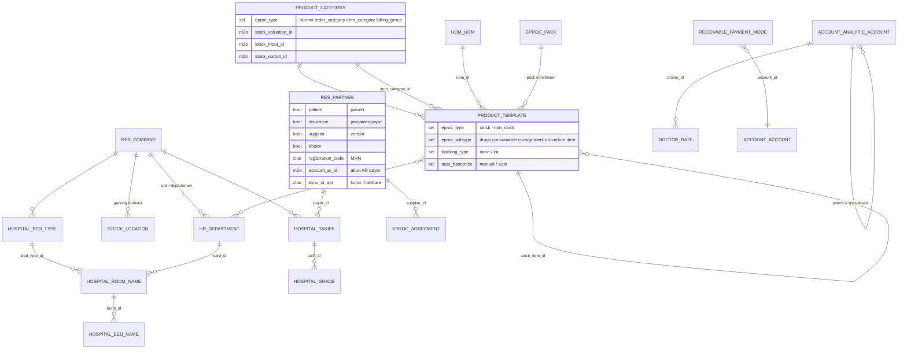

## Kenapa master data kritis di RS?

<Confidence level="general" /> Satu kesalahan master berlipat ganda: kategori produk salah → akun jurnal salah untuk ribuan transaksi; bed type tanpa patient type → harga tidak muncul; dokter ganda → fee terbelah; penjamin ganda → piutang tidak bisa direkonsiliasi. Karena data mengalir HIS → Bridge → Odoo, **kunci eksternal** lebih penting dari ID database.

## ER diagram (inti)

*Sumber:* `models/hospital.py`, `models/partner.py`, `eproc/eproc_tc.py` (ext. `product.template` 1812, `product.category` 2141, `res.partner` 2158, `eproc.pack` 906). <Confidence level="verified" />

## Tabel master

| Master | Model Odoo | Sumber kebenaran | Catatan |
| --- | --- | --- | --- |
| Unit RS | `res.company` (149 field tambahan) | Konfigurasi | `sync_type`, `sync_id_api` (= TrakCare `CT_Hospital.HOSP_RowId`), URL/token TC, akun AR Unbilled, `company_code` |
| Departemen | `hr.department` | TrakCare `mst_department` | Juga unit peminta PR |
| Lokasi / gudang | `stock.location`, `stock.warehouse` | TrakCare `mst_location` | Lokasi penerimaan eProc |
| Pasien | `res.partner` `patient=True` | TrakCare `mst_patient` | MRN di `registration_code` |
| Penjamin | `res.partner` `insurance=True` | TrakCare `mst_payor`, `mst_tpa` | Dipisah dari pasien lewat flag (sync_type tercemar) |
| Vendor | `res.partner` (`supplier`), `payable.supplier` | ERP Parent → Unit | AP group & COA |
| Dokter | `account.analytic.account` (`sync_wipro_type`) + `doctor.rate` | TrakCare `mst_doctor`, `mst_doctor_speciality`, `mst_referral` | Internal vs eksternal |
| Produk: stock item | `product.template` `eproc_type=stock` | TrakCare `mst_stock_item` | Dibeli & disimpan |
| Produk: order item | `product.template` `non_stock` | TrakCare `mst_order_item` | Dijual/ditagih; `stock_item_id` ke stock item |
| Kategori | `product.category` | `mst_order_category`, `mst_stock_category`, `mst_billing_group` | `eproc_type` membedakan |
| UoM & pack | `uom.uom`, `eproc.pack` | `mst_uom` | Konversi kemasan beli vs pakai |
| Tarif | `hospital.tariff` | `mst_tariff` | ID negatif = Base Price |
| Bed/room type | `hospital.bed.type`, `hospital.room.name`, `hospital.bed.name` | `mst_room_type`, `mst_room` | `patient_type` tidak ada di sumber TC |
| Cara bayar & bank | `receivable.payment.mode`, `receivable.bank.name` | `mst_payment_mode`, `mst_bank` | Payment mode → akun kas/bank |
| Termin pembayaran | `account.payment.term`, `eproc.term` | Odoo | |

<Confidence level="verified">model</Confidence> <Confidence level="verified">tabel Bridge dari README Airflow</Confidence>

## Keputusan identitas (dari project memory)

- Identitas Bridge → Unit adalah **`sync_id_api`** (kunci TrakCare), bukan `str(id)` tabel Bridge. Relasi diterjemahkan ke FK lokal dengan mencari kunci tersebut.
- Payor dan Patient sama-sama `res.partner`; dibedakan oleh flag `insurance`/`patient` di kunci match, karena `res_partner.sync_type` di unit live sudah tercemar.
- Kode patient type TrakCare numerik → kode Odoo: `1=OP, 2=IP, 3=AAE, 4=ODC, 5=MCU`; `6` ditolak.
- Bed type baru dari sync diberi `patient_type` default `IP` karena sumber tidak punya kolom itu — **perlu review bisnis** (31 baris dibuat 16 Sep 2026).
- Tariff ganda di MHKN karena kunci match memakai `sync_type` koneksi; tidak ada unique index `(sync_type, sync_id_api)`.

<Confidence level="inferred">memory</Confidence>

## Error bisnis akibat mapping salah

| Mapping salah | Akibat |
| --- | --- |
| `stock_item_id` kosong/salah | Base price tidak naik saat harga beli naik → jual rugi |
| Item category tanpa akun valuasi/output | Jurnal stok gagal / masuk akun salah |
| Bed type `patient_type` salah | Harga tidak tampil di wizard / dikirim dengan EpisodeType salah |
| Payment mode tanpa akun | Jurnal kasir gagal |
| Dokter ganda | Fee & profitabilitas dokter terbelah |
| Produk tidak dipetakan ke departemen | PR ditolak |
| Penjamin tanpa `account_ar_id` | Covering letter menjurnal ke akun kosong |

## Pertanyaan uji

<Accordions>
<Accordion title="Kenapa tidak boleh menyalin ID database antar Odoo?">
Setiap database unit punya sequence ID sendiri; ID 100 di Parent bukan record yang sama di Unit. Kunci yang stabil adalah `sync_id_api`.
</Accordion>
<Accordion title="Apa beda order item dan stock item?">
Order item adalah apa yang dipesan/ditagih (mis. "Paracetamol 500mg tablet"); stock item adalah barang fisik di gudang (mis. "Paracetamol 500mg box isi 100"). Satu stock item bisa dipakai banyak order item.
</Accordion>
</Accordions>
