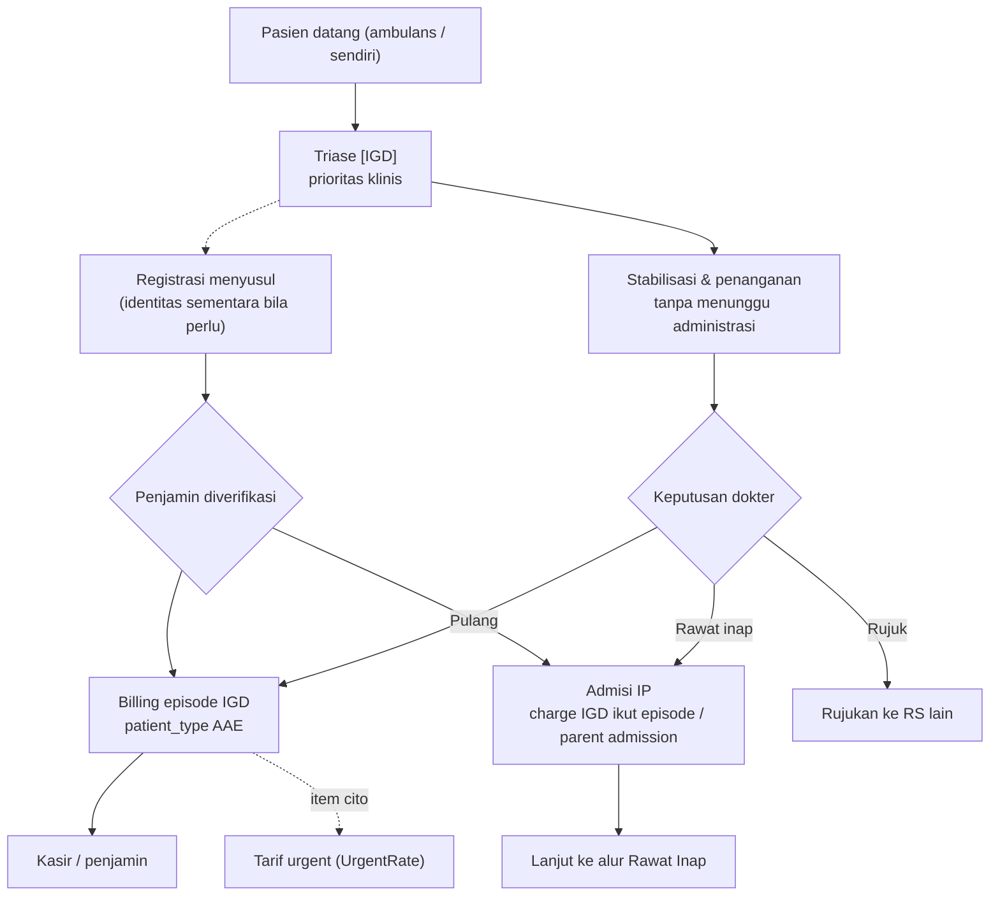

## 1. Apa itu?

IGD (*Emergency*, `AAE` / `3`) melayani kondisi gawat darurat 24 jam, tanpa janji temu. Pasien dapat pulang, dirawat inap, atau dirujuk.

## 2. Kenapa berbeda?

<Confidence level="general" />

- **Keselamatan pasien di atas administrasi.** Regulasi melarang fasyankes menolak pasien gawat darurat atau meminta uang muka terlebih dahulu (UU Kesehatan; prinsip yang sama sudah ada di UU RS 44/2009, yang kini dicabut UU 17/2023). Verifikasi penjamin dilakukan **setelah** stabilisasi.
- Identitas bisa belum lengkap (pasien tidak sadar) → registrasi sementara.
- Biaya IGD sering menjadi bagian episode rawat inap jika pasien di-admit.

## 3. Siapa yang terlibat?

Petugas triase, dokter jaga IGD, perawat IGD, admisi, penunjang cito, DPJP jika di-admit, kasir/admisi untuk penjamin.

## 6. Diagram

*Langkah klinis:* <Confidence level="general" />. *Link episode:* `sale.order.parent_admission_no`, `ref_admission_no` (<Src file="mayapada/models/sale.py" />). <Confidence level="inferred">penggunaan untuk konversi IGD→IP</Confidence>

## 7. Implementasi di Odoo Mayapada

| Aspek | Bukti di kode |
| --- | --- |
| Patient type Emergency | `sale.order.patient_type='3'`; bed type `AAE`; EpisodeType `E` di ekspor harga |
| Fee dokter IGD | Flag `is_igd`, `is_igd_total`, `igd_share/point` di `doctor.rate` / `doctor.fee` (skema bagi hasil pool dokter IGD) |
| Fee referral IGD | `referral.compute.wizard.type = 'igd'` ("Fee Per Billing IGD") |
| Tarif cito | Kolom `UrgentRate` (default 20%) di ekspor Fixed Selling Price |

<Confidence level="verified" />

## 10. Common problems

- Identitas sementara tidak di-*merge* dengan MRN asli → piutang pasien terpecah.
- Penjamin baru diketahui setelah pasien pulang → tagihan berpindah dari personal ke payer (koreksi billing di HIS, histori di `sale.order.bill.history`).

## 12. Pertanyaan uji

<Accordions>
<Accordion title="Bolehkah kasir meminta deposit sebelum pasien IGD ditangani?">
Tidak untuk kondisi gawat darurat — prinsip regulasi kesehatan Indonesia mewajibkan penanganan dahulu. Kebijakan internal Mayapada perlu dikonfirmasi. <Confidence level="confirm" />
</Accordion>
<Accordion title="Mengapa dokter IGD punya skema fee berbeda?">
Kode memiliki skema pool/poin khusus IGD (`igd_total_share`, `igd_point`, `igd_share`), umumnya karena dokter jaga dibayar berdasarkan pool layanan shift, bukan per pasien. <Confidence level="inferred" />
</Accordion>
</Accordions>

## Referensi

- UU 17/2023 tentang Kesehatan — ringkasan di [Hukumonline](https://www.hukumonline.com/berita/a/peraturan-teknis-uu-kesehatan-terbit--ini-sejumlah-aturan-pelaksana-yang-dicabut-lt66a89ff97dafd/?page=all) dan teks di [Wikisource](https://id.wikisource.org/wiki/Undang-Undang_Republik_Indonesia_Nomor_17_Tahun_2023). Pasal spesifik larangan uang muka gawat darurat perlu dicek pada teks resmi. <Confidence level="general" />
- [Permenkes 6/2026 tentang Rumah Sakit](https://peraturan.bpk.go.id/Details/350851/permenkes-no-6-tahun-2026) (berlaku 12 Jun 2026; mencabut Permenkes 85/2015 dan 4/2018), Pasal 36 ayat (1): kewajiban RS antara lain memberi informasi yang benar tentang pelayanan (huruf a), melaksanakan fungsi sosial termasuk **pelayanan gawat darurat tanpa uang muka** (huruf f), dan memberi informasi yang benar, jelas, jujur mengenai hak & kewajiban pasien (huruf l). *Mendukung:* pelayanan gawat darurat tanpa uang muka (sebelumnya Permenkes 4/2018 Pasal 10 huruf b, kini dicabut) (diakses 11 Okt 2026; teks pasal sudah dicek). <Confidence level="general" />

**Kode:**

- <Src file="mayapada/models/doctor_fee.py" line={113} symbol="doctor.rate" /> — model `DoctorRate`
- <Src file="mayapada/models/doctor_fee.py" line={4498} symbol="doctor.fee" /> — model `DoctorFee`
- <Src file="mayapada/models/sale.py" line={10404} symbol="sale.order.bill.history" /> — model `SaleOrderBillHistory`
