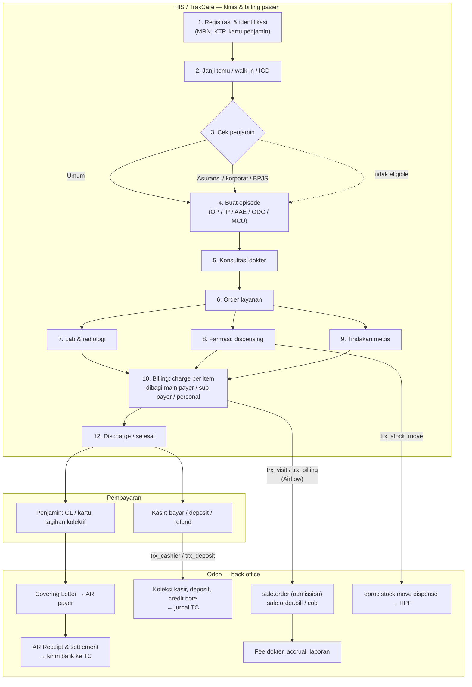

## Gambaran besar

Semua jenis kunjungan (rawat jalan, rawat inap, IGD, MCU, daycare) mengikuti 13 langkah yang sama, dengan intensitas berbeda. Kuncinya: **setiap langkah klinis menghasilkan charge**, dan setiap charge harus berakhir sebagai **pendapatan + piutang atau kas** di akuntansi.

*Legenda:* kotak HIS = di luar Odoo; panah berlabel `trx_*` = tabel Bridge yang disinkron Airflow. *Sumber:* `airflow:README.md` (interface 23–35), model `sale.order`, `receivable.*`, `account.coveringletter`. <Confidence level="verified">jalur data</Confidence> <Confidence level="general">langkah klinis</Confidence>

## 13 langkah: siapa, sistem, dan jejak di Odoo

| # | Langkah | Aktor RS | Sistem | Jejak di Odoo |
| --- | --- | --- | --- | --- |
| 1 | Registrasi & identifikasi | Admisi/pendaftaran | HIS | `res.partner` (`patient=True`, `registration_code`) via sync `mst_patient` |
| 2 | Janji temu / walk-in | Call center, pendaftaran | HIS / aplikasi | `referral.transaction.appointment_date` (hanya pasien rujukan agen) |
| 3 | Cek eligibilitas penjamin | Admisi, petugas asuransi/BPJS | HIS, portal asuransi, VClaim | `payer_id`, `tariff_id`, `is_bpjs` di billing — hasil, bukan proses <Confidence level="notfound">proses eligibility</Confidence> |
| 4 | Buat episode | Admisi | HIS | `sale.order` (Admit Date, patient_type, bed types, payer) |
| 5 | Konsultasi | Dokter, perawat | HIS/RME | `sale.order.line` (is_consultation, dokter primary/perform) |
| 6 | Order layanan | Dokter | HIS | `order_no`, `order_item_no` di `sale.order.line` |
| 7 | Lab & radiologi | Analis, radiografer | LIS/RIS | Item tagihan saja |
| 8 | Dispensing | Apoteker | HIS farmasi | `sale.order.line` (batch, expiry) + `eproc.stock.move` DIS_* |
| 9 | Tindakan | Dokter operator, anestesi | HIS | `surgery_operator_id`, `anesthetist_operator_id` (untuk fee) |
| 10 | Billing | Billing officer | HIS | `sale.order.bill`: gross/nett per payer |
| 11 | Pembayaran / jaminan / klaim | Kasir, AR, petugas klaim | HIS + Odoo | `receivable.scroll.receipt.cashier`, `receivable.patient.deposit`, `account.coveringletter` |
| 12 | Discharge | Dokter, perawat, admisi | HIS | `discharge_date`, `discharge_reason` |
| 13 | Settlement & laporan | Finance | **Odoo** | Jurnal TC, AR settlement, `profitability.*`, fee dokter |

## Detail per jenis kunjungan

<Cards>
  <Card title="Rawat Jalan (OPD)" href="/docs/patient-journey/rawat-jalan" />
  <Card title="Rawat Inap (IPD)" href="/docs/patient-journey/rawat-inap" />
  <Card title="IGD" href="/docs/patient-journey/igd" />
  <Card title="MCU & Daycare" href="/docs/patient-journey/mcu-daycare" />
</Cards>

## Yang perlu developer pahami

- `sale.order` di Mayapada **bukan** sales order biasa: state-nya `draft`=*New Admission*, `sent`=*Confirmed*, `sale`=*Accrual*, `done`=*Paid*, `invoice`=*Invoiced* (<Src file="mayapada/models/sale.py" line={129} symbol="state" />).
- Satu admission dapat memiliki beberapa billing (`billing_ids`), dan satu billing bisa *merged* atau dipecah ke **COB** (`sale.order.cob`).
- Diagnosis tersimpan sebagai kode & nama (primer, sekunder, repeat) — cukup untuk analisis keuangan, bukan rekam medis.

## Sumber

### Kode

- <Src file="mayapada/eproc/eproc_tc.py" line={10985} symbol="eproc.stock.move" /> — model `EprocStockMove`
- <Src file="mayapada/models/partner.py" line={19} symbol="res.partner" /> — extend `ResPartner`
- <Src file="mayapada/models/receivable.py" line={70} symbol="account.coveringletter" /> — model `CoveringLetter`
- <Src file="mayapada/models/receivable.py" line={9021} symbol="receivable.scroll.receipt.cashier" /> — model `ReceivableScrollReceiptCashier`
- <Src file="mayapada/models/receivable.py" line={9287} symbol="receivable.patient.deposit" /> — model `ReceivablePatientDeposit`
- <Src file="mayapada/models/sale.py" line={43} symbol="sale.order" /> — extend `SaleOrder`
- <Src file="mayapada/models/sale.py" line={1885} symbol="sale.order.line" /> — extend `SaleOrderLine`
- <Src file="mayapada/models/sale.py" line={9652} symbol="sale.order.bill" /> — model `SaleOrderBill`
- <Src file="mayapada/models/sale.py" line={10447} symbol="sale.order.cob" /> — model `SaleOrderCob`

### Eksternal

- Perpres 82/2018 tentang Jaminan Kesehatan (diubah Perpres 75/2019) — [peraturan.bpk.go.id (PDF)](https://peraturan.bpk.go.id/Download/254897/Perpres%20Nomor%2082%20Tahun%202018.pdf); ringkasan [Hukumonline](https://www.hukumonline.com/berita/a/inilah-12-ketentuan-dalam-perpres-jaminan-kesehatan-yang-perlu-dicermati-lt5bab443c5f973/). *Mendukung:* alur klaim BPJS (diakses 11 Okt 2026).
- Koordinasi antar penyelenggara jaminan (COB) & selisih biaya, KMK HK.01.07/MENKES/1366/2024 — [BKPK Kemenkes](https://www.badankebijakan.kemkes.go.id/penataan-kebijakan-selisih-biaya-melalui-koordinasi-antar-penyelenggara-jaminan-dalam-program-jkn-resmi-diluncurkan/); penjelasan naik kelas via asuransi tambahan: [Kontan](https://keuangan.kontan.co.id/news/peserta-jkn-bisa-naik-kelas-rawat-pakai-skema-cob-begini-mekanismenya-1). *Mendukung:* koordinasi penjamin (diakses 11 Okt 2026).
