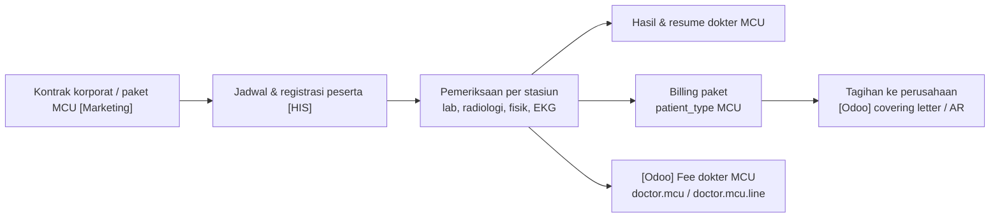

## MCU

### Apa & kenapa

<Confidence level="general" /> MCU adalah paket pemeriksaan kesehatan (fisik, lab, radiologi, EKG, dll.) — sering dibeli **perusahaan** untuk karyawannya (pre-employment, annual check-up). Bisnisnya berbasis **paket & kontrak korporat**: harga paket, daftar pemeriksaan, dan laporan hasil massal.

### Alur

### Implementasi

| Aspek | Bukti |
| --- | --- |
| Patient type | `MCU` di bed type tarif; `5` (MCU/Pharmacy Issues Only (FO)) di model billing |
| Paket | `sale.order.line.package_id`, `package_name`, `package_contribution`, `package_doctor_share`, `is_package` |
| Fee dokter MCU | `doctor.mcu` (49 field) & `doctor.mcu.line` (123 field), grup *Finance & Accounting – Staff MCU*, `doctor.fee.others.detail.fee_type = MCU` |
| Unit khusus | `is_akasia` ("Akasia 365 MC"), `sale.order.akasia.wizard`; `is_mec` (Mayapada Eye Centre) |

<Confidence level="verified">field & model</Confidence> <Confidence level="inferred">makna bisnis Akasia 365 MC</Confidence>

<Callout type="warn">
Kode `5` di model billing berlabel "MCU/Pharmacy Issues Only (FO)" sementara README Airflow memetakan `5 = MCU` dan `6 = Pharmacy/Cash Issue`. Perbedaan label ini perlu dikonfirmasi saat membuat laporan per patient type. <Confidence level="confirm" />
</Callout>

## Daycare / One Day Care (ODC)

### Apa & kenapa

<Confidence level="general" /> Pasien dirawat kurang dari 24 jam untuk tindakan terencana (kemoterapi, endoskopi, bedah minor, hemodialisis di beberapa RS). Lebih murah dari rawat inap, tetapi butuh fasilitas tempat tidur dan observasi.

### Implementasi

| Aspek | Bukti |
| --- | --- |
| Patient type | `ODC` (tarif), `4` (billing) |
| Flag item | `sale.order.line.is_daycare`, `is_hd` (hemodialisis), `is_cathlab` |
| Fee HD | `doctor.rate.is_hd`, `doctor.fee.hd_share/point` |
| Ekspor harga | EpisodeType **kosong** untuk ODC/MCU (lihat [Publikasi](/docs/tariff-pricing/publikasi-trakcare)) |

<Confidence level="verified" />

## Pertanyaan uji

<Accordions>
<Accordion title="Kenapa MCU erat kaitannya dengan piutang korporat?">
Karena pembayarnya perusahaan dengan termin, sehingga tagihan masuk alur covering letter → AR payer, bukan kasir.
</Accordion>
<Accordion title="Apa risiko jika EpisodeType kosong di TXT harga untuk ODC?">
TrakCare mungkin menolak atau memperlakukan harga sebagai berlaku untuk semua episode. Perlu dikonfirmasi dengan tim TC. <Confidence level="confirm" />
</Accordion>
</Accordions>

## Sumber

### Kode

- <Src file="mayapada/models/doctor_fee.py" line={3056} symbol="doctor.mcu" /> — model `DoctorMCU`
- <Src file="mayapada/models/doctor_fee.py" line={3543} symbol="doctor.mcu.line" /> — model `DoctorMCULine`
- <Src file="mayapada/models/sale.py" line={13893} symbol="sale.order.akasia.wizard" /> — model `SaleOrderAkasiaWizard`

### Eksternal

- Permenakertrans Per.02/MEN/1980 tentang Pemeriksaan Kesehatan Tenaga Kerja (sebelum bekerja, berkala min. 1×/tahun, khusus) — ringkasan [Hukumonline](https://www.hukumonline.com/klinik/a/pemeriksaan-berkala-kesehatan-pekerja--tanggung-jawab-siapa-lt646c3236b6888). Status berlaku belum dicek.. *Mendukung:* dasar kebutuhan MCU korporat (pre-employment & berkala) (diakses 11 Okt 2026).
- Definisi *One Day Care* (menempati tempat tidur < 24 jam) — contoh Pergub Jatim 39/2018 di [pasal.id](https://pasal.id/peraturan/pergub/pergub-prov-jawa-timur-no-39-tahun-2018). Definisi INA-CBG/BPJS belum ditemukan.. *Mendukung:* definisi daycare/rawat sehari (diakses 11 Okt 2026).
