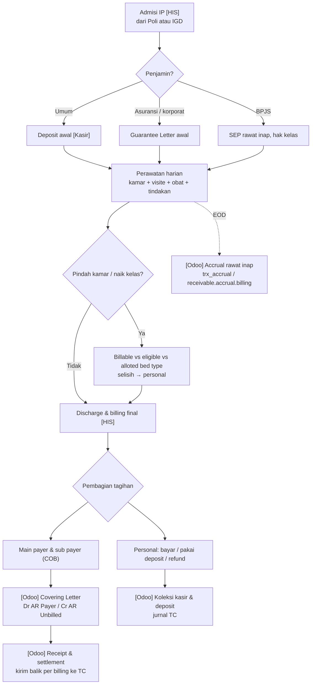

## 1. Apa itu?

Rawat inap (*inpatient*, `IP` / `2`) adalah episode di mana pasien menginap ≥ 1 malam. Charge menumpuk setiap hari: kamar, visite, keperawatan, obat, tindakan, penunjang.

## 2. Kenapa kompleks?

<Confidence level="general" />

- **Episode panjang** → tagihan baru final saat discharge, padahal pendapatan sudah terjadi tiap hari (perlu **accrual**).
- **Kelas kamar** menentukan tarif banyak item; pasien bisa dirawat di kelas berbeda dari haknya (naik kelas / titip kelas).
- **Penjamin** biasanya menanggung sebagian (limit, plafon, kelas hak) → pemisahan *payer* vs *personal*.
- **Deposit** diminta di awal untuk pasien umum / selisih biaya.

## 3. Siapa yang terlibat?

Admisi, dokter penanggung jawab (DPJP), perawat ruangan, farmasi rawat inap, penunjang, case manager / petugas asuransi, billing, kasir, Finance (AR, accrual).

## 4. Proses di lapangan

<Steps>
<Step>Admisi dari poli/IGD: surat perintah rawat, pilih kamar sesuai hak & ketersediaan.</Step>
<Step>Penjamin: GL (*guarantee letter*) asuransi/korporat, SEP rawat inap untuk BPJS; pasien umum membayar **deposit**.</Step>
<Step>Perawatan harian: visite, obat, tindakan, penunjang → charge ke episode setiap hari.</Step>
<Step>Pemindahan kamar/kelas bila perlu (bed transfer).</Step>
<Step>Discharge: dokter menyatakan pulang, billing final, konfirmasi penjamin (final GL), pasien membayar selisih atau menerima refund deposit.</Step>
<Step>Back office: tagihan payer dikumpulkan dalam **covering letter**, dikirim, lalu ditagih sampai lunas.</Step>
</Steps>

## 6. Diagram

*Sumber:* field `sale.order` (`bed_type_id`, `eligible_bed_type_id`, `alloted_bed_type_id`), `receivable.accrual.billing`, `account.coveringletter.action_confirm` (<Src file="mayapada/models/receivable.py" line={621} symbol="action_confirm" />), README Airflow interface 35 (*IP Payable Accrual Cutoff*). <Confidence level="verified" /> Aturan selisih kelas: <Confidence level="confirm" />

## 7. Implementasi di Odoo Mayapada

| Konsep | Model / field |
| --- | --- |
| Tiga bed type | `sale.order.bed_type_id` (Billable), `eligible_bed_type_id` (hak), `alloted_bed_type_id` (ditempati) |
| Deposit pasien | `inpatient.deposit` (legacy) dan `receivable.patient.deposit` (koleksi TC, <Src file="mayapada/models/receivable.py" line={9286} symbol="ReceivablePatientDeposit" />) |
| Accrual | <Src file="mayapada/models/receivable.py" line={11232} symbol="receivable.accrual.billing" />, `sale.order.line.accrual` (eproc report view) |
| Billing per payer | `sale.order.bill`: `payer_gross/amount/credit/receipt/balance`, `subpayer_*`, `personal_*` |
| COB | `sale.order.cob` (state sama dengan bill), `cob_bill`, `cob_billno`, `cob_sequence` |
| Riwayat outstanding | `sale.order.bill.history` (dibuat oleh <Src file="mayapada/models/sale.py" line={9932} symbol="SaleOrderBill.action_history" />) |

## 9. Business rules

- Billing yang sudah `invoice` tidak boleh dimasukkan lagi ke covering letter lain (`action_confirm` covering letter). <Confidence level="verified" />
- Periode yang sudah dikunci (`lock.ar.configuration.date`) tidak bisa menerima covering letter baru. <Confidence level="verified" />

## 10. Common problems

- Pasien belum pulang di akhir bulan → pendapatan harus diakru; jika accrual tidak tersinkron, laba bulan itu kurang saji.
- Penjamin menolak sebagian item (*non-covered*) setelah discharge → tagihan dipindah ke personal / credit note.
- Pindah kelas tanpa update bed type → harga salah untuk sisa episode.

## 12. Pertanyaan uji

<Accordions>
<Accordion title="Apa beda eligible dan alloted bed type?">
Eligible = kelas yang menjadi hak pasien menurut penjamin; alloted = kelas yang benar-benar ditempati; billable = kelas yang dipakai untuk menghitung tagihan. <Confidence level="inferred">dari label field</Confidence>
</Accordion>
<Accordion title="Kenapa rawat inap membutuhkan accrual?">
Karena layanan sudah diberikan (pendapatan terjadi) sebelum tagihan final diterbitkan saat discharge, terutama untuk pasien yang masih dirawat saat tutup buku.
</Accordion>
</Accordions>

## Sumber

### Kode

- <Src file="mayapada/eproc/eproc_tc_report_views.py" line={29} symbol="sale.order.line.accrual" /> — model `SaleOrderLineAccrual`
- <Src file="mayapada/models/receivable.py" line={621} symbol="action_confirm" /> — method `CoveringLetter`
- <Src file="mayapada/models/receivable.py" line={8224} symbol="inpatient.deposit" /> — model `InpatientDeposit`
- <Src file="mayapada/models/receivable.py" line={9287} symbol="receivable.patient.deposit" /> — model `ReceivablePatientDeposit`
- <Src file="mayapada/models/receivable.py" line={11232} symbol="receivable.accrual.billing" /> — model `ReceivableAccrualBilling`
- <Src file="mayapada/models/sale.py" line={43} symbol="sale.order" /> — extend `SaleOrder`
- <Src file="mayapada/models/sale.py" line={9652} symbol="sale.order.bill" /> — model `SaleOrderBill`
- <Src file="mayapada/models/sale.py" line={10404} symbol="sale.order.bill.history" /> — model `SaleOrderBillHistory`
- <Src file="mayapada/models/sale.py" line={10447} symbol="sale.order.cob" /> — model `SaleOrderCob`
