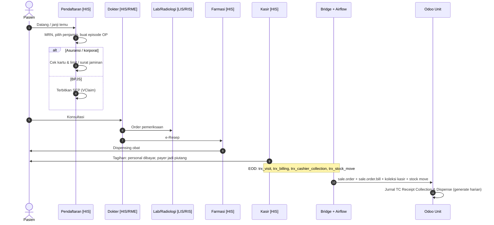

## 1. Apa itu?

Rawat jalan (*outpatient*, `patient_type` OP / `1`) adalah kunjungan tanpa menginap: konsultasi poliklinik, kontrol, pemeriksaan penunjang, pengambilan obat.

## 2. Kenapa penting secara bisnis?

<Confidence level="general" /> Volume tertinggi, nilai per transaksi relatif kecil, sebagian besar **dibayar di tempat** (pasien umum) atau ditagihkan kolektif (asuransi/korporat). Kesalahan kecil per transaksi menjadi besar karena volume.

## 3. Siapa yang terlibat?

Pendaftaran/admisi, perawat poli, dokter, farmasi rawat jalan, kasir, (petugas asuransi untuk pasien jaminan), Finance di back office.

## 4. Proses di lapangan

<Steps>
<Step>Pasien membuat janji (aplikasi/call center) atau datang langsung; pendaftaran mencari/membuat MRN.</Step>
<Step>Admisi memilih penjamin: umum, asuransi (cek kartu/eligibility), korporat (cek surat jaminan), BPJS (SEP — hanya jika RS bekerja sama).</Step>
<Step>Perawat triase ringan (tanda vital); dokter konsultasi, menulis diagnosis, order lab/radiologi, resep.</Step>
<Step>Pasien ke lab/radiologi bila perlu, lalu ke farmasi.</Step>
<Step>Kasir menutup tagihan: bagian pribadi dibayar; bagian penjamin menjadi piutang.</Step>
</Steps>

## 5. Contoh skenario

Ibu Sari (fiktif), pasien umum, kontrol hipertensi: konsultasi spesialis penyakit dalam Rp300.000, cek lab profil lipid Rp450.000, obat 30 hari Rp380.000. Total Rp1.130.000 dibayar debit di kasir. Lihat [Case 1](/docs/real-world-scenarios/case-1-rawat-jalan-umum).

## 6. Diagram

*Sumber langkah HIS:* praktik umum <Confidence level="general" />. *Sumber jalur Bridge→Odoo:* `airflow:README.md` interface 23, 24, 32, 33. <Confidence level="verified" />

## 7. Implementasi di Odoo Mayapada

| Data | Model | Field kunci |
| --- | --- | --- |
| Kunjungan | `sale.order` | `patient_type='1'`, `date_order` (Admit Date), `primary_doc_id`, `payer_id`, `tariff_id` |
| Tagihan | `sale.order.bill` | `billno`, `personal_amount`, `payer_amount`, `penjualanresep` (OTC Bill) |
| Item | `sale.order.line` | `product_id`, `service_categ_id`, `perform_doc_id`, `prescribe_doc_id`, `batch_id` |
| Penerimaan kasir | `receivable.scroll.receipt.cashier` (model TC) | `payment_type`, `amount`, `cutoff_date` |
| Konsumsi obat | `eproc.stock.move` | `move_type` DIS_PACKING / DIS_RETURN, `patient_code` |

## 9. Business rules

- Item farmasi rawat jalan dapat ditagihkan sebagai **OTC/Pharmacy Direct** (`patient_type='6'`, `penjualanresep`). Patient type `6` tidak punya padanan bed type tarif. <Confidence level="verified" />
- Marketing fee membedakan OPD **dengan** dan **tanpa** item farmasi (`marketing.rate.pic.patient_type` `1` vs `5`). <Confidence level="verified" />

## 10. Common problems

- Kunjungan ulang di hari yang sama tercatat sebagai satu atau dua episode tergantung HIS → memengaruhi hitungan *throughput* (`pmo.throughput.*`).
- Obat retur setelah bayar → perlu refund/credit note di HIS dan stock move `DIS_RETURN`.

## 12. Pertanyaan uji

<Accordions>
<Accordion title="Di sistem mana resep dokter dicatat?">
Di HIS/RME. Odoo hanya menerima item yang ditagihkan (`sale.order.line`) dan pergerakan stoknya (`eproc.stock.move`).
</Accordion>
<Accordion title="Kapan pendapatan rawat jalan masuk ke Odoo?">
Setelah sinkronisasi harian (EOD) data billing dari Bridge; jurnal kas dibuat lewat wizard jurnal TC per tanggal proses.
</Accordion>
</Accordions>
