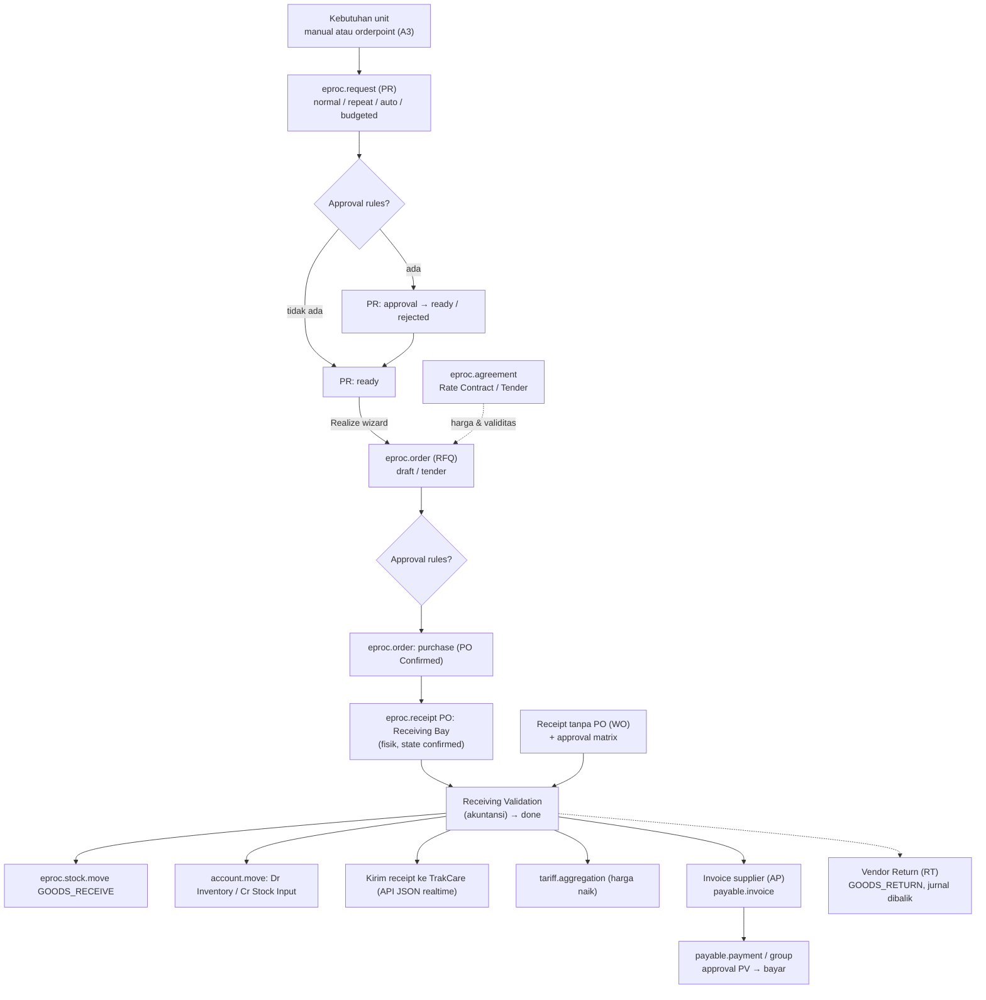

## 1. Apa itu?

**Procure-to-pay** adalah rantai: kebutuhan unit → permintaan pembelian (PR) → pemilihan vendor & harga (RFQ/agreement) → pesanan (PO) → penerimaan barang → validasi → tagihan supplier → pembayaran. Di Mayapada, rantai ini diimplementasikan oleh modul **eProc** (<Src file="mayapada/eproc/eproc_tc.py" />), terpisah dari `purchase.order` standar Odoo yang masih ada di <Src file="mayapada/models/purchase.py" /> (generasi lama). <Confidence level="verified" />

## 2. Kenapa RS membutuhkannya?

<Confidence level="general" />

- **Ketersediaan obat & BHP = keselamatan pasien.** Stok habis bisa menunda tindakan.
- **Nilai besar & risiko kedaluwarsa.** Obat dan reagen punya expiry; alkes mahal butuh budget capex.
- **Pengendalian biaya.** Harga beli memengaruhi base price & margin (lihat [Base Price Aggregation](/docs/tariff-pricing/base-price-aggregation)).
- **Kepatuhan & audit.** Pemisahan peminta, penyetuju, pembeli, penerima, dan pembayar (*separation of duties*).

## 3. Siapa yang terlibat?

| Peran | Grup Odoo (security.xml) | Aktivitas |
| --- | --- | --- |
| Unit peminta (farmasi, perawat ruangan, lab) | *PR Creation* | Membuat PR |
| Atasan / pemilik budget | *PR Approval*, *PR/PO Approval* | Menyetujui PR/PO |
| Purchasing unit / korporat | *Procurement – Staff/Ka.Unit/Ka.Dept Purchasing*, *Procurement – Corporate* | RFQ, agreement, PO |
| Gudang / farmasi | *Ka.Unit Inventory*, *Pharmacy – Ka.Unit Inventory*, *Ka.Unit General Storage* | Receiving Bay, return |
| Accounting | *Ka.Unit Accounting* | Receiving Validation |
| AP | *Ka.Unit Finance Account Payable*, *PV Approval* | Invoice & pembayaran supplier |

<Confidence level="verified">nama grup</Confidence> <Confidence level="inferred">pemetaan grup ke aktivitas</Confidence>

## 6. Diagram request-to-pay

*Sumber:* <Src file="mayapada/eproc/eproc_tc.py" /> — <Src file="mayapada/eproc/eproc_tc.py" line={6236} symbol="EprocRequest" />, <Src file="mayapada/eproc/eproc_tc.py" line={4252} symbol="EprocOrder" />, <Src file="mayapada/eproc/eproc_tc.py" line={2749} symbol="EprocAgreement" />, <Src file="mayapada/eproc/eproc_tc.py" line={11416} symbol="EprocReceipt" />, <Src file="mayapada/eproc/eproc_tc.py" line={13081} symbol="_complete_receipt" />; <Src file="mayapada/models/payable.py" />. <Confidence level="verified" /> Hubungan receipt → `payable.invoice`: <Confidence level="inferred">ada field `ap_invoice_signed_total_*` & `action_open_ap_invoice`</Confidence>

## Halaman

<Cards>
  <Card title="Purchase Request & Approval" href="/docs/procurement-inventory/purchase-request" />
  <Card title="RFQ, PO & Vendor Agreement" href="/docs/procurement-inventory/rfq-po-agreement" />
  <Card title="Receiving: Fisik vs Finansial, Return" href="/docs/procurement-inventory/receiving" />
  <Card title="Stock Movement, Valuasi, Orderpoint" href="/docs/procurement-inventory/stock-movement" />
</Cards>

<Callout type="info" title="Tentang istilah VRT, PRT, reservation di brief">
- **RT** = *Vendor Return* (`receipt_type='RT'`). Kode juga mengecek `'PRT'` di beberapa tempat (9 kali), tetapi `PRT` **tidak** ada di pilihan `receipt_type` — kemungkinan sisa kompatibilitas. **VRT** tidak ditemukan. <Confidence level="verified" />
- **Reservation** di eProc berarti **reservasi budget** (PR yang disetujui "memesan" sisa budget item), bukan reservasi stok seperti `stock.move` Odoo standar. <Confidence level="verified"><Src file="mayapada/eproc/eproc_tc.py" line={2397} symbol="reserve" />, <Src file="mayapada/eproc/eproc_tc.py" line={8636} symbol="reserved" /></Confidence>
</Callout>

## Sumber

### Kode

- <Src file="mayapada/eproc/eproc_tc.py" line={2749} symbol="EprocAgreement" /> — class `EprocAgreement`
- <Src file="mayapada/eproc/eproc_tc.py" line={4252} symbol="EprocOrder" /> — class `EprocOrder`
- <Src file="mayapada/eproc/eproc_tc.py" line={6236} symbol="EprocRequest" /> — class `EprocRequest`
- <Src file="mayapada/eproc/eproc_tc.py" line={11416} symbol="EprocReceipt" /> — class `EprocReceipt`
- <Src file="mayapada/eproc/eproc_tc.py" line={13081} symbol="_complete_receipt" /> — method `EprocReceipt`
- <Src file="mayapada/eproc/eproc_tc.py" line={14179} symbol="action_open_ap_invoice" /> — method `EprocReceipt`
- <Src file="mayapada/models/payable.py" line={188} symbol="payable.invoice" /> — model `PayableInvoice`
- <Src file="mayapada/models/purchase.py" line={31} symbol="purchase.order" /> — extend `PurchaseOrder`
- <Src file="mayapada/models/stock.py" line={3973} symbol="stock.move" /> — extend `StockMove`

### Eksternal

- Permenkes 72/2016 tentang Standar Pelayanan Kefarmasian di Rumah Sakit, Lampiran Bab II — [JDIH Kemenkes (PDF)](https://jdih.kemkes.go.id/storage/documents/pdfs/2016permenkes072.pdf). *Mendukung:* RS wajib punya mekanisme mencegah kekosongan stok obat (Bab II A.3) (diakses 11 Okt 2026).
