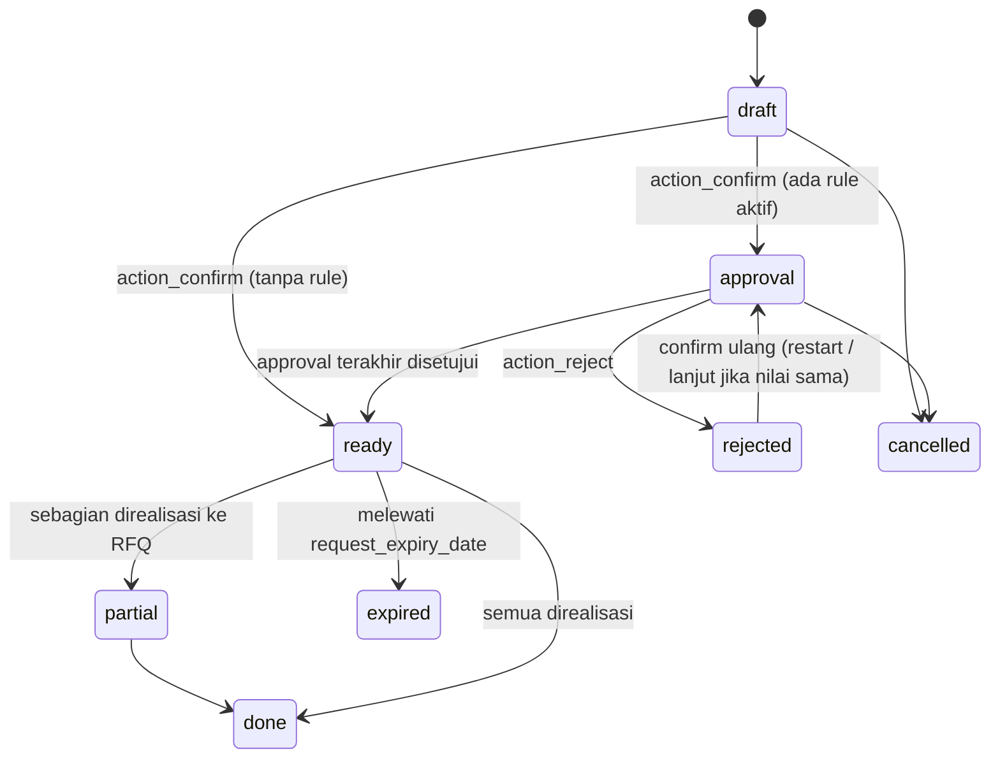

## 1. Apa itu?

**Purchase Request (PR)** — `eproc.request` — adalah permintaan resmi dari sebuah departemen untuk membeli barang/jasa, sebelum vendor dipilih.

`request_type`: `normal`, `repeat` (Repeat Order), `auto` (Auto PR dari orderpoint), `budgeted` (terkait budget item, mis. capex).

## 2. Kenapa RS membutuhkannya?

<Confidence level="general" /> Memisahkan **yang butuh** (unit) dari **yang membeli** (purchasing), memaksa persetujuan atasan & pemilik budget, dan menjadi jejak audit kenapa sesuatu dibeli. Medis vs non-medis biasanya punya approver dan procurement type berbeda.

## 4. Proses di lapangan

<Steps>
<Step>Unit membuat PR: departemen, procurement type (`eproc.type`), approval type, item + pack + qty.</Step>
<Step>Confirm → validasi; jika approval type punya rule aktif, PR masuk `approval`; jika tidak, langsung `ready`.</Step>
<Step>Approver berurutan menyetujui (check → approve → verify → review sesuai rule); notifikasi lewat chatter/inbox.</Step>
<Step>Jika ditolak → `rejected`; pembuat/penolak dapat merevisi & submit ulang.</Step>
<Step>PR `ready` direalisasi menjadi RFQ oleh purchasing (`eproc.request.realize.wizard`).</Step>
</Steps>

## 6. State diagram

*Sumber:* <Src file="mayapada/eproc/eproc_tc.py" line={6280} symbol="EprocRequest.state" />), <Src file="mayapada/eproc/eproc_tc.py" line={6857} symbol="action_confirm" />. Transisi `partial/done/expired` <Confidence level="inferred">dari state baris & nama</Confidence>

## 7. Implementasi — validasi saat confirm

<Src file="mayapada/eproc/eproc_tc.py" line={6794} symbol="_validate_before_confirm" /> mewajibkan:

- company, user, **department**, procurement type, approval type;
- minimal satu baris aktif; setiap baris punya produk, **pack**, dan qty > 0;
- **produk harus terdaftar untuk departemen** (`product.template.eproc_department_ids`) — farmasi tidak bisa meminta barang yang hanya untuk maintenance, dsb.;
- untuk `budgeted`: budget item cocok (group/kategori/produk) dan masih punya sisa (`unrealize_amount > 0`); total baris ≤ sisa budget (<Src file="mayapada/eproc/eproc_tc.py" line={6832} symbol="_validate_budget_line_amounts" />);
- approval type cocok dengan company + procurement type + (department atau budget group/kategori) (<Src file="mayapada/eproc/eproc_tc.py" line={6844} symbol="_validate_request_approval_type" />).

Aturan revisi setelah ditolak: hanya **pembuat** atau **penolak terakhir** (atau admin) yang boleh submit ulang. Jika total harga **tidak berubah**, approval dilanjutkan dari penolak; jika berubah, approval **diulang dari awal**. <Confidence level="verified" />

## Approval matrix

| Model | Isi |
| --- | --- |
| <Src file="mayapada/eproc/eproc_tc.py" line={4027} symbol="eproc.approval.type" /> | Jenis: `request` (PR), `order` (PO), `receipt` (GRN), `agreement` (Rate Contract), `budget` |
| <Src file="mayapada/eproc/eproc_tc.py" line={4113} symbol="eproc.approval.rule" /> | Langkah berurutan: `check`, `approve`, `verify`, `review` |
| <Src file="mayapada/eproc/eproc_tc.py" line={4153} symbol="eproc.approval.log" /> | Jejak per dokumen: `pending/approved/rejected/cancelled/skipped`, `amount_snapshot` |

Matriks yang sama dipakai PR, PO, GRN tanpa PO, agreement, dan budget — satu tempat untuk **separation of duties**.

## 10. Common problems

- "Product ... is not mapped to department ..." → master `eproc_department_ids` belum lengkap.
- "Approval Type does not match ..." → approval type dibuat untuk departemen lain.
- Budget habis → PR budgeted ditolak sistem.

## 12. Pertanyaan uji

<Accordions>
<Accordion title="Kenapa approval tidak diulang jika revisi tidak mengubah total?">
Karena keputusan finansial approver sebelumnya tetap valid; yang direvisi dianggap koreksi administratif. Perubahan nilai membutuhkan persetujuan ulang penuh.
</Accordion>
<Accordion title="Apa arti 'reservation' untuk PR budgeted?">
PR yang disetujui mengikat sisa budget item sehingga tidak bisa dipakai PR lain; RFQ/PO kemudian mengonversi komitmen itu.
</Accordion>
</Accordions>

## Sumber

### Kode

- <Src file="mayapada/eproc/eproc_tc.py" line={2382} symbol="eproc.type" /> — model `EprocType`
- <Src file="mayapada/eproc/eproc_tc.py" line={4027} symbol="eproc.approval.type" /> — model `EprocApprovalType`
- <Src file="mayapada/eproc/eproc_tc.py" line={4113} symbol="eproc.approval.rule" /> — model `EprocApprovalRule`
- <Src file="mayapada/eproc/eproc_tc.py" line={4153} symbol="eproc.approval.log" /> — model `EprocApprovalLog`
- <Src file="mayapada/eproc/eproc_tc.py" line={6237} symbol="eproc.request" /> — model `EprocRequest`
- <Src file="mayapada/eproc/eproc_tc.py" line={6794} symbol="_validate_before_confirm" /> — method `EprocRequest`
- <Src file="mayapada/eproc/eproc_tc.py" line={6832} symbol="_validate_budget_line_amounts" /> — method `EprocRequest`
- <Src file="mayapada/eproc/eproc_tc.py" line={6844} symbol="_validate_request_approval_type" /> — method `EprocRequest`
- <Src file="mayapada/eproc/eproc_tc.py" line={6857} symbol="action_confirm" /> — method `EprocRequest`
- <Src file="mayapada/eproc/eproc_tc.py" line={9933} symbol="eproc.request.realize.wizard" /> — model `EprocRequestRealizeWizard`

### Eksternal

- Permenkes 72/2016 tentang Standar Pelayanan Kefarmasian di Rumah Sakit, Lampiran Bab II — [JDIH Kemenkes (PDF)](https://jdih.kemkes.go.id/storage/documents/pdfs/2016permenkes072.pdf). *Mendukung:* perencanaan kebutuhan (metode konsumsi/epidemiologi, anggaran, sisa stok, lead time) — Bab II A.2; pengadaan di luar Instalasi Farmasi wajib melibatkan tenaga kefarmasian — Bab II A.3 (diakses 11 Okt 2026).
