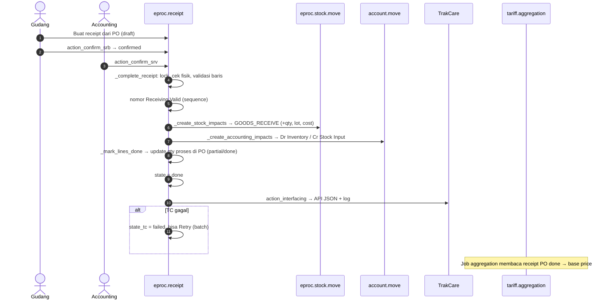

## 1. Apa itu?

`eproc.receipt` mencatat barang masuk dan keluar ke vendor, dengan `receipt_type`:

| Tipe | Arti | Alur konfirmasi |
| --- | --- | --- |
| `PO` | Penerimaan atas Purchase Order | **Receiving Bay** (`action_confirm_srb`) → **Receiving Validation** (`action_confirm_srv`) |
| `WO` | Penerimaan **tanpa PO** | Receiving Validation dengan **approval matrix wajib** |
| `RT` | **Vendor Return** (retur ke supplier) | `action_confirm_return` |

`receipt_method`: `single` (satu PO) atau `multiple` (beberapa PO dalam satu penerimaan).

## 2. Physical receipt vs financial acceptance vs reservation

| Konsep | Arti | Di Mayapada |
| --- | --- | --- |
| **Physical receipt** | Barang sampai, dicek jumlah, kemasan, expiry, batch | Receiving Bay → `state='confirmed'` ("Waiting for Accounting validation"). **Belum** ada stok/jurnal. |
| **Financial acceptance** | Penerimaan diakui: stok bertambah, hutang/GRNI timbul | Receiving Validation → `_complete_receipt()` → `done`: stock move + jurnal + kirim ke TC. |
| **Reservation** | Di Odoo standar: stok dipesan untuk keluar | Tidak dipakai eProc; "reserve" di eProc = **budget** (lihat [Procurement](/docs/procurement-inventory)). |

<Confidence level="verified">eproc_tc.py:12813, 12832, 13081</Confidence>

## 3. Siapa yang terlibat?

Gudang/farmasi (bay), Accounting unit (validasi), approver (WO), Procurement (retur), AP (invoice).

## 6. Sequence penyelesaian receipt

## 7. Implementasi Odoo Mayapada

| Langkah | Method | Detail |
| --- | --- | --- |
| Stok | `_create_stock_impacts` (13205) | Satu `eproc.stock.move` per baris; `GOODS_RECEIVE` qty positif, `GOODS_RETURN` qty negatif. Produk `tracking_type='lot'` wajib lot (`_ensure_lot`); retur wajib lot yang ada dan stok cukup (`_validate_return_stock_balance`). |
| Akuntansi | `_create_accounting_impacts` (13355) | Jurnal "Stock Journal": Dr akun **valuasi persediaan** kategori, Cr **stock input** (penampung GR/IR). Retur: dibalik. |
| PO progress | `_mark_lines_done` | Qty diterima − qty retur → `partial` / `done` per baris PO; retur tidak membuka kembali baris yang sudah di-*rebalance*. |
| TrakCare | `action_interfacing` (13821), `_send_tc_by_api` (13713) | **Hanya API JSON** ("Feature 815 contract"): wajib `company.sync_tc_active` dan `sync_tc_type = api`; hanya baris produk stok; receipt hasil modifikasi GRN **tidak** dikirim; receipt yang sudah sukses dilewati. Status di `eproc.receipt.log` & `state_tc`. Retry: `action_retry_interfacing_tc(_batch)`. Helper TXT `_generate_tc_txt` (13765) masih ada tetapi tidak dipanggil oleh `action_interfacing`. |
| Modifikasi GRN | `_validate_grn_modification_*`, `_create_grn_modification_accounting` | Revisi receipt (`receipt_revise`, `receipt_ref_id`) dengan jurnal koreksi. |
| Aset | `action_create_asset_realize` | Barang aset → `eproc.asset.realize` → `account.asset.asset`. |

## Jurnal harian TC untuk stok

Selain jurnal per receipt di atas, wizard jurnal TC (`TC_JOURNALS['tc_stock_receipt']`) dapat membuat jurnal ringkasan harian dari view `view_account_tc_stock_receiving`: Dr valuasi item category / Cr stock input, **mengecualikan item konsinyasi** (`default_code ILIKE 'CG%'`). <Confidence level="verified" /> Dua mekanisme jurnal ini berpotensi **dobel** jika keduanya dipakai untuk periode yang sama. <Confidence level="confirm">mana yang dipakai produksi</Confidence>

## 9. Business rules

- Receiving Bay hanya untuk PO dan hanya dari `draft`.
- Validasi PO hanya dari Receiving Bay yang `confirmed`.
- WO wajib approval type; jika ditolak & dikirim ulang tanpa perubahan nilai, approval dilanjutkan.
- Retur hanya dari `draft`, langsung selesai (tanpa approval).
- Akun valuasi & input wajib di kategori produk; tanpa itu → UserError.
- View "DIL Goods Receiving" tidak boleh membuat/mengonfirmasi record (view baca-saja). <Confidence level="verified" />

## 10. Common problems

| Masalah | Penyebab |
| --- | --- |
| Barang sudah di gudang, stok sistem belum bertambah | Baru Receiving Bay, belum divalidasi Accounting. |
| `state_tc = failed` | URL/token TC belum dikonfigurasi, share tidak writable, atau TC menolak payload. |
| Retur ditolak | Lot tidak ada / stok di lokasi kurang. |
| Jurnal tidak terbentuk | Kategori produk tanpa akun valuasi/stock input. |

## 11. Yang perlu developer pahami

- `line.move_id` adalah `stock.move` **native**; ledger eProc disimpan di `line.eproc_move_id` (komentar di kode). Jangan tertukar (memory: bug join view selisih harga, 9 Okt 2026).
- Semua efek dibuat dalam satu transaksi; kegagalan kirim TC **tidak** membatalkan receipt (kecuali konteks `force_tc_interface`).

## 12. Pertanyaan uji

<Accordions>
<Accordion title="Kenapa dipisah Receiving Bay dan Receiving Validation?">
Separation of duties: gudang mengakui fisik, accounting mengakui nilai. Ini mencegah stok & hutang diakui hanya berdasarkan klaim satu orang.
</Accordion>
<Accordion title="Akun apa yang dikredit saat barang diterima?">
Stock input kategori (akun penampung penerimaan/GRNI) — nanti dihapus saat invoice supplier dicatat di AP.
</Accordion>
<Accordion title="Kenapa item konsinyasi dikecualikan dari jurnal penerimaan TC?">
Barang konsinyasi masih milik supplier sampai dipakai; RS tidak mengakui persediaan saat barang datang. <Confidence level="general" />
</Accordion>
</Accordions>
