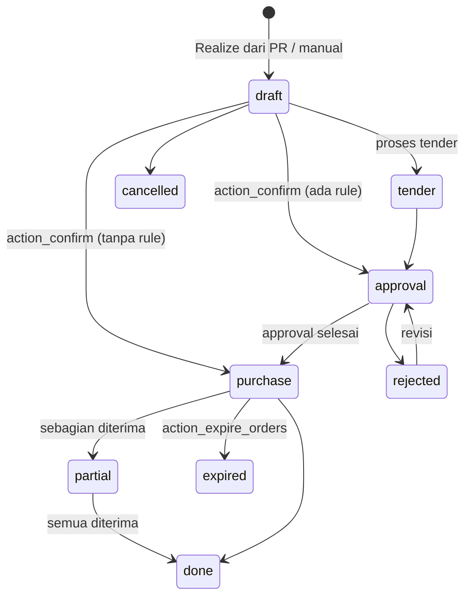

## 1. Apa itu?

- **RFQ/PO** — `eproc.order`. Dokumen yang sama berevolusi dari permintaan penawaran (RFQ) menjadi pesanan yang dikonfirmasi (`state='purchase'`, "PO Confirmed").
- **Vendor Agreement** — `eproc.agreement`: kontrak harga dengan supplier untuk periode tertentu.
  - `type='rate'` **Rate Contract**: harga per item disepakati di muka (umum untuk obat & BHP rutin).
  - `type='tender'` **Call for Tender**: harga dari penawaran kompetitif; dibandingkan via **bid tabulation** (`eproc.tabulation.wizard`).

## 2. Kenapa RS membutuhkannya?

<Confidence level="general" /> Obat dan BHP dibeli berulang setiap minggu; negosiasi per PO tidak efisien. Kontrak harga memberi kepastian harga & lead time, sedangkan tender dipakai untuk pembelian besar/tidak rutin agar harga kompetitif dan transparan.

## 6. State PO

*Sumber:* <Src file="mayapada/eproc/eproc_tc.py" line={4308} symbol="EprocOrder.state" />), <Src file="mayapada/eproc/eproc_tc.py" line={5387} symbol="action_confirm" />, <Src file="mayapada/eproc/eproc_tc.py" line={4372} symbol="action_expire_orders" />. <Confidence level="verified" />

## 7. Implementasi — kontrol saat confirm PO

| Kontrol | Method | Aturan |
| --- | --- | --- |
| Budget | <Src file="mayapada/eproc/eproc_tc.py" line={5378} symbol="_check_budget_ceiling" /> | Komitmen PO tidak boleh melampaui budget item; RFQ **Medical Equipment** (capex) wajib berasal dari PR ber-budget. |
| Kelipatan kemasan | `_get_qty_multiple_mismatches` | Peringatan jika qty tidak sesuai kelipatan pack (wizard konfirmasi). |
| Tanggal agreement | `_is_confirm_date_inside_agreement_range` | Peringatan jika tanggal di luar periode kontrak. |
| Harga agreement | <Src file="mayapada/eproc/eproc_tc.py" line={5441} symbol="_validate_stock_agreement_pricing" /> | **PO stok wajib punya agreement.** Untuk rate contract: agreement harus valid untuk supplier, procurement type, company, tanggal; setiap baris harus menemukan harga agreement untuk produk + pack + qty; harga diterapkan otomatis. Tender memakai harga tabulasi. |
| Lokasi | `_validate_required_locations` | Lokasi penerimaan & supplier wajib. |
| Approval | <Src file="mayapada/eproc/eproc_tc.py" line={5292} symbol="EprocOrder._create_approval_logs" />, <Src file="mayapada/eproc/eproc_tc.py" line={2970} symbol="EprocAgreement._create_approval_logs" /> | Sama seperti PR (restart jika nilai berubah). |

<Callout title="Makna bisnis">
Aturan "PO stok wajib agreement" berarti pembeli **tidak bisa mengetik harga bebas** untuk barang stok. Harga beli dikendalikan kontrak — dan kontrak itu juga menjadi sumber **base price** (Airflow D012_05).
</Callout>

## Fitur pendukung

- `eproc.order.rebalance.wizard` — menyeimbangkan sisa qty PO (`pack_qty_rebalanced`).
- `eproc.order.change.supplier.wizard`, `...change.agreement.wizard` — ganti supplier/kontrak sebelum proses.
- `eproc.agreement.evaluation` — evaluasi vendor.
- Cetak RFQ/PO stok & non-stok (`action_print_po_stock`, `action_print_po_nonstock`).

## 10. Common problems

| Error | Arti |
| --- | --- |
| "Agreement is required for Stock RFQ/PO." | Tidak ada kontrak harga untuk PO barang stok. |
| "No valid agreement price was found for product ..." | Agreement ada tetapi tidak mencakup produk/pack/qty/tanggal tersebut. |
| "CapEx Medical Equipment RFQs must originate from budget-linked PR items." | Alkes capex dibeli tanpa PR budgeted. |

## Emergency procurement

<Confidence level="notfound">alur pembelian darurat khusus</Confidence> Tidak ditemukan tipe/flag "emergency" di eProc. Kemungkinan ditangani dengan **Receipt tanpa PO (WO)** yang wajib approval matrix, atau procurement type khusus. <Confidence level="confirm" />

## 12. Pertanyaan uji

<Accordions>
<Accordion title="Apa beda rate contract dan tender di kode?">
Rate contract memvalidasi & menerapkan harga dari baris agreement per produk/pack/qty/tanggal. Tender melewati validasi itu dan memakai harga dari bid tabulation.
</Accordion>
<Accordion title="Kenapa PO bisa expired?">
PO memiliki masa berlaku; `action_expire_orders` menandai PO yang tidak lagi valid sehingga sisa qty tidak bisa diterima.
</Accordion>
</Accordions>

## Sumber

### Kode

- <Src file="mayapada/eproc/eproc_tc.py" line={2750} symbol="eproc.agreement" /> — model `EprocAgreement`
- <Src file="mayapada/eproc/eproc_tc.py" line={3772} symbol="eproc.agreement.evaluation" /> — model `EprocAgreementEvaluation`
- <Src file="mayapada/eproc/eproc_tc.py" line={3791} symbol="eproc.tabulation.wizard" /> — model `EprocTabulationWizard`
- <Src file="mayapada/eproc/eproc_tc.py" line={4253} symbol="eproc.order" /> — model `EprocOrder`
- <Src file="mayapada/eproc/eproc_tc.py" line={4372} symbol="action_expire_orders" /> — method `EprocOrder`
- <Src file="mayapada/eproc/eproc_tc.py" line={4534} symbol="_is_confirm_date_inside_agreement_range" /> — method `EprocOrder`
- <Src file="mayapada/eproc/eproc_tc.py" line={4565} symbol="_get_qty_multiple_mismatches" /> — method `EprocOrder`
- <Src file="mayapada/eproc/eproc_tc.py" line={4826} symbol="_validate_required_locations" /> — method `EprocOrder`
- <Src file="mayapada/eproc/eproc_tc.py" line={5378} symbol="_check_budget_ceiling" /> — method `EprocOrder`
- <Src file="mayapada/eproc/eproc_tc.py" line={5387} symbol="action_confirm" /> — method `EprocOrder`
- <Src file="mayapada/eproc/eproc_tc.py" line={5441} symbol="_validate_stock_agreement_pricing" /> — method `EprocOrder`
- <Src file="mayapada/eproc/eproc_tc.py" line={5688} symbol="action_print_po_nonstock" /> — method `EprocOrder`
- <Src file="mayapada/eproc/eproc_tc.py" line={5719} symbol="action_print_po_stock" /> — method `EprocOrder`
- <Src file="mayapada/eproc/eproc_tc.py" line={9501} symbol="eproc.order.rebalance.wizard" /> — model `EprocOrderRebalanceWizard`
- <Src file="mayapada/eproc/eproc_tc.py" line={9573} symbol="eproc.order.change.supplier.wizard" /> — model `EprocOrderChangeSupplierWizard`
