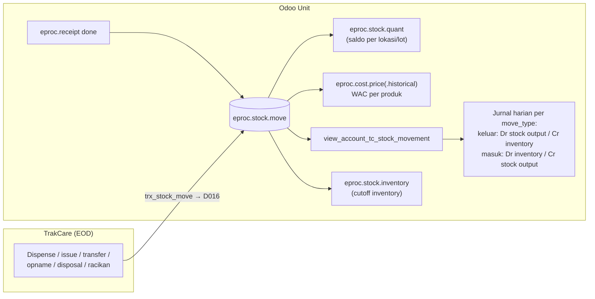

## 1. Apa itu?

<Src file="mayapada/eproc/eproc_tc.py" line={10985} symbol="eproc.stock.move" />) adalah **ledger pergerakan stok** eProc. Sebagian dibuat Odoo (penerimaan/retur), sebagian besar disinkron dari TrakCare (`trx_stock_move`), karena dispensing ke pasien dan distribusi antar unit terjadi di HIS.

## 2. Jenis pergerakan (`EPROC_STOCK_MOVE_TYPES`, 10963)

| Kode | Arti bisnis RS | Arah |
| --- | --- | --- |
| `INIT` | Saldo awal | + |
| `GOODS_RECEIVE` / `GOODS_RETURN` | Terima dari / retur ke vendor | + / − |
| `DIS_PACKING`, `DIS_ISSUE` / `DIS_RETURN` | Dispensing obat ke pasien / retur dari pasien | − / + |
| `ISSUE_REQ` / `ISSUE_RET` | Permintaan unit (amprahan) dari gudang / pengembalian | − / + |
| `TRANSFER_OUT` / `TRANSFER_IN` | Transfer antar lokasi | − / + |
| `ADJ_SO` | Selisih stock opname | ± |
| `ADJ_RECEIPT` / `ADJ_ISSUE` | Penyesuaian tambah / kurang | + / − |
| `DISPOSAL` | Pemusnahan (rusak, kedaluwarsa) | − |
| `BOM_OUTPUT` / `BOM_INPUT` | Hasil / bahan racikan (manufaktur) | + / − |
| `CONSUMPTION` | Pemakaian / scrap (BHP ruangan) | − |

README Airflow memetakan subtipe TC 23.01–23.12 ke kelompok yang sama (Opname, Disposal, Adjustment, Dispense, Issue, Transfer, Manufacture, Consumption). <Confidence level="verified" />

## 6. Alur stok & jurnal

*Sumber:* `TC_JOURNAL_VIEWS['view_account_tc_stock_movement']` (eproc_tc.py ~22718); model <Src file="mayapada/eproc/eproc_tc.py" line={1306} symbol="eproc.stock.quant" />, <Src file="mayapada/eproc/eproc_tc.py" line={1481} symbol="eproc.stock.inventory" />, <Src file="mayapada/eproc/eproc_tc.py" line={1644} symbol="eproc.cost.price" />, <Src file="mayapada/eproc/eproc_tc.py" line={1690} symbol="eproc.cost.price.historical" />; README Airflow (016-01..04: quant, WAC/COGS, cost placement, cutoff inventory). <Confidence level="verified" />

<Callout type="warn" title="Pertanyaan terbuka di memory">
Workbook requirement menyebut Dispense = Dr COGS / Cr Inventory, sedangkan SQL view (kelompok keluar) menghasilkan Dr *stock output* / Cr *inventory valuation* dengan qty keluar bernilai negatif. Konvensi tanda qty dari TC dan nama akun stock output vs COGS **belum diverifikasi**. <Confidence level="confirm" />
</Callout>

## Valuasi

- `eproc.cost.price`: harga pokok, stok, dan nilai per produk per `cutoff_date`.
- `eproc.cost.price.historical`: jejak per pergerakan — `prev_price/stock/valuation` → `current_price/stock/valuation`, dengan `cost_unit`/`cost_total` move. Pola ini adalah **Weighted Average Cost**: setiap penerimaan mengubah harga rata-rata; pengeluaran memakai harga rata-rata. <Confidence level="inferred">dari struktur field & README "WAC/COGS"</Confidence>

## Lot & kedaluwarsa

<Src file="mayapada/eproc/eproc_tc.py" line={10778} symbol="eproc.stock.lot" /> menyimpan batch & `expiration_date`. Produk `tracking_type='lot'` wajib lot saat diterima; retur wajib lot yang ada. Penarikan barang kedaluwarsa tercatat sebagai `DISPOSAL`. Alur notifikasi near-expiry tidak ditemukan. <Confidence level="notfound" />

## Orderpoint (A3)

| Model | Fungsi |
| --- | --- |
| <Src file="mayapada/eproc/eproc_tc.py" line={1027} symbol="eproc.orderpoint" /> | Aturan per produk: `auto` (dihitung) / `manual`; pemakaian 7/14/30/90 hari, periode jadwal. |
| `eproc.product.log` | Statistik pemakaian (A3-1). |
| <Src file="mayapada/eproc/eproc_tc.py" line={5846} symbol="eproc.orderpoint.log" /> | Saran pembelian (A3-2), state `draft → auto_pr → cancel`, saran supplier. |
| `eproc.orderpoint.realize.wizard` | Realisasi saran menjadi PR/RFQ (A3-3). |

<Confidence level="verified">model & README A3</Confidence>

## Common problems

| Masalah | Penyebab |
| --- | --- |
| Stok Odoo ≠ stok TC | Job D016 gagal/terlambat; cutoff berbeda. |
| HPP melonjak | Penerimaan dengan harga salah (uom/pack conversion) mengubah WAC. |
| Jurnal stok tidak seimbang dengan ledger | Item tanpa item category → akun NULL → wizard menolak. |

## Pertanyaan uji

<Accordions>
<Accordion title="Kenapa dispensing obat dicatat di Odoo walau terjadi di TrakCare?">
Karena dispensing mengurangi persediaan & menimbulkan HPP — dampak finansial yang harus ada di buku besar Odoo.
</Accordion>
<Accordion title="Apa beda ISSUE_REQ dan CONSUMPTION?">
ISSUE_REQ memindahkan barang dari gudang ke unit (masih persediaan unit, tergantung desain lokasi); CONSUMPTION menghabiskan barang (BHP ruangan) menjadi beban. Keduanya dipetakan ke jurnal berbeda (`tc_stock_issue` vs `tc_stock_consumption`), meski di kode `tc_stock_issue` memakai nama jurnal "TC Stock Consumption". <Confidence level="verified" />
</Accordion>
</Accordions>

## Sumber

### Kode

- <Src file="mayapada/eproc/eproc_tc.py" line={1027} symbol="eproc.orderpoint" /> — model `EprocOrderpoint`
- <Src file="mayapada/eproc/eproc_tc.py" line={1306} symbol="eproc.stock.quant" /> — model `EprocStockQuant`
- <Src file="mayapada/eproc/eproc_tc.py" line={1481} symbol="eproc.stock.inventory" /> — model `EprocStockInventory`
- <Src file="mayapada/eproc/eproc_tc.py" line={1644} symbol="eproc.cost.price" /> — model `EprocCostPrice`
- <Src file="mayapada/eproc/eproc_tc.py" line={1690} symbol="eproc.cost.price.historical" /> — model `EprocCostPriceHistorical`
- <Src file="mayapada/eproc/eproc_tc.py" line={1756} symbol="eproc.product.log" /> — model `EprocProductLog`
- <Src file="mayapada/eproc/eproc_tc.py" line={5846} symbol="eproc.orderpoint.log" /> — model `EprocOrderpointLog`
- <Src file="mayapada/eproc/eproc_tc.py" line={10426} symbol="eproc.orderpoint.realize.wizard" /> — model `EprocOrderpointRealizeWizard`
- <Src file="mayapada/eproc/eproc_tc.py" line={10778} symbol="eproc.stock.lot" /> — model `EprocStockLot`
- <Src file="mayapada/eproc/eproc_tc.py" line={10985} symbol="eproc.stock.move" /> — model `EprocStockMove`
