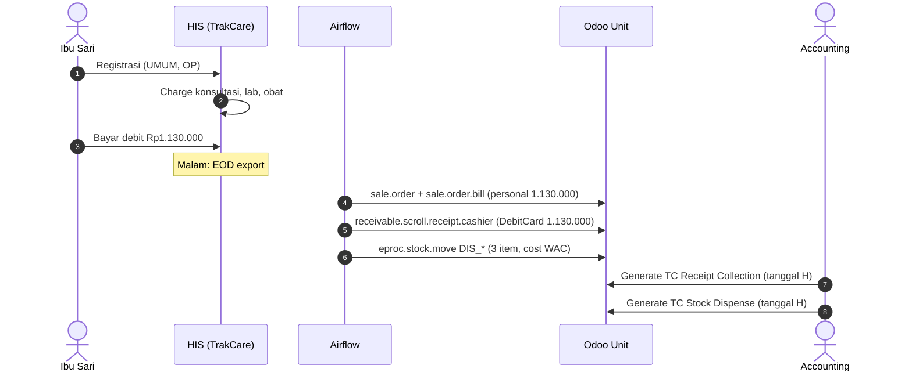

## Cerita

Ibu Sari (52, fiktif) datang ke poli penyakit dalam MH Kuningan tanpa asuransi. Dokter meminta profil lipid dan meresepkan obat 30 hari. Total tagihan Rp1.130.000 dibayar dengan kartu debit.

## Aktor

Pendaftaran · perawat poli · dr. Budi Sp.PD (fiktif) · analis lab · apoteker · kasir · (malam) job Airflow · (besok) staf accounting.

## Timeline

| Waktu | Kejadian | Sistem |
| --- | --- | --- |
| 08:10 | Registrasi, MRN lama ditemukan, penjamin = UMUM, episode OP | HIS |
| 08:40 | Konsultasi Rp300.000 | HIS/RME |
| 09:00 | Lab profil lipid Rp450.000 | LIS → HIS |
| 10:00 | Farmasi dispensing obat Rp380.000 (3 item, batch tercatat) | HIS |
| 10:15 | Kasir: debit Rp1.130.000 → bill close | HIS |
| 23:00 | TXT kasir ke NAS; EOD billing & stock move ke Bridge | TC → Bridge |
| 03:xx | Airflow A2: billing → `sale.order`/`bill`; D019/D019_01 kasir → `receivable.scroll.receipt.cashier`; D016 stock move | Bridge → Odoo |
| H+1 | Accounting generate jurnal TC Receipt Collection & Dispense untuk tanggal H | Odoo |

## Diagram

## Record yang terbentuk (Odoo)

| Model | Isi utama |
| --- | --- |
| `sale.order` | patient_type `1`, partner = Ibu Sari, primary doc = dr. Budi, tariff UMUM |
| `sale.order.bill` | personal_amount 1.130.000, payer_amount 0, state done |
| `sale.order.line` ×5 | konsultasi, lab, 3 obat (batch, expiry) |
| `receivable.scroll.receipt.cashier` | payment_type DebitCard, amount 1.130.000, cutoff_date H |
| `eproc.stock.move` ×3 | move_type DIS_*, qty negatif, cost_total (mis. Rp240.000 total HPP) |

## Dampak finansial (sintetis)

| Jurnal | Debit | Kredit | Rp |
| --- | --- | --- | ---: |
| TC Receipt Collection | Bank/EDC (akun payment mode Debit) | Akun 1104020101 (piutang) | 1.130.000 |
| TC Stock Dispense | Stock output (HPP) | Persediaan | 240.000 |
| Pendapatan (mekanisme perlu konfirmasi) | Piutang | Pendapatan jasa & farmasi | 1.130.000 |
| Fee dokter (bulanan) | Beban jasa medis | Hutang fee | mis. 225.000 |

## Pengecualian

- Obat dikembalikan sebelum dipakai → `DIS_RETURN` + credit note/refund.
- Kartu debit gagal tetapi kasir sudah close → kas sistem > kas bank; rekonsiliasi harian menemukan selisih.
- Pasien membeli obat bebas saja → OTC (`penjualanresep`, patient type `6`).

## Pelajaran

1. Satu kunjungan sederhana menghasilkan **empat** dampak buku besar dari tiga sumber berbeda.
2. Odoo tidak melihat transaksi sampai EOD — laporan "hari ini" selalu belum lengkap.
3. HPP bergantung pada WAC yang dibentuk oleh penerimaan barang (Case 4).
