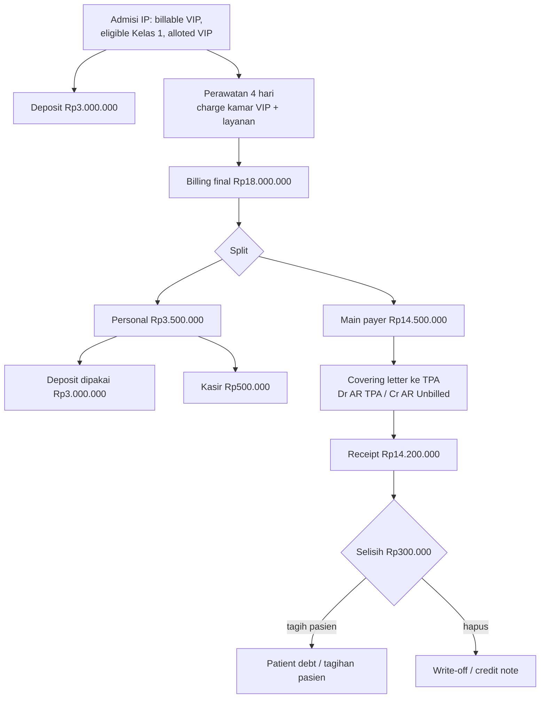

## Cerita

Pak Dodi (45, fiktif), peserta "Asuransi Sehat Prima" (via TPA), dirawat inap karena demam berdarah. Haknya kamar **Kelas 1**, tetapi minta **VIP**. Dirawat 4 malam. Total tagihan Rp18.000.000.

## Aktor

Admisi · case manager asuransi/TPA · DPJP · perawat · farmasi · billing · kasir · staf AR · Finance.

## Timeline & pembagian tagihan

| Hari | Kejadian |
| --- | --- |
| H0 | Admisi dari poli; GL awal dari TPA (hak Kelas 1, limit kamar); pasien setuju bayar selisih kelas; deposit Rp3.000.000 |
| H0–H4 | Charge harian: kamar VIP, visite, infus, obat, lab |
| H4 | Discharge; billing final Rp18.000.000; final GL: penjamin menanggung Rp14.500.000 (setara Kelas 1 + item ter-cover) |
| H4 | Personal Rp3.500.000 − deposit 3.000.000 → pasien bayar Rp500.000 |
| H+10 | AR membuat covering letter ke TPA untuk 25 billing bulan itu, termasuk billing Pak Dodi |
| H+45 | TPA membayar Rp14.200.000 untuk billing ini (Rp300.000 tidak dibayar: item non-cover) |

## Diagram

## Record

| Model | Isi |
| --- | --- |
| `sale.order` | patient_type `2`, `bed_type_id` VIP, `eligible_bed_type_id` Kelas 1, `alloted_bed_type_id` VIP, payer TPA |
| `receivable.patient.deposit` | Deposit 3.000.000 (jurnal: Dr kas / Cr 2103000000) |
| `sale.order.bill` | payer_amount 14.500.000; personal_amount 3.500.000; personal_deposit_availed 3.000.000 |
| `account.coveringletter` | billing_type `bill`, 25 billing, due date dari `due_day` |
| `sale.order.bill.history` | baris CONFIRM letter; baris receipt; baris write-off |
| `receivable.receipt` + `.settlement` | receipt_type MHCL; settlement per billing state_tc pending → dikirim ke TC |

## Dampak finansial

| Tahap | Debit | Kredit | Rp |
| --- | --- | --- | ---: |
| Deposit | Kas | Deposit pasien (2103000000) | 3.000.000 |
| Pemakaian deposit | Deposit pasien | Piutang pasien | 3.000.000 <Confidence level="inferred" /> |
| Kasir pelunasan | Kas | Piutang (1104020101) | 500.000 |
| Covering letter | AR TPA | AR Unbilled | 14.500.000 |
| Pembayaran TPA | Bank | AR TPA | 14.200.000 |
| Write-off sisa | Beban/penyisihan | AR TPA | 300.000 <Confidence level="inferred" /> |

## Pengecualian

- Pasien belum pulang saat tutup buku → accrual rawat inap.
- TPA menolak seluruh klaim (polis tidak aktif) → seluruh tagihan dialihkan ke pasien; covering letter direvisi/dibatalkan (jurnal dihapus, billing kembali `done`).
- Dua penjamin (asuransi + korporat) → `sale.order.cob`.

## Pelajaran

1. **Tanggung jawab bayar berpindah tiga kali:** pasien (deposit) → penjamin (GL) → pasien lagi (non-cover).
2. Bed type adalah variabel harga **dan** variabel penjaminan.
3. Piutang penjamin harus dilacak per billing — itulah fungsi history & settlement.
