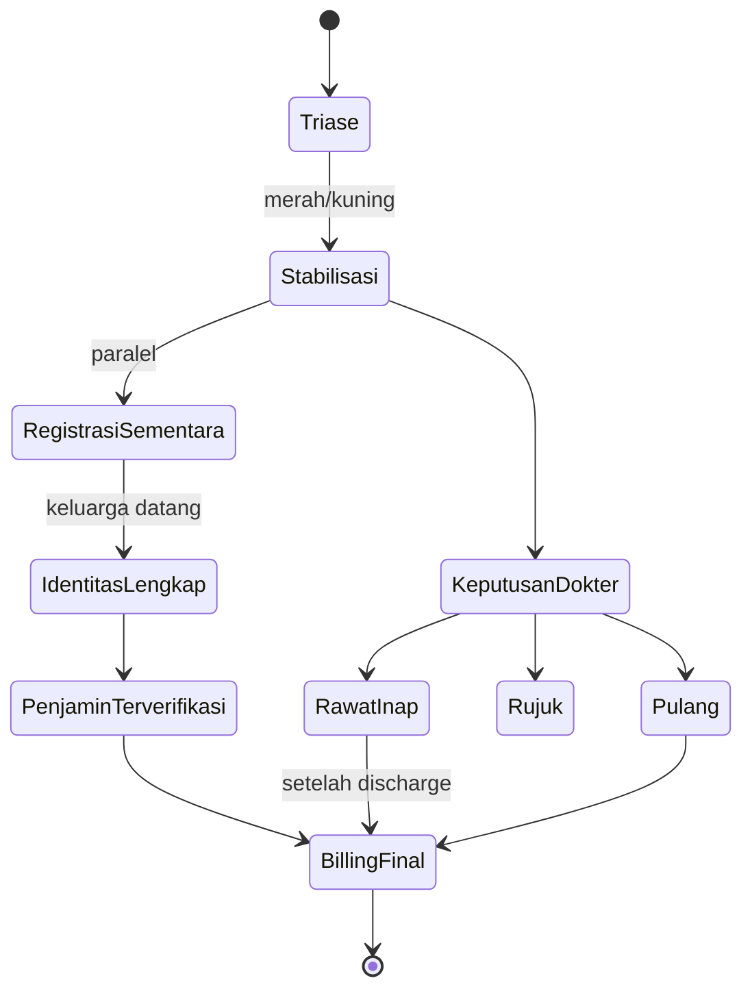

<Callout type="info">Alur klinis IGD adalah <Confidence level="general">ilustrasi alur RS Indonesia</Confidence>; jejak finansial di Odoo dipetakan ke model yang ada.</Callout>

## Cerita

Pukul 22:15, pengendara motor (fiktif, belum diketahui namanya) dibawa ambulans dengan cedera kepala. Triase merah. Keluarga datang pukul 23:30 membawa KTP dan kartu asuransi korporat dari kantornya.

## Aktor

Petugas triase · dokter jaga IGD · perawat IGD · radiologi (CT scan cito) · dokter bedah saraf (konsul) · admisi · keluarga · petugas penjamin korporat · billing.

## Timeline

| Waktu | Kejadian | Catatan |
| --- | --- | --- |
| 22:15 | Triase merah, resusitasi, CT scan **cito** | Tidak menunggu administrasi |
| 22:20 | Registrasi sementara ("Mr. X", MRN sementara) | Episode AAE |
| 23:30 | Identitas & penjamin diketahui; MRN digabung; penjamin korporat dihubungi | Surat jaminan pagi berikutnya |
| 00:30 | Diputuskan rawat inap ICU | Episode IP terhubung (parent/ref admission) |
| H+6 | Pulang; billing IGD + ICU + ruang rawat | Payer korporat + personal |

## Diagram

## Record & mapping Odoo

| Aspek | Odoo |
| --- | --- |
| Episode IGD | `sale.order` patient_type `3` (atau charge IGD masuk episode IP — tergantung HIS) |
| Hubungan IGD → IP | `parent_admission_no`, `ref_admission_no` <Confidence level="inferred" /> |
| Item cito | Harga dengan UrgentRate (ekspor tarif) <Confidence level="inferred" /> |
| Fee dokter IGD | Pool IGD (`is_igd`, `igd_share/point`) |
| Fee perujuk (jika dirujuk agen) | `referral.compute.wizard` tipe `igd` |
| Penjamin korporat | payer di `sale.order.bill` → covering letter ke perusahaan |

## Dampak finansial

- Charge IGD terjadi **sebelum** penjamin diketahui → billing bisa berpindah dari personal ke payer (history billing).
- Jika identitas sementara tidak di-*merge*, piutang terpecah di dua partner → aging & penagihan salah.

## Pengecualian

- Pasien tidak teridentifikasi sampai meninggal/pulang → piutang tak tertagih (kebijakan sosial RS). <Confidence level="confirm" />
- Penjamin menolak karena kecelakaan lalu lintas (dijamin skema lain, mis. Jasa Raharja) → koordinasi penjamin. <Confidence level="general" />

## Pelajaran

1. Di IGD, **klinis mendahului administrasi** — sistem harus mentoleransi data administratif yang terlambat.
2. Kualitas **master pasien** (merge MRN) langsung memengaruhi AR.
3. Pool fee IGD berbeda dari fee per pasien.

## Sumber

### Kode

- <Src file="mayapada/models/referral_fee.py" line={1793} symbol="referral.compute.wizard" /> — model `ReferralComputeWizard`
- <Src file="mayapada/models/sale.py" line={43} symbol="sale.order" /> — extend `SaleOrder`
- <Src file="mayapada/models/sale.py" line={9652} symbol="sale.order.bill" /> — model `SaleOrderBill`
