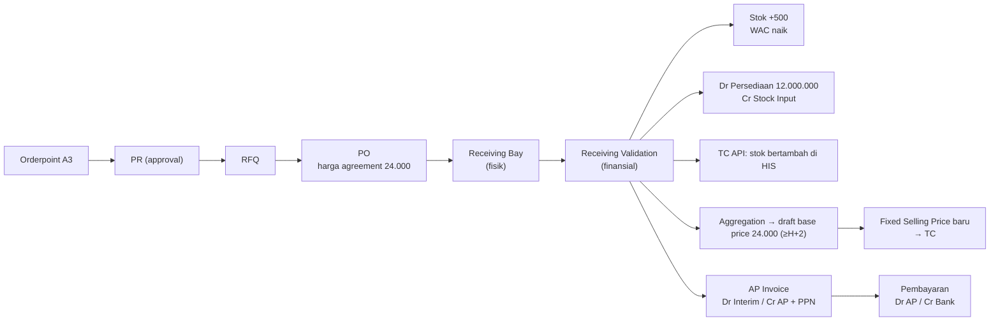

## Cerita

Stok "Infus Set Dewasa" (fiktif) di gudang farmasi MH Jakarta Timur menipis. Orderpoint menyarankan 500 pcs. Kontrak harga (rate contract) dengan PT Medika Sejahtera (fiktif) memberi harga Rp22.000/pcs, tetapi kontrak baru per bulan ini Rp24.000/pcs.

## Aktor

Apoteker gudang (PR Creation) · Ka.Unit Farmasi (approval) · Purchasing · Ka.Dept Purchasing (approval PO) · petugas gudang (Receiving Bay) · Accounting (Receiving Validation) · AP · PV Approval · Finance (bayar) · tim tarif.

## Timeline

| Hari | Kejadian | Dokumen | State |
| --- | --- | --- | --- |
| D1 06:00 | A3 orderpoint membuat saran | `eproc.orderpoint.log` | draft → auto_pr |
| D1 | PR 500 pcs dikonfirmasi | `eproc.request` | draft → approval |
| D1 | Ka.Unit menyetujui | `eproc.approval.log` | approval → ready |
| D2 | Realize ke RFQ; agreement terbaru dipilih; harga 24.000 diterapkan | `eproc.order` | draft |
| D2 | Confirm → approval → PO | `eproc.order` | approval → purchase |
| D5 | Barang datang 500 pcs, batch & expiry dicek | `eproc.receipt` PO | draft → confirmed (Receiving Bay) |
| D5 | Accounting validasi | `eproc.receipt` | confirmed → done |
| D5 | Stock move + jurnal + kirim ke TC | `eproc.stock.move`, `account.move` | — |
| D6 03:00 | Aggregation: 24.000 > base price aktif 22.000 | `tariff.aggregation` | pending |
| D6 | Tim tarif realize, efektif D8 | `tariff.pricelist` | draft |
| D10 | Invoice supplier diterima (tukar faktur) | `payable.invoice` | draft → confirm |
| D40 | Pembayaran (TOP 30 hari) | `payable.payment.group` | waiting → approved → confirm |

## Diagram

## Dampak finansial (sintetis, PPN diabaikan)

| Tahap | Debit | Kredit | Rp |
| --- | --- | --- | ---: |
| Validasi penerimaan | Persediaan (valuasi kategori) | Stock input / interim | 12.000.000 |
| Invoice supplier | Interim | AP PT Medika | 12.000.000 |
| Pembayaran | AP PT Medika | Bank | 12.000.000 |
| Harga jual | Base price 22.000 → 24.000; harga jual UMUM VIP 28.600 → 31.200 (markup 30%) | | |

## Mapping Odoo

`eproc.orderpoint.log` → <Src file="mayapada/eproc/eproc_tc.py" line={6857} symbol="eproc.request.action_confirm" /> → `eproc.request.realize.wizard` → <Src file="mayapada/eproc/eproc_tc.py" line={5387} symbol="eproc.order.action_confirm" /> dengan <Src file="mayapada/eproc/eproc_tc.py" line={5441} symbol="_validate_stock_agreement_pricing" /> → `eproc.receipt.action_confirm_srb/srv` (12813/12832) → <Src file="mayapada/eproc/eproc_tc.py" line={13081} symbol="_complete_receipt" /> → <Src file="mayapada/eproc/eproc_tc.py" line={22219} symbol="tariff.aggregation._scheduler_baseprice_aggregation" /> → `payable.invoice` (link `invoice_eproc_ids`).

## Pengecualian

| Kejadian | Penanganan |
| --- | --- |
| Datang 480 pcs | Receipt 480 → PO `partial`; sisa diterima nanti atau di-*rebalance* |
| 20 pcs rusak | Retur RT → `GOODS_RETURN`, jurnal dibalik, kirim ke TC |
| Expiry < 6 bulan | Ditolak di bay (kebijakan) <Confidence level="confirm" /> |
| Agreement belum aktif | PO ditolak sistem ("No valid agreement price...") |
| TC API down | `state_tc=failed` → retry batch |
| Pembelian mendesak tanpa PO | Receipt WO dengan approval matrix |

## Pelajaran

1. Kontrak harga mengendalikan **dua** hal: biaya beli dan (lewat aggregation) **harga jual**.
2. Pemisahan bay vs validasi adalah kontrol, bukan birokrasi.
3. Receipt adalah titik di mana procurement, inventory, accounting, tarif, dan HIS bertemu.

## Sumber

### Kode

- <Src file="mayapada/eproc/eproc_tc.py" line={4153} symbol="eproc.approval.log" /> — model `EprocApprovalLog`
- <Src file="mayapada/eproc/eproc_tc.py" line={4253} symbol="eproc.order" /> — model `EprocOrder`
- <Src file="mayapada/eproc/eproc_tc.py" line={5441} symbol="_validate_stock_agreement_pricing" /> — method `EprocOrder`
- <Src file="mayapada/eproc/eproc_tc.py" line={5846} symbol="eproc.orderpoint.log" /> — model `EprocOrderpointLog`
- <Src file="mayapada/eproc/eproc_tc.py" line={6237} symbol="eproc.request" /> — model `EprocRequest`
- <Src file="mayapada/eproc/eproc_tc.py" line={9933} symbol="eproc.request.realize.wizard" /> — model `EprocRequestRealizeWizard`
- <Src file="mayapada/eproc/eproc_tc.py" line={10985} symbol="eproc.stock.move" /> — model `EprocStockMove`
- <Src file="mayapada/eproc/eproc_tc.py" line={11417} symbol="eproc.receipt" /> — model `EprocReceipt`
- <Src file="mayapada/eproc/eproc_tc.py" line={13081} symbol="_complete_receipt" /> — method `EprocReceipt`
- <Src file="mayapada/eproc/eproc_tc.py" line={19129} symbol="tariff.pricelist" /> — model `TariffPricelist`
- <Src file="mayapada/eproc/eproc_tc.py" line={22052} symbol="tariff.aggregation" /> — model `TariffAggregation`
- <Src file="mayapada/models/account.py" line={18869} symbol="account.move" /> — model `AccountMove`
- <Src file="mayapada/models/payable.py" line={188} symbol="payable.invoice" /> — model `PayableInvoice`
- <Src file="mayapada/models/payable.py" line={1872} symbol="payable.payment.group" /> — model `PayablePaymentGroup`
