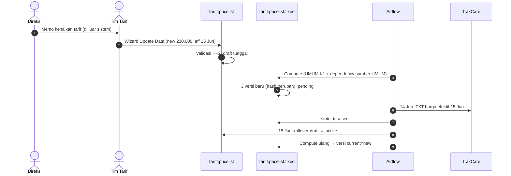

## Cerita

Direksi memutuskan tarif tindakan "Jahit Luka" untuk tariff UMUM Kelas 1 naik dari Rp200.000 menjadi Rp230.000 mulai 15 Juni (fiktif). ASURANSI-X depend 110% ke UMUM Kelas 1; UMUM VIP depend 150%.

## Aktor

Direksi (keputusan) · tim tarif/Finance (input) · scheduler/Airflow (rilis & compute) · IT integrasi (publikasi) · tim TrakCare · kasir (pemakai harga).

## Timeline

| Tanggal | Kejadian | Record |
| --- | --- | --- |
| 1 Jun | Memo direksi | di luar sistem <Confidence level="notfound">approval tarif</Confidence> |
| 10 Jun | Input wizard: new 230.000, effective 15 Jun (≥ H+2 ✓) | `tariff.pricelist` draft (current 200.000) |
| 10 Jun | Compute: versi fixed baru untuk UMUM K1 (new 230.000), UMUM VIP (new 345.000), ASURANSI-X K1 (new 253.000) | `tariff.pricelist.fixed` pending |
| 14 Jun | D01209: versi dengan new_effective ≤ H+1 dikirim TXT; `state_tc=sent` | NAS |
| 15 Jun | Rollover: draft → active (prev 200.000); compute: versi baru current = new | `tariff.pricelist`, `.fixed` |
| 15 Jun | Kasir TC menagih 230.000 | HIS |

## Diagram

## Dampak

| Tariff · bed | Lama | Baru |
| --- | ---: | ---: |
| UMUM · Kelas 1 | 200.000 | 230.000 |
| UMUM · VIP (150%) | 300.000 | 345.000 |
| ASURANSI-X · Kelas 1 (110%) | 220.000 | 253.000 |

Satu input menggeser **tiga** harga. Kontrak ASURANSI-X yang mensyaratkan pemberitahuan perubahan harga (lazim di kerja sama asuransi) harus dipenuhi di luar sistem. <Confidence level="confirm" />

## Pengecualian

| Kejadian | Akibat |
| --- | --- |
| Input effective 11 Jun (H+1) | Ditolak: "New Effective Date must be H+2 or later" |
| Input ulang 12 Jun dengan 235.000 | Draft yang sama ditimpa |
| Scheduler rollover tidak jalan 15 Jun | Odoo masih 200.000 sebagai current; TC sudah menerima 230.000 efektif 15 Jun → **TC & Odoo berbeda** sampai rollover |
| Pasien rawat inap sejak 13 Jun | Kebijakan harga di tengah episode ditentukan HIS <Confidence level="confirm" /> |
| Markup diubah 16 Jun | Fixed baru dengan current_effective 16 Jun (tanpa H+2) |

## Pelajaran

1. Perubahan harga adalah **perubahan jadwal**, bukan edit angka.
2. Dependency menyebarkan perubahan — selalu cek tarif turunan.
3. Approval perubahan tarif tidak ada di sistem; jejak hanya chatter & versi harga.

## Sumber

### Kode

- <Src file="mayapada/eproc/eproc_tc.py" line={19129} symbol="tariff.pricelist" /> — model `TariffPricelist`
- <Src file="mayapada/eproc/eproc_tc.py" line={19683} symbol="tariff.pricelist.fixed" /> — model `TariffPricelistFixed`
