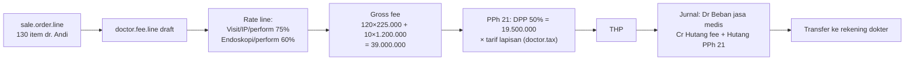

## Cerita

dr. Andi Sp.PD (fiktif) adalah dokter mitra di MH Bandung. Pada Maret ia melakukan 120 visite rawat inap (bill Rp300.000) dan 10 tindakan endoskopi (bill Rp2.000.000, sebagai *perform*). Master rate: visite IP 75%, tindakan perform 60%. Ber-NPWP, tanpa gross-up.

## Aktor

dr. Andi · billing (HIS) · Staff Fee Doctor · Ka.Unit Accounting · Finance (pembayaran) · tim pajak.

## Timeline

| Tanggal | Kejadian | Record |
| --- | --- | --- |
| 1–31 Mar | Layanan & billing di HIS | `sale.order.line` (perform/primary doc) |
| 1 Apr | Buat header fee Maret untuk semua dokter | `doctor.fee` (`doctor.fee.wizard.create_doctor_fee`) |
| 2 Apr | Tarik transaksi fee → baris fee draft | `doctor.fee.line` |
| 2 Apr | Compute line → rate per baris | `_compute_fee_line` |
| 3 Apr | Compute header: gross, PPh 21, THP | `doctor.fee` |
| 5 Apr | Confirm & posting jurnal Maret | `doctor.fee.posting.wizard.posting` |
| 10 Apr | Payout transfer & email slip | `doctor.payout.line`, `doctor.fee.send.email.wizard` |

## Diagram

## Dampak finansial (sintetis; tarif pajak contoh 5%)

| Komponen | Rp |
| --- | ---: |
| Pendapatan RS dari layanan dr. Andi | 120×300.000 + 10×2.000.000 = **56.000.000** |
| Gross fee | **39.000.000** |
| Bagian RS (hospital sharing) | 17.000.000 |
| DPP (50%) | 19.500.000 |
| PPh 21 (contoh 5%) | 975.000 |
| THP | **38.025.000** |

| Jurnal | Debit | Kredit | Rp |
| --- | --- | --- | ---: |
| Posting fee | Beban jasa medis (analitik dr. Andi) | Hutang fee dokter | 38.025.000 |
| | | Hutang PPh 21 | 975.000 |
| Pembayaran | Hutang fee dokter | Bank | 38.025.000 |

Struktur akun mengikuti wizard (expense/credit/tax account); pemetaan baris dari `view_account_service_cost`. <Confidence level="verified">struktur</Confidence> <Confidence level="inferred">angka & akun contoh</Confidence>

## Pengecualian

- Rate line untuk endoskopi tidak ada → fee 0 untuk baris itu (perlu cek laporan fee nol).
- Pasien BPJS → fee dari skema `doctor.fee.bpjs` (import), bukan tarif item.
- Dokter baru dengan guarantee fee Rp25.000.000 dan fee aktual 18.000.000 → top-up GF. <Confidence level="inferred" />
- Tagihan pasien dibatalkan setelah fee diposting → deduction bulan berikutnya (`deduction.transaction`). <Confidence level="inferred" />

## Pelajaran

1. Fee dihitung dari **tagihan**, bukan dari **penerimaan kas** — RS menanggung risiko piutang tak tertagih kecuali kontrak mengatur lain. <Confidence level="confirm" />
2. Ketepatan master rate (service × item × patient type × peran) menentukan fee.
3. Pajak kumulatif membuat koreksi bulan lalu berdampak ke bulan ini.
