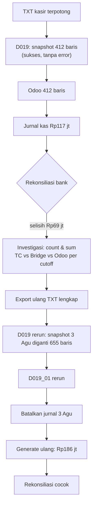

## Cerita

Senin 3 Agustus (fiktif), NAS penuh pukul 23:40 sehingga TXT kasir MH Kuningan hanya berisi 412 dari 655 transaksi. Job D019 Selasa pagi sukses (file valid, header benar). Rabu, Accounting men-generate jurnal TC Receipt Collection untuk 3 Agustus. Jumat, rekonsiliasi bank menunjukkan setoran Rp186 juta, jurnal kas Rp117 juta.

## Aktor

IT infra (NAS) · Airflow (D019/D019_01) · Accounting · kasir/supervisor kasir · AR · IT integrasi.

## Timeline

| Waktu | Kejadian | Sistem |
| --- | --- | --- |
| Sen 23:40 | TXT terpotong (412 baris) | TC → NAS |
| Sel 03:10 | D019 COPY → snapshot `trx_cashier_collection` (sync_type 6, cutoff 3 Agu) = 412 baris | Bridge |
| Sel 03:20 | D019_01 → `receivable.scroll.receipt.cashier` 412 baris | Odoo |
| Rab | Jurnal TC Receipt Collection 3 Agu = Rp117 jt | Odoo |
| Jum | Rekonsiliasi bank: selisih Rp69 jt | Finance |
| Jum | Investigasi: jumlah transaksi TC (655) ≠ Odoo (412) | IT + Finance |
| Sen+1 | TC export ulang lengkap; D019 rerun → snapshot diganti 655 baris; D019_01 rerun | Bridge/Odoo |
| Sen+1 | Batalkan/hapus jurnal 3 Agu (draft), generate ulang = Rp186 jt | Odoo |

## Diagram

## Dampak bisnis

| Area | Dampak selama belum pulih |
| --- | --- |
| Kas & bank | Kas GL kurang saji Rp69 jt; selisih rekonsiliasi |
| Piutang pasien | 243 tagihan tampak belum dibayar → risiko penagihan keliru ke pasien |
| Laporan harian manajemen | Pendapatan kas hari itu kurang saji |
| Fee/insentif berbasis receipt | Insentif PIC (payment_type RC) bisa salah hitung |
| Kepercayaan | Kasir dicurigai selisih padahal masalah integrasi |

## Mengapa sistem tidak mendeteksi otomatis?

- File terpotong tetap valid secara format → D019 sukses. <Confidence level="verified">D019 memvalidasi header/unit/tanggal, bukan kelengkapan</Confidence>
- Tidak ada **control total** (jumlah baris & nominal dari sumber) yang dibandingkan. <Confidence level="notfound">control total</Confidence>
- Wizard jurnal menolak tanggal yang sudah ada, sehingga jurnal salah harus dibatalkan dulu — ini **baik** (mencegah dobel) tetapi butuh prosedur.

## Mekanisme recovery yang didukung kode

- D019 **mengganti snapshot** per `sync_type + company + cutoff_date` dalam satu transaksi → rerun dengan file lengkap aman (tidak dobel). <Confidence level="verified">snapshot</Confidence>
- Jurnal TC unik per tanggal + advisory lock → tidak ada dobel jika dua orang generate bersamaan. <Confidence level="verified" />

## Pelajaran

1. "Job hijau" ≠ "data lengkap". Tambahkan control total dari sumber.
2. Desain **snapshot per tanggal** membuat rerun aman — pertahankan pola ini saat menambah interface baru.
3. Prosedur pemulihan harus melibatkan **Finance dan IT** (siapa membatalkan jurnal, siapa rerun job).
4. Pertanyaan terbuka: siapa pemilik monitoring & SLA? Lihat [Open Questions I1–I2](/docs/getting-started/open-questions).

## Sumber

### Kode

- <Src file="mayapada/models/receivable.py" line={9021} symbol="receivable.scroll.receipt.cashier" /> — model `ReceivableScrollReceiptCashier`
