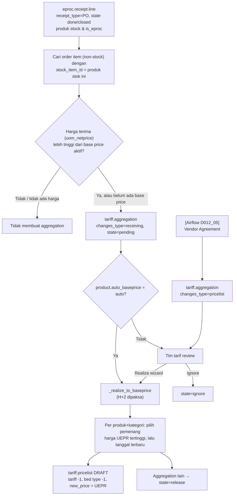

## 1. Apa itu?

**Base Price** adalah harga dasar barang (obat, BHP, alkes) yang menjadi titik awal markup. Di Mayapada, kandidat base price baru (**aggregation**, `tariff.aggregation`) dibuat ketika:

- **Receiving** (`changes_type = receiving`): penerimaan barang PO selesai dengan harga per UoM **lebih tinggi** dari base price aktif; atau
- **Vendor Pricelist / Agreement** (`changes_type = pricelist`): vendor agreement berlaku dengan harga baru (dihitung oleh Airflow D012_05).

Nama harga yang dipakai: **UEPR** (`uepr_price`, `uepr_effective`). Kepanjangan UEPR tidak ditemukan di repo. <Confidence level="confirm">arti singkatan UEPR</Confidence>

## 2. Kenapa RS membutuhkannya?

<Confidence level="general" /> Margin farmasi RS dihitung dari harga beli. Jika harga beli naik dan harga jual tidak ikut naik, RS menjual rugi. Sebaliknya penurunan harga beli tidak otomatis menurunkan harga jual di implementasi ini (lihat aturan 1 di bawah).

## 3. Siapa yang terlibat?

| Peran | Aksi |
| --- | --- |
| Gudang/Receiving | Menyelesaikan penerimaan barang (sumber harga). |
| Procurement | Mengesahkan vendor agreement. |
| Tim tarif/Finance | Mereview aggregation pending: **Realize** atau **Ignore**. |
| Sistem | Realisasi otomatis untuk produk dengan `auto_baseprice = auto`. |

## 6. Diagram

*Sumber:* <Src file="mayapada/eproc/eproc_tc.py" line={22219} symbol="TariffAggregation._scheduler_baseprice_aggregation" />), <Src file="mayapada/eproc/eproc_tc.py" line={22176} symbol="_prepare_from_receipt_line" />, <Src file="mayapada/eproc/eproc_tc.py" line={22265} symbol="_realize_to_baseprice" />; `airflow:a2_scheduler_mix_interfacing/D012_05_vendor_pricelist_to_baseprice_aggregation.py` → `sync_vendor_agreement_aggregation_unit()`. <Confidence level="verified" />

## 7. Implementasi di Odoo Mayapada

| Langkah | Kode | Catatan |
| --- | --- | --- |
| Ambil receipt line | `_scheduler_baseprice_aggregation` | Domain: `receipt_type='PO'`, `state in (done, closed)`, produk `is_eproc` & `eproc_type='stock'`; urut `uom_netprice desc`. |
| Mapping ke order item | <Src file="mayapada/eproc/eproc_tc.py" line={22167} symbol="_get_aggregation_products" /> | `product.template` dengan `stock_item_id` = produk stok. Satu stock item bisa dipetakan ke banyak order item. |
| Harga terima | <Src file="mayapada/eproc/eproc_tc.py" line={22163} symbol="_get_receiving_price" /> | `uom_netprice` atau `uom_price`. |
| Filter kenaikan | `_prepare_from_receipt_line` | Jika ada base price aktif dan `receive_price <= current_price` → **tidak** dibuat. |
| Idempotensi | — | Kunci `company + product + receipt_line_id`; record pending diperbarui, bukan diduplikasi. |
| Realisasi otomatis | `auto_baseprice == 'auto'` | Konteks `enforce_aggregation_h2` → `new_effective = max(tgl terima, hari ini+2)`. |
| Realisasi manual | <Src file="mayapada/eproc/eproc_tc.py" line={22427} symbol="tariff.aggregation.wizard" /> | `new_effective` default H+2, wajib ≥ H+2; jika sudah ada draft Base Price, wizard minta konfirmasi sebelum menimpa. |
| Pemenang | `_realize_to_baseprice` | Rank = (harga UEPR, tanggal UEPR, calculated_date, id) — **harga tertinggi menang**. Draft lama untuk bed type sama di-expire, diganti draft baru. |
| Laporan | <Src file="mayapada/eproc/eproc_tc.py" line={21121} symbol="tariff.aggregation.report.baseprice.receipt.wizard" /> | XLS "BasePrice vs Latest GRN". |

## 8. Alur perubahan data (sintetis)

| Waktu | Kejadian | Hasil |
| --- | --- | --- |
| 1 Apr | Base price aktif "Infus Set" Rp20.000 | — |
| 5 Apr | GRN-A Rp22.000/pcs; GRN-B Rp21.500/pcs | 2 aggregation pending (receiving) |
| 6 Apr | Tim tarif klik Realize, efektif 9 Apr | GRN-A menang → draft base price new 22.000/9 Apr; aggregation GRN-B → release |
| 9 Apr | Rollover | Base price aktif 22.000, prev 20.000 |
| 9 Apr | Compute fixed | Semua tariff yang bergantung pada base price item ini mendapat versi baru |

## 9. Business rules

1. **Hanya kenaikan** yang memicu aggregation dari receiving. Penurunan harga beli tidak menurunkan base price. <Confidence level="verified" /> Apakah ini kebijakan resmi? <Confidence level="confirm" />
2. Produk kategori item wajib punya item category.
3. Base price dibuat untuk bed type `id = -1` saja.
4. Receipt **tanpa PO (WO)** dan **retur (RT)** tidak menjadi sumber harga.

## 10. Common problems

| Masalah | Penyebab |
| --- | --- |
| GRN sudah done tapi tidak ada aggregation | `stock_item_id` order item tidak terisi; harga tidak lebih tinggi; produk bukan `is_eproc`/`stock`. |
| Receiving & vendor agreement menghasilkan dua baris untuk produk sama | Keduanya diproses independen (memory: gap requirement "hanya tampilkan sumber terbaru"). |
| Aggregation memakai harga lebih tinggi yang sudah "basi" | Rank berbasis harga, bukan tanggal — GRN lama yang mahal bisa mengalahkan GRN baru yang lebih murah dalam batch pending yang sama. |
| Run Airflow mengembalikan 0 baris | Tanggal run tidak sesuai tanggal penerimaan/agreement (memory, 3 Sep 2026). |

## 11. Yang perlu developer pahami

- Aggregation membandingkan dengan `current_price` aktif, bukan dengan `current_effective`.
- Lookup base price aktif utamanya per produk; jika satu produk punya beberapa kombinasi kategori, review disambiguasi (memory). <Confidence level="inferred" />
- Fungsi <Src file="mayapada/eproc/eproc_tc.py" line={22418} symbol="sync_baseprice_aggregation_unit" /> / <Src file="mayapada/eproc/eproc_tc.py" line={22421} symbol="sync_baseprice_pricelist_unit" /> adalah *entry point* yang dipanggil job; realisasi lewat job selalu memaksa H+2.

## 12. Pertanyaan uji

<Accordions>
<Accordion title="Harga beli turun dari Rp22.000 menjadi Rp19.000. Apa yang terjadi pada base price?">
Tidak ada. `_prepare_from_receipt_line` hanya membuat aggregation jika harga terima lebih tinggi dari base price aktif.
</Accordion>
<Accordion title="Kenapa base price butuh mapping order item ↔ stock item?">
Karena yang dibeli adalah **stock item** (kemasan gudang), sedangkan yang dijual di HIS adalah **order item**. Harga beli harus diterjemahkan ke item yang punya tarif.
</Accordion>
<Accordion title="Apa beda state release dan ignore?">
`release` = sudah direalisasi (atau kalah dari pemenang dalam batch yang sama). `ignore` = ditolak manual oleh tim tarif.
</Accordion>
</Accordions>

## 13. Referensi

<Src file="mayapada/eproc/eproc_tc.py" line={21120} end={22510} /> <Confidence level="verified" /> · Project memory "Important Decisions" (changes_type, Vendor Agreement) <Confidence level="inferred" />

**Kode:**

- <Src file="mayapada/eproc/eproc_tc.py" line={21121} symbol="tariff.aggregation.report.baseprice.receipt.wizard" /> — model `TariffAggregationBasepriceReceiptReportWizard`
- <Src file="mayapada/eproc/eproc_tc.py" line={22052} symbol="tariff.aggregation" /> — model `TariffAggregation`
- <Src file="mayapada/eproc/eproc_tc.py" line={22163} symbol="_get_receiving_price" /> — method `TariffAggregation`
- <Src file="mayapada/eproc/eproc_tc.py" line={22167} symbol="_get_aggregation_products" /> — method `TariffAggregation`
- <Src file="mayapada/eproc/eproc_tc.py" line={22176} symbol="_prepare_from_receipt_line" /> — method `TariffAggregation`
- <Src file="mayapada/eproc/eproc_tc.py" line={22219} symbol="TariffAggregation._scheduler_baseprice_aggregation" /> — method `TariffAggregation`
- <Src file="mayapada/eproc/eproc_tc.py" line={22265} symbol="_realize_to_baseprice" /> — method `TariffAggregation`
- <Src file="mayapada/eproc/eproc_tc.py" line={22418} symbol="sync_baseprice_aggregation_unit" /> — method `TariffAggregation`
- <Src file="mayapada/eproc/eproc_tc.py" line={22421} symbol="sync_baseprice_pricelist_unit" /> — method `TariffAggregation`
- <Src file="mayapada/eproc/eproc_tc.py" line={22427} symbol="tariff.aggregation.wizard" /> — model `TariffAggregationWizard`
- <Src file="mayapada/models/product.py" line={54} symbol="product.template" /> — extend `ProductTemplate`
