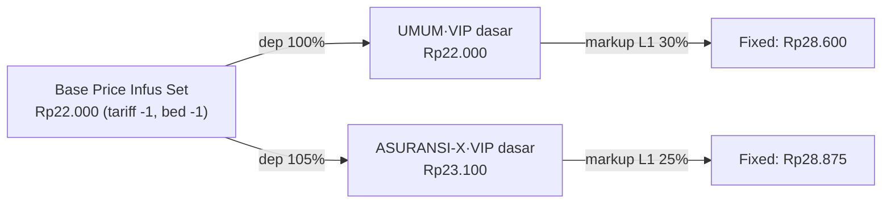

<Callout type="warn">
Semua nama tarif, item, dan angka **fiktif**. Pola konfigurasi (misalnya tarif item diturunkan dari Base Price lewat dependency) adalah **inferensi** dari batasan kode: pricelist tarif jual hanya untuk produk `procedure`, sedangkan barang hanya punya Base Price. <Confidence level="inferred" /> <Confidence level="confirm">konfigurasi aktual di produksi</Confidence>
</Callout>

## Data master contoh

| Tariff | ID | Keterangan |
| --- | --- | --- |
| BASEPRICE | -1 | Base Price |
| UMUM | 10 | Pasien bayar sendiri |
| ASURANSI-X | 11 | Asuransi swasta kontrak |

| Bed type | ID | patient_type |
| --- | --- | --- |
| OPD BASE | -1 | OP |
| KELAS 1 | 21 | IP |
| VIP | 22 | IP |

## Contoh 1 — Tindakan "Jahit Luka" (produk procedure)

**Konfigurasi**

- Pricelist UMUM · KELAS 1 · "Tindakan Minor" · Jahit Luka = **Rp200.000** (active).
- Dependency UMUM · VIP · Tindakan Minor → UMUM · KELAS 1 · **150%**.
- Dependency ASURANSI-X · KELAS 1 · Tindakan Minor → UMUM · KELAS 1 · **110%**.
- Tidak ada markup (produk tindakan tanpa item category).

**Hasil Fixed Selling Price**

| Tariff · Bed | Rumus | Harga |
| --- | --- | ---: |
| UMUM · KELAS 1 | 200.000 | **200.000** |
| UMUM · VIP | 200.000 × 150% | **300.000** |
| ASURANSI-X · KELAS 1 | 200.000 × 110% | **220.000** |

## Contoh 2 — Barang "Infus Set" (Base Price + markup berjenjang)

**Konfigurasi**

- Base Price BASEPRICE · OPD BASE · Infus Set = **Rp22.000**.
- Dependency UMUM · VIP · "Alkes & BHP" → BASEPRICE · OPD BASE · **100%**.
- Dependency ASURANSI-X · VIP · "Alkes & BHP" → BASEPRICE · OPD BASE · **105%**.
- Markup UMUM · VIP · item category "BHP" (Category): L1 0–50.000 = **30%**; L2 50.000,01–500.000 = **20%**; L3 ≥ 500.000,01 = **10%**.
- Markup ASURANSI-X · VIP · BHP (Category): L1 0–50.000 = **25%**.

| Tariff | Harga dasar | Tier | Final |
| --- | ---: | --- | ---: |
| UMUM · VIP | 22.000 × 100% = 22.000 | L1 30% | 22.000 × 1,30 = **28.600** |
| ASURANSI-X · VIP | 22.000 × 105% = 23.100 | L1 25% | 23.100 × 1,25 = **28.875** |

## Contoh 3 — Harga beli naik, harga baru terjadwal

1. **5 Apr:** GRN Infus Set Rp52.000/pcs (naik dari 22.000) → aggregation pending.
2. **6 Apr:** Realize, efektif **9 Apr** → draft Base Price `new_price` 52.000.
3. **6 Apr, compute:** Fixed UMUM · VIP versi baru:

| Field | Nilai | Penjelasan |
| --- | ---: | --- |
| current_price | 28.600 | 22.000 × 1,30 (tier L1) |
| new_price | **62.400** | 52.000 × 1,20 — harga dasar baru masuk **tier L2** |
| new_effective | 9 Apr | dari draft pending |
| state_tc | pending | siap dikirim ke TC |

4. **9 Apr:** rollover → base price aktif 52.000 (prev 22.000); compute → versi baru dengan current = new = 62.400.

<Callout title="Pelajaran">
Kenaikan harga beli 136% hanya menaikkan harga jual 118% karena item pindah ke tier markup yang lebih rendah. Inilah tujuan markup berjenjang.
</Callout>

## Latihan

<Accordions>
<Accordion title="Jika markup L1 UMUM·VIP diubah dari 30% menjadi 35% pada 7 Apr, apa current_effective versi baru?">
`MAX(base price current_effective, dependency.write_date, markup.write_date)` = **7 Apr** (karena markup baru ditulis 7 Apr), dengan current_price = 22.000 × 1,35 = 29.700 (sebelum rollover 9 Apr).
</Accordion>
<Accordion title="Item baru 'Kateter' hanya punya Base Price, tetapi tidak ada dependency untuk kategorinya di ASURANSI-X. Berapa harganya di ASURANSI-X?">
Tidak ada record Fixed Selling Price untuk ASURANSI-X — item tidak berharga di TC untuk penjamin itu. Ini kasus "missing price" yang harus dideteksi.
</Accordion>
</Accordions>
