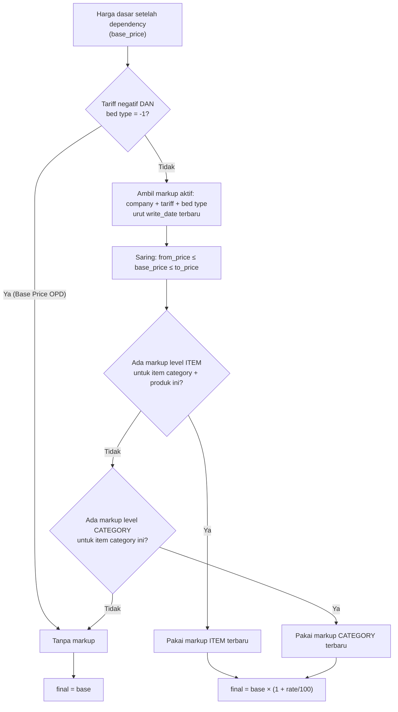

## 1. Apa itu?

- **Dependency** (`tariff.dependency`): "Harga tarif **B** untuk bed type **Y** dan kategori **K** = harga tarif **A** untuk bed type **X** × **depend rate %**." Satu aturan berlaku untuk **semua produk** di kategori K.
- **Markup** (`tariff.markup`): "Untuk tarif B, bed type Y, item category/item tertentu, jika harga dasar ada di rentang [from, to], tambahkan **markup rate %**." Ada maksimal 4 tingkat (Price Level 1–4).

## 2. Kenapa RS membutuhkannya?

<Confidence level="general" />

- **Efisiensi pemeliharaan.** RS punya ribuan item × puluhan tarif × belasan kelas kamar. Menginput semua harga manual tidak realistis; tarif kontrak sering dinyatakan sebagai persentase dari tarif dasar.
- **Margin berjenjang untuk barang.** Praktik umum farmasi RS: margin persentase lebih besar untuk barang murah dan lebih kecil untuk barang mahal, agar harga obat mahal tetap wajar.
- **Kelas kamar.** Tarif VIP sering ditetapkan sebagai kelipatan tarif kelas standar.

## 3. Siapa yang terlibat?

Tim tarif/Finance mengatur aturan; manajemen menetapkan kebijakan persentase. <Confidence level="confirm" />

## 4. Contoh skenario (sintetis)

> RS menandatangani kontrak dengan "Asuransi Sehat Prima": tarif tindakan = **110%** tarif umum di kelas yang sama. Untuk BHP, markup **30%** jika harga dasar ≤ Rp50.000, **20%** untuk Rp50.001–Rp500.000, **10%** di atasnya.

- Dependency: `tariff_id`=SEHAT PRIMA, `bed_type_id`=Kelas 1, `category_id`=Tindakan Bedah, `depend_tariff_id`=UMUM, `depend_bed_type_id`=Kelas 1, `depend_rate`=110.
- Markup: tiga record Level 1–3 untuk SEHAT PRIMA, Kelas 1, item category "BHP", markup_level=Category.

## 6. Diagram pemilihan markup

*Sumber:* <Src file="mayapada/eproc/eproc_tc.py" line={19857} symbol="TariffPricelistFixed._get_markup_for_combination" />. <Confidence level="verified" />

## 7. Implementasi di Odoo Mayapada

### Dependency — `eproc_tc.py:21313`

| Field | Arti |
| --- | --- |
| `tariff_id`, `bed_type_id`, `category_id` | Target (tarif yang harganya diturunkan). `category_id` = service/order category. |
| `depend_tariff_id`, `depend_bed_type_id` | Sumber harga. |
| `depend_rate` | Persen. Record aktif wajib **1–200**; record nonaktif 0–200 (<Src file="mayapada/eproc/eproc_tc.py" line={21351} symbol="_check_depend_rate" />). |

- Membuat dependency aktif baru meng-*archive* dependency aktif lama untuk kunci `company + tariff + category + bed type` (<Src file="mayapada/eproc/eproc_tc.py" line={21365} symbol="_archive_existing_active" />).
- Saat compute, dependency yang dipakai adalah yang **`write_date` terbaru** (<Src file="mayapada/eproc/eproc_tc.py" line={19817} symbol="_get_dependency" />) — mengedit dependency lama membuatnya "paling baru".
- Wizard <Src file="mayapada/eproc/eproc_tc.py" line={21385} symbol="tariff.dependency.wizard" /> menampilkan semua service category untuk tariff/bed type terpilih agar diisi massal.

### Markup — `eproc_tc.py:21577`

| Field | Arti |
| --- | --- |
| `markup_level` | `0` = Item, `1` = Category. |
| `category_id` | **Item category** (bukan order category) untuk kedua level. |
| `product_tmpl_id` | Wajib untuk level Item. |
| `markup_tier` | Level 1–4 (<Src file="mayapada/eproc/eproc_tc.py" line={21562} symbol="TARIFF_MARKUP_TIERS" />). |
| `from_price`, `to_price` | Rentang harga dasar. Default to = 9.999.999.999.999. |
| `markup_rate` | 0–100%. |

Validasi:
- `_check_markup_rate`: 0 ≤ rate ≤ 100.
- <Src file="mayapada/eproc/eproc_tc.py" line={21642} symbol="_check_markup_price_range" />: `to ≥ from ≥ 0`; rentang aktif **tidak boleh tumpang tindih** untuk tariff + level + bed type + kategori/item yang sama.
- `_check_markup_level_fields`: Item butuh bed type + category + item; Category butuh bed type + category; category harus `item_category`.
- `_check_base_tariff_opd_bed_type`: Base tariff + OPD bed type tidak boleh punya markup.

<Callout type="warn" title="Perubahan Okt 2026 (memory)">
Sejak 2026-10-03, level Category juga memakai **item category** (sebelumnya order category). Sembilan markup Category lama di Odoo 16 masih menunjuk order category dan **tidak lagi berlaku** — data sengaja tidak dimigrasi. <Confidence level="confirm">perlu keputusan mapping bisnis</Confidence>
</Callout>

## 9. Business rules penting

1. Dependency tidak punya produk → **tidak bisa membuat harga sendiri**. Harga target hanya tercipta untuk produk yang punya pricelist sumber (active/draft) di kategori & bed type sumber.
2. Markup dipilih berdasarkan **harga dasar** saat itu; harga baru (`new`) bisa jatuh ke tier berbeda dari harga sekarang (`current`), sehingga markup current dan new dihitung terpisah.
3. Item markup selalu menang atas Category markup.

## 10. Common problems

| Masalah | Akibat | Cara deteksi |
| --- | --- | --- |
| Depend rate salah ketik (mis. 11 bukan 110) | Semua item kategori itu turun 89% | Bandingkan Fixed Selling Price antar tariff per kategori. |
| Rentang markup ada celah (mis. 50.000–50.001) | Item di celah tanpa markup → dijual pada harga dasar | Laporan item tanpa markup. |
| Source pricelist tidak ada | Item tidak punya harga di tariff turunan | Hitung kombinasi dependency tanpa Fixed Selling Price. |
| Category markup memakai order category lama | Markup diabaikan | Query markup level 1 dengan category `eproc_type != item_category`. |

## 11. Yang perlu developer pahami

- `write_date` adalah bagian dari logika bisnis (pemilihan dependency & tanggal efektif). Menyentuh record (write tanpa perubahan bermakna) bisa menggeser `current_effective` Fixed Selling Price. Lihat [Fixed Selling Price](/docs/tariff-pricing/fixed-selling-price).
- Dependency berantai (A→B→C) **tidak** dihitung rekursif: compute dependency membaca `tariff.pricelist` sumber, bukan Fixed Selling Price sumber. <Confidence level="verified">_compute_dependency_fixed_price_vals membaca tariff.pricelist</Confidence>

## 12. Pertanyaan uji

<Accordions>
<Accordion title="Tarif B depend 120% ke A. Harga A Rp100.000, markup B Category Level 1 (0–200.000) 25%. Berapa harga final B?">
Base B = 100.000 × 1,20 = 120.000 → masuk Level 1 → 120.000 × 1,25 = **Rp150.000**.
</Accordion>
<Accordion title="Kenapa markup bisa berbeda antara harga current dan harga new untuk item yang sama?">
Karena tier dipilih dari harga dasar masing-masing. Jika harga baru melewati batas `to_price` tier 1, ia memakai tier 2.
</Accordion>
<Accordion title="Bisakah tarif C depend ke B yang depend ke A?">
Tidak secara otomatis. C akan membaca `tariff.pricelist` milik B; jika B hanya ada sebagai hasil dependency (tanpa pricelist sendiri), C tidak mendapat harga.
</Accordion>
</Accordions>

## 13. Referensi

<Src file="mayapada/eproc/eproc_tc.py" line={19817} end={19944} />, <Src file="mayapada/eproc/eproc_tc.py" line={21313} end={22050} />. <Confidence level="verified" />

**Kode:**

- <Src file="mayapada/eproc/eproc_tc.py" line={19129} symbol="tariff.pricelist" /> — model `TariffPricelist`
- <Src file="mayapada/eproc/eproc_tc.py" line={19817} symbol="_get_dependency" /> — method `TariffPricelistFixed`
- <Src file="mayapada/eproc/eproc_tc.py" line={19857} symbol="TariffPricelistFixed._get_markup_for_combination" /> — method `TariffPricelistFixed`
- <Src file="mayapada/eproc/eproc_tc.py" line={21314} symbol="tariff.dependency" /> — model `TariffDependency`
- <Src file="mayapada/eproc/eproc_tc.py" line={21351} symbol="_check_depend_rate" /> — method `TariffDependency`
- <Src file="mayapada/eproc/eproc_tc.py" line={21365} symbol="_archive_existing_active" /> — method `TariffDependency`
- <Src file="mayapada/eproc/eproc_tc.py" line={21385} symbol="tariff.dependency.wizard" /> — model `TariffDependencyWizard`
- <Src file="mayapada/eproc/eproc_tc.py" line={21578} symbol="tariff.markup" /> — model `TariffMarkup`
- <Src file="mayapada/eproc/eproc_tc.py" line={21627} symbol="_check_markup_rate" /> — method `TariffMarkup`
- <Src file="mayapada/eproc/eproc_tc.py" line={21633} symbol="_check_base_tariff_opd_bed_type" /> — method `TariffMarkup`
- <Src file="mayapada/eproc/eproc_tc.py" line={21642} symbol="_check_markup_price_range" /> — method `TariffMarkup`
- <Src file="mayapada/eproc/eproc_tc.py" line={21666} symbol="_check_markup_level_fields" /> — method `TariffMarkup`

**Eksternal:**

- Permenkes 85/2015 tentang Pola Tarif Nasional Rumah Sakit — ringkasan [pasal.id](https://pasal.id/peraturan/permen/permenkes-no-85-tahun-2015); teks [BN 2016/9 (PDF)](https://www.kemhan.go.id/itjen/wp-content/uploads/2017/03/bn9-2016.pdf). *Mendukung:* tarif berbeda per kelas perawatan (diakses 11 Okt 2026).
