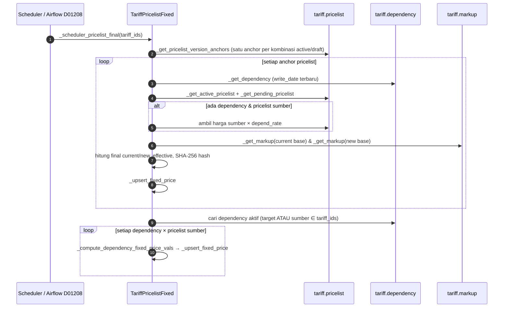

## 1. Apa itu?

`tariff.pricelist.fixed` ("Tariff Fixed Selling Price") adalah **hasil akhir** perhitungan harga: angka yang dipakai HIS untuk menagih. Setiap record berisi `current_price/current_effective`, `new_price/new_effective`, `state_tc`, dan `price_hash`. Workbook requirement menamainya `tariff.pricelist.final`; implementasinya `tariff.pricelist.fixed`. <Confidence level="verified">memory + kode</Confidence>

## 2. Kenapa harus disimpan?

- HIS butuh angka final per kombinasi, bukan rumus.
- **Bukti historis:** versi lama tidak dihapus, hanya `active=False`, sehingga harga yang dikirim pada tanggal tertentu bisa direkonstruksi.
- **Status kirim** (`pending`/`sent`) per versi mencegah pengiriman ganda.
- **Hash** mencegah versi baru jika tidak ada perubahan nyata.

## 3. Siapa yang terlibat?

Scheduler/Airflow (compute), Finance (export manual / mark sent), IT integrasi (TXT ke NAS), TrakCare (konsumen).

## 6. Sequence perhitungan



*Sumber:* <Src file="mayapada/eproc/eproc_tc.py" line={20657} symbol="_scheduler_pricelist_final" /> dan method terkait. <Confidence level="verified" />

## 7. Implementasi di Odoo Mayapada

### Rumus

```text
current_base = harga active (atau harga sumber × depend_rate jika dependency)
new_base     = new_price draft pending (atau sumber pending × depend_rate); jika tidak ada = current_base
final_current = current_base × (1 + markup(current_base)/100)
final_new     = new_base     × (1 + markup(new_base)/100)
```

### Tanggal efektif — `_max_current_effective` (20049)

```text
current_effective = MAX( pricelist.current_effective,
                         dependency.write_date (tanggal),
                         markup.write_date (tanggal) )
new_effective     = pending.new_effective, atau = current_effective jika tidak ada pending
```

Artinya: **mengubah dependency atau markup hari ini membuat harga "efektif" hari ini** walaupun pricelist-nya lama. <Confidence level="verified" /> Apakah ini sesuai kebijakan bisnis (perubahan markup berlaku langsung tanpa H+2)? <Confidence level="confirm" />

### Versi & hash — `_generate_price_hash` (20106), `_upsert_fixed_price` (20562)

- Hash = SHA-256 dari company, tariff, kategori, produk, bed type, patient type, harga current/new (dibulatkan 4 desimal), dan tanggal current/new.
- Cari record **active** untuk kombinasi yang sama (termasuk `patient_type`).
  - Hash sama → tidak ada perubahan (log "unchanged").
  - Hash beda → record lama `active=False`, record baru dibuat dengan `state_tc=pending`.

### Scope recompute — `_scheduler_pricelist_final` (20657)

Diproses: (1) semua anchor pricelist tariff terpilih; (2) dependency yang **target**-nya tariff terpilih; (3) dependency yang **sumber**-nya tariff terpilih. Butir (3) memastikan perubahan tarif A ikut menghitung ulang tarif B yang bergantung pada A.

### Wizard & aksi

| Komponen | Fungsi |
| --- | --- |
| <Src file="mayapada/eproc/eproc_tc.py" line={19631} symbol="tariff.pricelist.fixed.wizard" /> | Hitung ulang untuk tariff terpilih (`action_update`). |
| <Src file="mayapada/eproc/eproc_tc.py" line={20829} symbol="tariff.pricelist.fixed.export" /> | Export XLS/TXT per status (Pending/Sent/All); field `urgent_rate` default 20%. |
| <Src file="mayapada/eproc/eproc_tc.py" line={20821} symbol="action_mark_sent_tc" /> | Tandai versi terpilih `sent`. |

## 8. Alur perubahan data (sintetis)

| Hari | Kejadian | Fixed Selling Price (UMUM, Kelas 1, "Jahit Luka") |
| --- | --- | --- |
| D0 | Compute awal | v1: current 200.000 / eff 1 Jan, new = current, pending |
| D0 | Export & mark sent | v1: sent |
| D1 | Compute lagi tanpa perubahan | v1 tetap (hash sama) |
| D2 | Draft baru 220.000 eff D4 | v1 active=False; **v2**: current 200.000, new 220.000/D4, pending |
| D4 | Rollover, compute | v2 off; **v3**: current 220.000/D4, new 220.000/D4, pending |

## 9. Business rules

- Base Price OPD (tariff negatif + bed type -1) tidak pernah diberi markup.
- `patient_type` record fixed diambil dari pricelist/dependency; default `ALL`.
- Hanya pricelist `active=True` dengan state `active`/`draft` yang menjadi anchor.

## 10. Common problems

| Masalah | Penyebab |
| --- | --- |
| Versi baru terus muncul setiap hari | Field ikut hash berubah tiap compute — mis. tanggal efektif bergeser karena dependency/markup di-*write* oleh ETL setiap hari. |
| Harga tidak pernah terkirim | Tidak ada versi `pending` yang `new_effective`-nya jatuh di jendela kirim (H+1, lihat Publikasi). |
| Dua record active untuk satu kombinasi | Compute berjalan paralel (tidak ada lock) atau insert via SQL. <Confidence level="inferred" /> |
| Status `sent` tapi TC belum memakai | `sent` hanya berarti file dibuat/ditandai; callback ACK dari TC (D01210) belum diimplementasikan menurut memory. |

## 11. Yang perlu developer pahami

- Jangan menambah field ke hash tanpa memikirkan dampaknya: setiap perubahan definisi hash membuat **semua** kombinasi menjadi versi baru dan dikirim ulang ke TC.
- `_get_pending_pricelist` hanya membaca draft dengan `state_tc='pending'`.
- Perhitungan berjalan dengan ORM per kombinasi — lambat untuk ribuan item; ETL Airflow mungkin punya implementasi SQL sendiri (D42/D01208). Pastikan keduanya konsisten.

## 12. Pertanyaan uji

<Accordions>
<Accordion title="Kenapa recompute tanpa perubahan tidak membuat record baru?">
Karena `_upsert_fixed_price` membandingkan `price_hash`; hash identik → kembalikan record lama.
</Accordion>
<Accordion title="Markup diubah hari ini pukul 10.00. Apa current_effective Fixed Selling Price?">
Tanggal hari ini (MAX dengan `markup.write_date`), selama markup tersebut yang terpilih.
</Accordion>
<Accordion title="Tarif A berubah. Apakah tarif B yang depend ke A ikut berubah jika scheduler dijalankan hanya untuk tarif A?">
Ya. Scheduler juga memproses dependency yang `depend_tariff_id` ∈ tariff terpilih.
</Accordion>
</Accordions>

## 13. Referensi

<Src file="mayapada/eproc/eproc_tc.py" line={19682} end={21119} /> <Confidence level="verified" /> · Memory: D01208 compute, D01209 TXT, D01210 callback belum diimplementasi <Confidence level="inferred" />

**Kode:**

- <Src file="mayapada/eproc/eproc_tc.py" line={19631} symbol="tariff.pricelist.fixed.wizard" /> — model `TariffPricelistFixedWizard`
- <Src file="mayapada/eproc/eproc_tc.py" line={19667} symbol="action_update" /> — method `TariffPricelistFixedWizard`
- <Src file="mayapada/eproc/eproc_tc.py" line={19683} symbol="tariff.pricelist.fixed" /> — model `TariffPricelistFixed`
- <Src file="mayapada/eproc/eproc_tc.py" line={19945} symbol="_get_pending_pricelist" /> — method `TariffPricelistFixed`
- <Src file="mayapada/eproc/eproc_tc.py" line={20049} symbol="_max_current_effective" /> — method `TariffPricelistFixed`
- <Src file="mayapada/eproc/eproc_tc.py" line={20106} symbol="_generate_price_hash" /> — method `TariffPricelistFixed`
- <Src file="mayapada/eproc/eproc_tc.py" line={20562} symbol="_upsert_fixed_price" /> — method `TariffPricelistFixed`
- <Src file="mayapada/eproc/eproc_tc.py" line={20657} symbol="_scheduler_pricelist_final" /> — method `TariffPricelistFixed`
- <Src file="mayapada/eproc/eproc_tc.py" line={20821} symbol="action_mark_sent_tc" /> — method `TariffPricelistFixed`
- <Src file="mayapada/eproc/eproc_tc.py" line={20829} symbol="tariff.pricelist.fixed.export" /> — model `TariffPricelistFixedExport`
