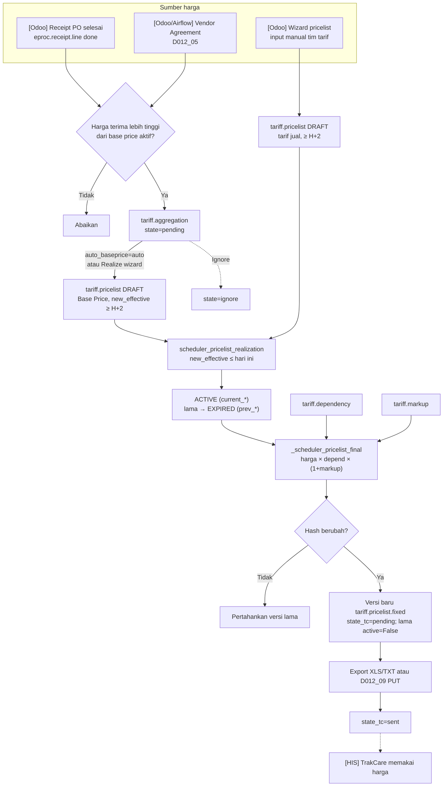

## 1. Apa itu?

**Tarif rumah sakit** adalah daftar harga setiap item yang bisa ditagihkan ke pasien: tindakan, visite dokter, kamar, obat, alat kesehatan habis pakai (BHP), pemeriksaan lab/radiologi. Satu item bisa punya **banyak harga** tergantung:

- **Siapa penjaminnya** (tarif umum, tarif asuransi X, tarif perusahaan Y, BPJS) → di Odoo disebut **Tariff** (`hospital.tariff`).
- **Kelas kamar / jenis episode** (VIP, Kelas 1, OPD, IGD) → **Bed Type** (`hospital.bed.type`) yang membawa **patient type**.
- **Kapan** harga berlaku → tanggal efektif (`current_effective`, `new_effective`).

## 2. Kenapa rumah sakit membutuhkannya?

<Confidence level="general" />

- **Kontrak penjamin berbeda.** Asuransi swasta dan perusahaan menegosiasikan harga (diskon atau markup tertentu). BPJS dibayar dengan paket INA-CBG, bukan per item — tetapi RS tetap butuh tarif per item untuk menghitung biaya riil dan selisih.
- **Kelas kamar.** Praktik umum di RS swasta: semakin tinggi kelas kamar, semakin tinggi tarif tindakan & visite (bukan hanya harga kamar).
- **Harga barang naik.** Obat & BHP mengikuti harga beli; RS harus menjaga margin tanpa menjual di bawah harga beli.
- **Audit & konsistensi.** Harga yang ditagihkan ke pasien harus bisa ditelusuri ke keputusan harga yang sah pada tanggal tersebut.

## 3. Siapa yang terlibat?

| Peran | Tanggung jawab | Status |
| --- | --- | --- |
| Finance / tim tarif (grup *Finance & Accounting* di Odoo) | Mengisi pricelist, dependency, markup | <Confidence level="inferred">dari ACL & menu</Confidence> |
| Procurement / Purchasing | Menghasilkan harga beli (PO, receipt, vendor agreement) yang memicu base price | <Confidence level="verified" /> |
| Manajemen / Direksi | Menyetujui kebijakan tarif & margin | <Confidence level="confirm">tidak ada approval tarif di kode</Confidence> |
| IT Integrasi | Menjalankan job Airflow & publikasi TXT ke TrakCare | <Confidence level="verified">README Airflow</Confidence> |
| Kasir/Billing (di HIS) | Memakai harga final saat menagih pasien | <Confidence level="general" /> |

## 4. Bagaimana prosesnya di lapangan? (lifecycle Mayapada)

<Steps>
<Step>
**Harga beli masuk.** Barang diterima dari supplier (receipt PO selesai) atau vendor agreement disahkan.
</Step>
<Step>
**Base Price Aggregation.** Odoo membandingkan harga beli dengan base price aktif. Jika lebih tinggi, dibuat *saran* (`tariff.aggregation`, state `pending`).
</Step>
<Step>
**Realisasi ke Base Price.** Saran direalisasi menjadi **draft** `tariff.pricelist` (tariff Base Price, bed type OPD) dengan `new_effective` ≥ H+2.
</Step>
<Step>
**Input harga tarif jual** (tindakan/prosedur) oleh tim tarif via wizard, juga sebagai draft ≥ H+2.
</Step>
<Step>
**Rollover/Release.** Saat `new_effective` tiba, draft → `active`, active lama → `expired`, harga lama disimpan di `prev_*`.
</Step>
<Step>
**Compute Fixed Selling Price.** Untuk setiap kombinasi tarif × produk × bed type: harga dasar × depend rate × (1+markup) → `tariff.pricelist.fixed` (versi baru hanya jika hash berubah).
</Step>
<Step>
**Publikasi ke TrakCare.** Versi `pending` diekspor (XLS/TXT) dan, menurut desain Airflow, di-PUT sebagai TXT ke NAS lalu ditandai `sent`.
</Step>
</Steps>

## 6. Diagram lifecycle

*Sumber:* <Src file="mayapada/eproc/eproc_tc.py" /> — <Src file="mayapada/eproc/eproc_tc.py" line={22051} symbol="TariffAggregation" />, <Src file="mayapada/eproc/eproc_tc.py" line={19266} symbol="TariffPricelist.scheduler_pricelist_realization" />, <Src file="mayapada/eproc/eproc_tc.py" line={20657} symbol="TariffPricelistFixed._scheduler_pricelist_final" />; `airflow:README.md` (A2 012-04 s.d. 012-10). <Confidence level="verified" />

<PriceFormula />

## Halaman di bagian ini

<Cards>
  <Card title="Master Tarif: Tariff, Bed Type, Patient Type" href="/docs/tariff-pricing/master-tarif" />
  <Card title="Lifecycle Pricelist (Draft → Active → Expired)" href="/docs/tariff-pricing/pricelist-lifecycle" />
  <Card title="Dependency & Markup" href="/docs/tariff-pricing/dependency-markup" />
  <Card title="Fixed Selling Price" href="/docs/tariff-pricing/fixed-selling-price" />
  <Card title="Base Price Aggregation (dari GRN)" href="/docs/tariff-pricing/base-price-aggregation" />
  <Card title="Publikasi ke TrakCare" href="/docs/tariff-pricing/publikasi-trakcare" />
  <Card title="Contoh Perhitungan Lengkap" href="/docs/tariff-pricing/contoh-perhitungan" />
</Cards>

## Pertanyaan cepat

<Accordions>
<Accordion title="Kenapa harga layanan bisa berbeda antara pasien umum dan pasien asuransi?">
Karena di Odoo setiap penjamin/kontrak dipetakan ke **tariff** berbeda. Harga untuk tariff asuransi bisa diturunkan dari tariff lain lewat **dependency** (mis. 90% dari tarif umum) lalu diberi **markup** sendiri. Pasien umum memakai tariff umum. Keputusan tariff mana yang dipakai pasien terjadi di HIS saat registrasi (`sale.order.tariff_id` hanya mencatat hasilnya).
</Accordion>
<Accordion title="Apa yang terjadi kalau tarif rumah sakit berubah?">
Harga baru disimpan sebagai `new_price` pada baris **draft** dengan `new_effective` ≥ H+2. Harga lama tetap berlaku sampai tanggal itu. Saat rollover, baris lama di-*expire* dan harga lama tersalin ke `prev_price`. Fixed Selling Price lalu dihitung ulang — termasuk untuk **semua tariff yang bergantung** pada tariff yang berubah.
</Accordion>
<Accordion title="Kenapa fixed selling price perlu disimpan, bukan dihitung on-the-fly?">
Karena (1) HIS membutuhkan angka final, bukan rumus; (2) harus ada **bukti versi** harga yang dikirim pada tanggal tertentu (audit, sengketa tagihan); (3) status kirim (`state_tc`) harus dilacak per versi; (4) perhitungan dependency + markup mahal jika diulang per transaksi.
</Accordion>
<Accordion title="Bagaimana tarif kamar memengaruhi tagihan?">
Bed type adalah bagian dari kunci harga. Item yang sama bisa punya harga berbeda per bed type, dan dependency dapat merujuk ke bed type lain (mis. tarif VIP = 150% tarif Kelas 1). Di sisi billing, `sale.order` menyimpan *billable*, *eligible*, dan *alloted* bed type — selisih antara kamar yang dijamin dan kamar yang ditempati biasanya menjadi beban pribadi pasien. <Confidence level="confirm">aturan selisih kelas di Mayapada</Confidence>
</Accordion>
<Accordion title="Apa akibat pricing dependency yang salah?">
Harga salah tersebar ke **banyak** item sekaligus (satu dependency berlaku untuk satu tariff × bed type × kategori). Jika source pricelist tidak ada untuk suatu produk, dependency **tidak menghasilkan** harga sama sekali untuk produk itu — item tidak punya harga di HIS. Lihat [Dependency & Markup](/docs/tariff-pricing/dependency-markup).
</Accordion>
</Accordions>

## Sumber

### Kode

- <Src file="mayapada/eproc/eproc_tc.py" line={19129} symbol="tariff.pricelist" /> — model `TariffPricelist`
- <Src file="mayapada/eproc/eproc_tc.py" line={19266} symbol="TariffPricelist.scheduler_pricelist_realization" /> — method `TariffPricelist`
- <Src file="mayapada/eproc/eproc_tc.py" line={19683} symbol="tariff.pricelist.fixed" /> — model `TariffPricelistFixed`
- <Src file="mayapada/eproc/eproc_tc.py" line={20657} symbol="TariffPricelistFixed._scheduler_pricelist_final" /> — method `TariffPricelistFixed`
- <Src file="mayapada/eproc/eproc_tc.py" line={22051} symbol="TariffAggregation" /> — class `TariffAggregation`
- <Src file="mayapada/eproc/eproc_tc.py" line={22052} symbol="tariff.aggregation" /> — model `TariffAggregation`
- <Src file="mayapada/models/hospital.py" line={30} symbol="hospital.bed.type" /> — model `HospitalBedType`
- <Src file="mayapada/models/hospital.py" line={178} symbol="hospital.tariff" /> — model `HospitalTariff`
- <Src file="mayapada/models/sale.py" line={43} symbol="sale.order" /> — extend `SaleOrder`

### Eksternal

- Permenkes 85/2015 tentang Pola Tarif Nasional Rumah Sakit — ringkasan [pasal.id](https://pasal.id/peraturan/permen/permenkes-no-85-tahun-2015); teks [BN 2016/9 (PDF)](https://www.kemhan.go.id/itjen/wp-content/uploads/2017/03/bn9-2016.pdf). *Mendukung:* tarif RS ditetapkan per jenis layanan & kelas perawatan (diakses 11 Okt 2026).
- Koordinasi antar penyelenggara jaminan (COB) & selisih biaya, KMK HK.01.07/MENKES/1366/2024 — [BKPK Kemenkes](https://www.badankebijakan.kemkes.go.id/penataan-kebijakan-selisih-biaya-melalui-koordinasi-antar-penyelenggara-jaminan-dalam-program-jkn-resmi-diluncurkan/); penjelasan naik kelas via asuransi tambahan: [Kontan](https://keuangan.kontan.co.id/news/peserta-jkn-bisa-naik-kelas-rawat-pakai-skema-cob-begini-mekanismenya-1). *Mendukung:* selisih tarif INA-CBG antarkelas (diakses 11 Okt 2026).
