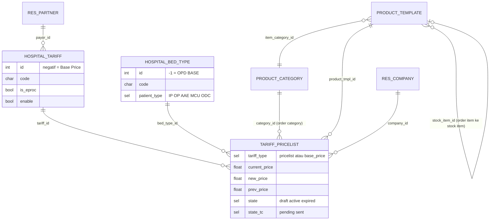

## Kunci sebuah harga

Satu baris harga (`tariff.pricelist`) unik per kombinasi:

```text
company × tariff_type × tariff × service category × product × bed type
```

`patient_type` **bukan** kunci terpisah — ia ikut dari bed type (`related='bed_type_id.patient_type'`). <Confidence level="verified"><Src file="mayapada/eproc/eproc_tc.py" line={19167} symbol="patient_type" /></Confidence>



*Sumber:* <Src file="mayapada/models/hospital.py" /> (<Src file="mayapada/models/hospital.py" line={177} symbol="HospitalTariff" />, <Src file="mayapada/models/hospital.py" line={29} symbol="HospitalBedType" />); <Src file="mayapada/eproc/eproc_tc.py" /> (<Src file="mayapada/eproc/eproc_tc.py" line={2449} symbol="HospitalBedType" />, <Src file="mayapada/eproc/eproc_tc.py" line={19030} symbol="HospitalTariff" />, <Src file="mayapada/eproc/eproc_tc.py" line={19128} symbol="TariffPricelist" />, <Src file="mayapada/eproc/eproc_tc.py" line={1812} symbol="ProductTemplate" />).

## Tariff (`hospital.tariff`)

| Field | Arti bisnis |
| --- | --- |
| `code`, `name` | Kode tarif di HIS (mis. tarif umum, tarif asuransi). Contoh data uji di memory: `BASEPRICE`, `SINARMAS`, `BPJS`, `PRUDENTIAL`. |
| `payor_id` | Penjamin yang memakai tarif ini (opsional). |
| `is_eproc`, `enable`, `active` | Hanya tariff `is_eproc=True, enable=True, active=True` yang muncul di wizard tarif. |
| `sync_type`, `sync_id_api` | Unit asal & kunci TrakCare. |

**Konvensi ID negatif** <Confidence level="verified" />: wizard menolak Base Price dengan tariff `id >= 0` dan Pricelist dengan tariff `id <= 0` (<Src file="mayapada/eproc/eproc_tc.py" line={19499} symbol="TariffPricelistWizard.action_view" />). Tariff Base Price adalah record `id = -1` (<Src file="mayapada/eproc/eproc_tc.py" line={22108} symbol="TariffAggregation._get_base_tariff" />). Record dengan ID negatif biasanya dibuat lewat SQL/data seed, bukan UI. <Confidence level="inferred" />

## Bed Type (`hospital.bed.type`) & Patient Type

Bed type merepresentasikan **kelas/jenis tempat layanan** (mis. OPD BASE, VIP, Kelas 1, EMERGENCY, MCU, ODC).

<Callout type="warn" title="Dua kamus patient type di satu repo">
- <Src file="mayapada/models/hospital.py" line={47} symbol="patient_type" /> mendefinisikan `patient_type` numerik: `1`=OP, `2`=IP, `3`=Emergency, `4`=Daycare, `5`=MCU/Pharmacy Issues Only(FO), `6`=Pharmacy (Direct), `0`=Both.
- <Src file="mayapada/eproc/eproc_tc.py" line={2456} symbol="patient_type" /> **menimpa** field yang sama menjadi kode: `IP`, `OP`, `AAE` (Emergency), `MCU`, `ODC` (DayCare), default `OP`, wajib diisi.

Karena eproc di-load setelah models, definisi kode yang berlaku untuk `hospital.bed.type`. Namun `sale.order`, `doctor.rate.line`, `receivable.*`, `marketing.*` tetap memakai **numerik**. Saat menggabungkan data tarif dengan data billing/fee, selalu petakan: `1↔OP`, `2↔IP`, `3↔AAE`, `4↔ODC`, `5↔MCU`. TrakCare `6` (Pharmacy/Cash Issue) **tidak punya** padanan di bed type tarif (keputusan di memory). <Confidence level="verified" />
</Callout>

Bed type khusus **`id = -1` ("OPD BASE")** dipakai untuk Base Price. Markup dilarang untuk kombinasi tariff negatif + bed type `-1` (<Src file="mayapada/eproc/eproc_tc.py" line={21633} symbol="_check_base_tariff_opd_bed_type" />).

## Kategori produk

`product.category.eproc_type` (<Src file="mayapada/eproc/eproc_tc.py" line={2146} symbol="eproc_type" />) membedakan:

| eproc_type | Dipakai untuk |
| --- | --- |
| `order_category` | **Service Category** pada pricelist & dependency (kategori order di HIS). |
| `item_category` | Kategori barang untuk Base Price dan **markup** (Item/Category level). |
| `billing_group` | Pengelompokan billing dari TrakCare. |
| `normal` | Kategori Odoo biasa. |

Produk (<Src file="mayapada/eproc/eproc_tc.py" line={1813} symbol="product.template" />) membawa `eproc_type` (`stock` / `non_stock`) dan `eproc_subtype` (`drugs`, `consumable`, `consignment`, `procedure`, `item`):

- **Pricelist (tarif jual)** hanya untuk produk `non_stock` dengan subtype `procedure` (tindakan).
- **Base Price** hanya untuk produk `non_stock` yang **bukan** `procedure` (order item barang) dan wajib punya item category.
- **Order item ↔ stock item:** `stock_item_id` menghubungkan item yang dijual di HIS dengan item stok ERP. Inilah jembatan dari harga beli (stock item) ke harga jual (order item).

<Confidence level="verified">TariffPricelistWizard._get_product_domain, 19381</Confidence>

## Common problems

| Gejala | Penyebab umum |
| --- | --- |
| Wizard "View Data" kosong untuk patient type IP | Bed type tidak `is_eproc`/`enable`, atau `patient_type` tersimpan dengan kamus berbeda (kasus Odoo 10 di memory). |
| Item tidak bisa dipilih di Base Price | Produk `procedure`, tidak punya item category, atau bukan `is_eproc`. |
| Tariff baru dari TrakCare tidak muncul | `is_eproc`/`enable` belum true, atau duplikasi karena `sync_type` alias (memory: tariff 339–360 di MHKN ganda). |

## Yang perlu developer pahami

- Jangan membandingkan `patient_type` lintas model tanpa pemetaan.
- Jangan membuat tariff/bed type negatif lewat UI; konvensi ini menopang filter di banyak query.
- `stock_item_id` salah → base price tidak pernah ter-update dari GRN.

## Sumber

### Kode

- <Src file="mayapada/eproc/eproc_tc.py" line={19128} symbol="TariffPricelist" /> — class `TariffPricelist`
- <Src file="mayapada/eproc/eproc_tc.py" line={19129} symbol="tariff.pricelist" /> — model `TariffPricelist`
- <Src file="mayapada/eproc/eproc_tc.py" line={19499} symbol="TariffPricelistWizard.action_view" /> — method `TariffPricelistWizard`
- <Src file="mayapada/eproc/eproc_tc.py" line={21633} symbol="_check_base_tariff_opd_bed_type" /> — method `TariffMarkup`
- <Src file="mayapada/eproc/eproc_tc.py" line={22108} symbol="TariffAggregation._get_base_tariff" /> — method `TariffAggregation`
- <Src file="mayapada/models/doctor_fee.py" line={409} symbol="doctor.rate.line" /> — model `DoctorRateLine`
- <Src file="mayapada/models/hospital.py" line={29} symbol="HospitalBedType" /> — class `HospitalBedType`
- <Src file="mayapada/models/hospital.py" line={30} symbol="hospital.bed.type" /> — model `HospitalBedType`
- <Src file="mayapada/models/hospital.py" line={177} symbol="HospitalTariff" /> — class `HospitalTariff`
- <Src file="mayapada/models/hospital.py" line={178} symbol="hospital.tariff" /> — model `HospitalTariff`
- <Src file="mayapada/models/product.py" line={53} symbol="ProductTemplate" /> — class `ProductTemplate`
- <Src file="mayapada/models/product.py" line={54} symbol="product.template" /> — extend `ProductTemplate`
- <Src file="mayapada/models/sale.py" line={43} symbol="sale.order" /> — extend `SaleOrder`
