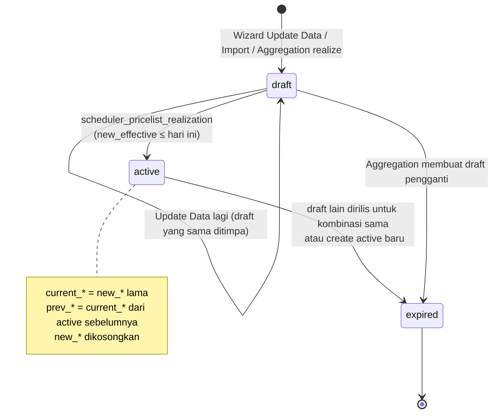

## 1. Apa itu?

`tariff.pricelist` menyimpan **harga dasar** sebuah kombinasi tariff × kategori × produk × bed type, dalam tiga "slot":

| Slot | Field | Arti |
| --- | --- | --- |
| Sekarang | `current_price`, `current_effective` | Harga yang sedang berlaku. |
| Baru | `new_price`, `new_effective` | Harga yang dijadwalkan. |
| Sebelumnya | `prev_price`, `prev_effective` | Harga terakhir sebelum rilis. |

Plus `state` (`draft`/`active`/`expired`) dan `state_tc` (`pending`/`sent`).

## 2. Kenapa RS membutuhkannya?

Perubahan harga **tidak boleh langsung berlaku** saat diketik: HIS perlu menerima harga dulu, kasir perlu tahu, dan pasien yang sudah dirawat sebelum perubahan tidak boleh tiba-tiba kena harga baru di tengah episode tanpa kebijakan jelas. <Confidence level="general" /> Penjadwalan + riwayat juga menjawab pertanyaan audit "harga berapa yang berlaku tanggal X?".

## 3. Siapa yang terlibat?

Tim tarif/Finance (input via wizard atau import Excel), scheduler/Airflow (rilis), Finance (export ke TC). Otorisasi persetujuan **tidak ada** di model ini. <Confidence level="notfound">approval perubahan tarif</Confidence>

## 4. Proses di lapangan (di Odoo)

<Steps>
<Step>
Buka wizard **Tariff Pricelist** (`tariff.pricelist.wizard`), pilih Tariff Type (Pricelist/Base Price), Tariff, Service Category, Order Item, Patient Type.
</Step>
<Step>
**View Data**: sistem menampilkan satu baris per bed type yang relevan (Base Price → hanya bed type `-1`; Pricelist → bed type ID positif, difilter patient type kecuali `ALL`) beserta harga sekarang dan draft yang ada.
</Step>
<Step>
Isi **New Price** dan **New Effective** (default H+2), klik **Update Data**.
</Step>
<Step>
Sistem membuat **draft** baru, atau meng-update draft yang sudah ada untuk kombinasi yang sama (tidak pernah dua draft).
</Step>
<Step>
Saat `new_effective` ≤ hari ini, `scheduler_pricelist_realization` merilis draft.
</Step>
</Steps>

## 6. State diagram

*Sumber:* `TariffPricelist.create/_archive_existing_active` (19193/19237), <Src file="mayapada/eproc/eproc_tc.py" line={19266} symbol="scheduler_pricelist_realization" />, <Src file="mayapada/eproc/eproc_tc.py" line={22265} symbol="TariffAggregation._realize_to_baseprice" />. <Confidence level="verified" />

## 7. Implementasi di Odoo Mayapada

| Elemen | Lokasi | Perilaku |
| --- | --- | --- |
| Model | <Src file="mayapada/eproc/eproc_tc.py" line={19128} symbol="TariffPricelist" /> `TariffPricelist` | Semua field `readonly=True`, `tracking=True` (chatter mencatat perubahan). |
| Constraint draft tunggal | <Src file="mayapada/eproc/eproc_tc.py" line={19201} symbol="_check_single_draft_pricelist" /> | ValidationError jika ada >1 draft aktif untuk kombinasi yang sama. |
| Constraint kategori | <Src file="mayapada/eproc/eproc_tc.py" line={19222} symbol="_check_tariff_type_category" /> | Category harus `order_category`; produk harus di kategori itu; Base Price untuk kategori item wajib item category yang cocok. |
| Auto-expire saat create active | <Src file="mayapada/eproc/eproc_tc.py" line={19237} symbol="_archive_existing_active" /> | Membuat record `state=active` meng-expire active lama. |
| Wizard input | <Src file="mayapada/eproc/eproc_tc.py" line={19499} symbol="TariffPricelistWizard.action_view" />, <Src file="mayapada/eproc/eproc_tc.py" line={19567} symbol="action_update" /> | Validasi tanda tariff, kategori, H+2, harga ≥ 0. |
| Aturan H+2 | <Src file="mayapada/eproc/eproc_tc.py" line={19487} symbol="_check_new_effective" /> | `new_effective ≥ hari ini + 2` dan ≥ `current_effective`. |
| Rilis | <Src file="mayapada/eproc/eproc_tc.py" line={19266} symbol="scheduler_pricelist_realization" /> | Lihat alur data di bawah. |
| Import Excel | <Src file="mayapada/eproc/eproc_tc.py" line={18230} symbol="TariffImportWizard" /> | Import Pricelist/Dependency/Markup dengan preview baris (`tariff.import.line`). |
| Export existing | <Src file="mayapada/eproc/eproc_tc.py" line={18080} symbol="TariffExistingExportWizard" /> | Ekspor record terpilih ke `.xls` dengan header template import. |
| Proteksi arsip | <Src file="mayapada/eproc/eproc_tc.py" line={17991} symbol="_disable_tariff_active_archive_field" /> | Field `active` dibuat readonly di UI. |

<Callout type="info">
Project memory mencatat bahwa di server (Odoo 10 dan 16) **tree/form tarif dikunci read-only** sejak Okt 2026; perubahan hanya lewat wizard/ETL. Ini restriksi UI, bukan ACL model. <Confidence level="inferred">memory, belum diverifikasi di repo</Confidence>
</Callout>

## 8. Alur perubahan data (contoh sintetis)

| Waktu | Aksi | Record A (lama) | Record B (baru) |
| --- | --- | --- | --- |
| 1 Mar | Data awal | active, current 100.000 (eff 1 Jan) | — |
| 10 Mar | Wizard: harga 110.000 eff 12 Mar | tetap active | **draft**, current 100.000, new 110.000/12 Mar, prev 100.000 |
| 11 Mar | Wizard lagi: 115.000 eff 15 Mar | tetap | draft yang **sama** di-update: new 115.000/15 Mar |
| 15 Mar | Scheduler rilis | **expired**, active=False | **active**, current 115.000/15 Mar, prev 100.000/1 Jan, new kosong |

## 9. Business rules & validasi

- Harga tidak boleh negatif (`_check_price`).
- Minimal satu bed type harus diberi New Price > 0.
- `new_effective` wajib untuk bed type yang diberi harga; ≥ H+2; tidak boleh sebelum `current_effective`.
- Base Price → tariff `id < 0` dan bed type `-1`; Pricelist → tariff & bed type `id > 0`.

## 10. Common problems

- **Draft tidak pernah aktif:** scheduler realization tidak berjalan (tidak ada `ir.cron` di repo; di Airflow ini job D01207 "rollover"). <Confidence level="inferred">nama job dari memory</Confidence>
- **Harga "hilang" setelah rilis:** draft dibuat dengan `new_price = 0` — scheduler hanya memproses `new_price != False`.
- **Dua active untuk kombinasi sama:** data hasil SQL/ETL yang melewati ORM tidak memicu `_archive_existing_active`.

## 11. Yang perlu developer pahami

- ETL Airflow menulis langsung ke tabel; constraint Python **tidak** berjalan. Validasi yang sama harus ada di ETL.
- `scheduler_pricelist_realization` dipanggil dari tiga model (`tariff.pricelist`, `tariff.dependency`, `tariff.markup`) sebagai alias — semuanya mendelegasikan ke implementasi yang sama.
- Tidak ada `ir.cron` tarif di XML repo; penjadwalan diasumsikan dari Airflow atau cron yang dibuat di DB. <Confidence level="confirm" />

## 12. Pertanyaan uji

<Accordions>
<Accordion title="Kenapa tidak boleh ada dua draft untuk kombinasi yang sama?">
Karena saat rilis, sistem tidak tahu draft mana yang benar; constraint memaksa satu jadwal per kombinasi. Perubahan kedua menimpa draft pertama.
</Accordion>
<Accordion title="Dari mana prev_price diambil saat rilis?">
Dari `current_price` record **active** sebelumnya untuk kombinasi yang sama (yang terbaru menurut `current_effective`, `write_date`, `id`). Jika tidak ada, dari `current_price` draft itu sendiri.
</Accordion>
<Accordion title="Apa fungsi aturan H+2?">
Memberi jeda bagi compute Fixed Selling Price dan publikasi ke TrakCare (yang mengirim versi yang efektif H+1) sebelum harga berlaku.
</Accordion>
</Accordions>

## 13. Referensi & confidence

- <Src file="mayapada/eproc/eproc_tc.py" line={17991} end={19630} /> <Confidence level="verified" />
- Test case `TARIFF_TEST_CASE_ODOO10.md` (TC-02, TC-03) di `/Users/macbook/Documents/mayapada/` — skenario uji yang konsisten dengan perilaku di atas. <Confidence level="verified">dokumen uji internal</Confidence>

**Kode:**

- <Src file="mayapada/eproc/eproc_tc.py" line={18052} symbol="tariff.import.line" /> — model `TariffImportWizardLine`
- <Src file="mayapada/eproc/eproc_tc.py" line={18080} symbol="TariffExistingExportWizard" /> — class `TariffExistingExportWizard`
- <Src file="mayapada/eproc/eproc_tc.py" line={18230} symbol="TariffImportWizard" /> — class `TariffImportWizard`
- <Src file="mayapada/eproc/eproc_tc.py" line={19128} symbol="TariffPricelist" /> — class `TariffPricelist`
- <Src file="mayapada/eproc/eproc_tc.py" line={19129} symbol="tariff.pricelist" /> — model `TariffPricelist`
- <Src file="mayapada/eproc/eproc_tc.py" line={19201} symbol="_check_single_draft_pricelist" /> — method `TariffPricelist`
- <Src file="mayapada/eproc/eproc_tc.py" line={19222} symbol="_check_tariff_type_category" /> — method `TariffPricelist`
- <Src file="mayapada/eproc/eproc_tc.py" line={19237} symbol="_archive_existing_active" /> — method `TariffPricelist`
- <Src file="mayapada/eproc/eproc_tc.py" line={19266} symbol="scheduler_pricelist_realization" /> — method `TariffPricelist`
- <Src file="mayapada/eproc/eproc_tc.py" line={19307} symbol="tariff.pricelist.wizard" /> — model `TariffPricelistWizard`
- <Src file="mayapada/eproc/eproc_tc.py" line={19487} symbol="_check_new_effective" /> — method `TariffPricelistWizard`
- <Src file="mayapada/eproc/eproc_tc.py" line={19499} symbol="TariffPricelistWizard.action_view" /> — method `TariffPricelistWizard`
- <Src file="mayapada/eproc/eproc_tc.py" line={19562} symbol="_check_price" /> — method `TariffPricelistWizard`
- <Src file="mayapada/eproc/eproc_tc.py" line={19567} symbol="action_update" /> — method `TariffPricelistWizard`
- <Src file="mayapada/eproc/eproc_tc.py" line={21314} symbol="tariff.dependency" /> — model `TariffDependency`
- <Src file="mayapada/eproc/eproc_tc.py" line={21578} symbol="tariff.markup" /> — model `TariffMarkup`
- <Src file="mayapada/eproc/eproc_tc.py" line={22265} symbol="TariffAggregation._realize_to_baseprice" /> — method `TariffAggregation`
- <Src file="mayapada/models/base.py" line={348} symbol="ir.cron" /> — extend `IrCron`

**Eksternal:**

- [Permenkes 6/2026 tentang Rumah Sakit](https://peraturan.bpk.go.id/Details/350851/permenkes-no-6-tahun-2026) (berlaku 12 Jun 2026; mencabut Permenkes 85/2015 dan 4/2018), Pasal 36 ayat (1): kewajiban RS antara lain memberi informasi yang benar tentang pelayanan (huruf a), melaksanakan fungsi sosial termasuk **pelayanan gawat darurat tanpa uang muka** (huruf f), dan memberi informasi yang benar, jelas, jujur mengenai hak & kewajiban pasien (huruf l). *Mendukung:* kewajiban memberi informasi yang benar kepada pasien; tarif harus transparan (lihat juga Pasal 72 ayat (3)). Rincian "informasi biaya/perkiraan biaya" yang dulu eksplisit di Permenkes 4/2018 tidak saya temukan dalam pasal setara di Permenkes 6/2026 (pencarian kata "biaya" di teksnya) (diakses 11 Okt 2026; teks pasal sudah dicek).
