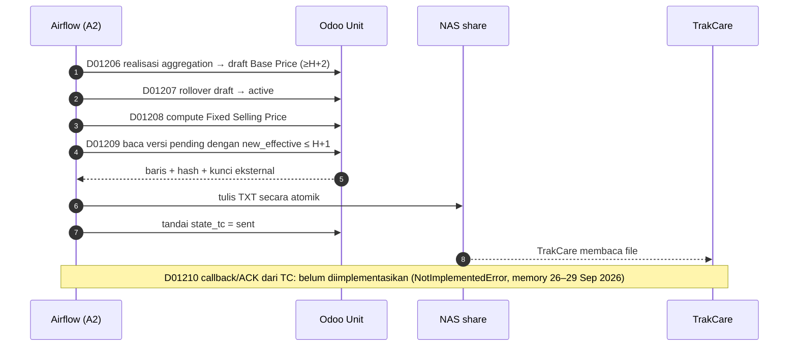

## Apa yang dikirim?

File ekspor <Src file="mayapada/eproc/eproc_tc.py" line={20829} symbol="tariff.pricelist.fixed.export" />) memiliki kolom (<Src file="mayapada/eproc/eproc_tc.py" line={20832} symbol="EXPORT_HEADERS" />):

| Kolom | Sumber nilai |
| --- | --- |
| ORDER ITEM CODE | `product_tmpl_id.default_code` |
| DESCRIPTION | nama produk |
| EFFECTIVE DATE FROM | `new_effective` (TXT: `dd/mm/YYYY`) |
| EFFECTIVE DATE TO | kosong |
| TARIFF CODE | `tariff_id.code` |
| PRICE | `new_price` |
| CURRENCY CODE | `IDR` |
| ROOM TYPE CODE | `bed_type_id.code` |
| HOSPITAL CODE | kode company |
| RANK | `1` |
| EpisodeType | `O` (OP), `I` (IP), `E` (Emergency); kosong untuk MCU/ODC |
| UrgentRate | `new_price × urgent_rate%` (default **20%**) |

TXT memakai pemisah `^` (satu karakter, keputusan terakhir user menurut memory). <Confidence level="verified" />

<Callout type="warn" title="EpisodeType kosong untuk MCU & DayCare">
<Src file="mayapada/eproc/eproc_tc.py" line={20913} symbol="_episode_type" /> hanya memetakan OP/IP/Emergency. Baris MCU/ODC terkirim dengan EpisodeType kosong. Perlu dikonfirmasi apakah TrakCare menerima ini. <Confidence level="confirm" />
</Callout>

<Callout type="info" title="Apa itu Urgent Rate?">
Kolom ini mengisi tambahan harga untuk order *urgent/cito* (default 20% dari harga). Kebijakan tarif cito Mayapada tidak tertulis di repo. <Confidence level="inferred">dari nama field</Confidence> <Confidence level="confirm" />
</Callout>

## Sequence publikasi (desain Airflow + kode Odoo)

*Sumber:* project memory (Current State & Active Work), `airflow:README.md` (012-09/012-10). File D01209/D01210 **tidak ada** di snapshot lokal. <Confidence level="inferred" />

Jalur manual yang terverifikasi di kode: menu Fixed Selling Price → **Export** (XLS/TXT, filter Pending/Sent/All) → kirim → **Mark Sent TC** (<Src file="mayapada/eproc/eproc_tc.py" line={20821} symbol="action_mark_sent_tc" />). <Confidence level="verified" />

## Batas yang perlu diingat

- `sent` ≠ "TrakCare sudah memakai harga". Tanpa ACK, rekonsiliasi harus dilakukan dengan membandingkan harga di TC vs versi `sent`.
- Selama uji staging, memory mencatat flag `NAS_TASKS_ENABLED=False` di DAG per-unit sehingga langkah TXT/NAS di-*bypass* (sukses tanpa eksekusi). Jangan menganggap hijau di Airflow sebagai bukti publikasi.

## Pertanyaan uji

<Accordions>
<Accordion title="Mengapa harga dikirim dengan EFFECTIVE DATE FROM = new_effective, bukan current?">
Karena tujuan publikasi adalah memberi tahu TC harga yang **akan** berlaku. Untuk kombinasi tanpa perubahan pending, `new_*` = `current_*`.
</Accordion>
<Accordion title="Apa risiko jika file TXT gagal ditulis tetapi state sudah sent?">
Harga tidak pernah sampai ke TC dan tidak akan dikirim ulang (bukan pending lagi). Desain D01209 menulis file dulu, baru update state, untuk mencegah ini.
</Accordion>
</Accordions>

## Sumber

### Kode

- <Src file="mayapada/eproc/eproc_tc.py" line={20821} symbol="action_mark_sent_tc" /> — method `TariffPricelistFixed`
- <Src file="mayapada/eproc/eproc_tc.py" line={20829} symbol="tariff.pricelist.fixed.export" /> — model `TariffPricelistFixedExport`
- <Src file="mayapada/eproc/eproc_tc.py" line={20913} symbol="_episode_type" /> — method `TariffPricelistFixedExport`
